> **先读主文：** 叙事短版见 [README.md](README.md)。本页是深潜：完整推导、实验、设计问答与附录。

---

# 深潜：两把尺子之间的跳跃

*主文：[README.md](README.md)。English deep dive: [deep.en.md](deep.en.md)。所有数字由 [`computation/article_numbers.py`](../computation/article_numbers.py) 从存档数据重新算出，见 [numbers.md](numbers.md)。*

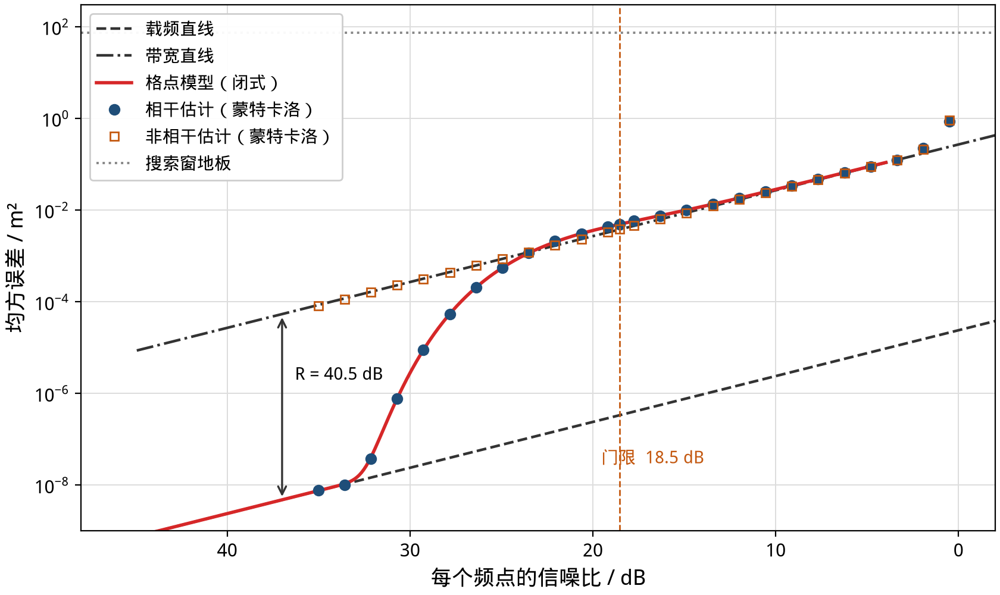

**图 1**　八个等间距频点（2400–2470 MHz，间隔 10 MHz）测距的均方误差，横轴是每个频点的信噪比，从左到右变差。蓝点是相干极大似然的蒙特卡洛结果（拐点附近用 $2\times10^6$ 次局部试验），红线是本文的闭式格点模型，没有任何拟合参数。

在几个频率上各测一次相位，再用这些相位算距离：蓝牙 6.0 的信道探测（Channel Sounding）、步进频率雷达、多波长干涉仪、GNSS 载波相位定位，用的都是这个办法。图 1 是这类系统最典型的误差曲线：信噪比高时，误差贴着一条很低的直线走；信噪比降到某处，误差几乎垂直地跳起 40 分贝，然后贴着另一条平行直线继续走。

这篇文章讲清楚三件事：

1. **跳跃在哪里，跳多高，完全可以写成闭式。** 两条直线的高度差只由一个数 $R$ 决定（这里 40.5 dB）；跳跃的中心在总信噪比 $\approx R_{\mathrm{dB}} - 13$ dB，跳跃的脚在总信噪比 $\approx R_{\mathrm{dB}} + 1$ dB（后者只在 $R\approx40$–45 dB 时成立；一般情形见[数学专文](math.zh.md) §3.3 的 $x(R)$ 表）。中间那段 S 形曲线由一个一维“取整”模型给出，和蒙特卡洛的偏差在 0.2 dB 以内，一直验证到 $10^{-5}$ 量级的滑周概率。
2. **跳跃是“估计量”的事，也是“信息”的事，二者可以分账。** 在门限上，相干极大似然比带宽直线高 1.1 dB；换成后验均值能拿回 1.2 dB；剩下与 Ziv–Zakai 下界之间的 3.2 dB 是界本身不紧，其中约 2.5 dB 是 Ziv–Zakai 界自己的松弛：单测试点 Weiss–Weinstein 界只比后验均值低约 0.7 dB（[数学专文](math.zh.md) §2.5、§5）。
3. **它直接变成工程规则。** 群时延不影响门限；所有频点共有的相位偏差会推迟门限，20° 以内代价不到 1 dB；多径会让整数判决发生确定性错误；频点怎么排，第一道门限几乎只看频率的二阶矩，而远处的深谷决定误差会不会从厘米级一下变成米级。等间距不是最优的：有一组八个频点，在每频点信噪比 35 到 10 dB 的整个范围里都不比等间距差，从 29 dB 往下严格更好。

文章写给工程师，也写给做估计理论的人。数学都放在单独的方框和附录里，跳过它们不影响读懂结论。

---

## 目录

1. [问题：用相位量距离](#1-问题用相位量距离)
2. [两把尺子](#2-两把尺子)
3. [为什么会跳：一个多峰的似然](#3-为什么会跳一个多峰的似然)
4. [格点模型：把跳跃写成闭式](#4-格点模型把跳跃写成闭式)
5. [只和 R 有关](#5-只和-r-有关)
6. [估计量的账和信息的账](#6-估计量的账和信息的账)
7. [相位模型够用吗：复观测](#7-相位模型够用吗复观测)
8. [偏差：谁移动门限，谁不移动](#8-偏差谁移动门限谁不移动)
9. [平台为什么会消失：一层一层的模糊](#9-平台为什么会消失一层一层的模糊)
10. [怎样排频点](#10-怎样排频点)
11. [工程预算卡](#11-工程预算卡)
12. [三个设计问题](#12-三个设计问题)
13. [为什么这个界很少被细致研究](#13-为什么这个界很少被细致研究)
14. [局限与开放问题](#14-局限与开放问题)
15. [附录](#附录)

---

## 1 问题：用相位量距离

电磁波走过距离 $d$，频率为 $f$ 的载波相位转过 $2\pi f d/c$。接收机只看得到这个角度除以 $2\pi$ 的余数，也就是“包裹”后的相位：

$$
\varphi_i = \mathrm{wrap}\left(\frac{2\pi f_i d}{c} + e_i\right), \qquad e_i \sim \mathcal{N}(0, \sigma^2), \quad i = 1,\dots,N .
$$

一个频点只能告诉你距离在一个波长内的位置。2.4 GHz 的波长是 12.3 cm，所以单个相位在 12.3 cm、24.6 cm、36.9 cm…… 上看起来完全一样。用多个频点，是为了把这些候选排除掉。

本文的主要例子是 2400 到 2470 MHz、间隔 10 MHz 的八个频点，和蓝牙信道探测的典型设置一个量级。往返测距只是把 $c$ 换成 $c/2$，所有以弧度表示的门限都不变。

相位噪声 $\sigma$ 和每个频点的信噪比之间，在高信噪比下有 $\sigma^2 = 1/(2\,\mathrm{SNR})$。下文两种单位都用：$\sigma$ 是理论上最方便的量，信噪比是工程上看得到的量。

---

## 2 两把尺子

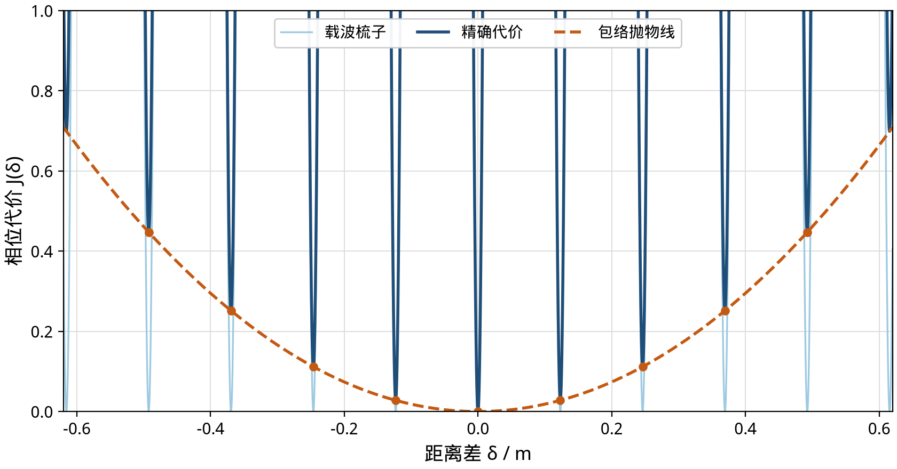

**图 2**　距离偏差 $\delta$ 处的相位代价 $J(\delta)$（所有频点残差平方和）。蓝色实线是精确代价；浅蓝是“载波梳子”，每个平均波长归零一次；橙色虚线是“包络抛物线”，只由频点之间的间距决定。精确代价就是梳子加抛物线，橙点是各个齿的齿底。

把八个相位放在一起，可以看到两种完全不同的距离信息（图 2）：

- **载波（细尺）。** 所有频点都在 2.4 GHz 附近，它们的相位一起以平均波长 $\lambda = 12.3$ cm 为周期转动。这把尺子极细，但每 12.3 cm 就重复一次。
- **包络（粗尺）。** 频点之间相差几十兆赫，相位差随距离慢慢变化，像一把刻度很粗、但在几十米内不重复的尺子。

两把尺子各自对应一条误差直线。记 $F = \sum f_i^2$，$S = \sum (f_i - \bar f)^2$：

> **两条直线**
>
> $$\mathrm{HMSE} = \frac{c^2 \sigma^2}{4\pi^2 F} \quad(\text{载频直线}), \qquad \mathrm{MMSE} = \frac{c^2\sigma^2}{4\pi^2 S} \quad(\text{带宽直线}).$$
>
> 它们都正比于 $\sigma^2$，在双对数图上平行，间隔是
>
> $$R = \frac{F}{S} = 1 + \frac{N\bar f^2}{S}, \qquad \text{等间距时 } R = 1 + \frac{12(N-1)}{N+1}\left(\frac{\bar f}{B}\right)^2 .$$

对例子里的八个频点，$S = 4200\ \mathrm{MHz}^2$，$R = 11295$，即 40.53 dB。用均方根误差说：载频直线比带宽直线精确 106 倍。每个频点 35 dB 信噪比时，载频直线是 0.09 mm，带宽直线是 9.3 mm。

细尺读数精确但会认错周期；粗尺不会认错周期但读数粗。只要粗尺的误差远小于半个波长，就能用粗尺选中正确的那个周期，然后用细尺读出精确位置，误差落在载频直线上。粗尺误差一旦接近半个波长，选周期就开始出错。

---

## 3 为什么会跳：一个多峰的似然

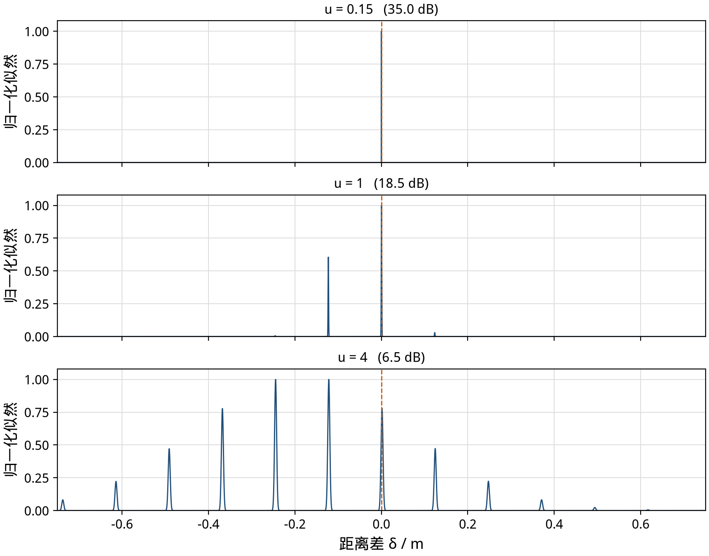

**图 3**　同一组噪声样本，在三个噪声水平下的归一化似然（横轴是相对真值的距离）。动画版：[f03_likelihood.gif](figures/zh/f03_likelihood.gif)。

在统计学上，这确实就是**多峰似然的极大似然估计问题**。图 3 画的是同一次测量在三个噪声水平下的似然函数：

- 噪声小（上）：似然是一排细齿，中间那颗远高于其他，极大似然稳稳选中它。
- 噪声中等（中）：相邻的齿差不多高。噪声稍微一推，最高的齿就可能换成隔壁那颗，估计值一下子错了整整一个波长。
- 噪声大（下）：细齿被抹平，只剩一个宽包络，估计只能靠粗尺。

单个频点的信息量随噪声是光滑变化的，局部的克拉美–罗界也不跳。跳的是**全局**估计：它从正确的那颗齿跳到了隔壁。这正是 Rife 与 Boorstyn 1974 年在单音频率估计里描述的门限现象，只不过这里的“错误峰”排得非常整齐。

整齐就是突破口。多峰问题一般没有闭式，但这里所有的错误峰都在同一条直线上，可以化成一个一维问题。

---

## 4 格点模型：把跳跃写成闭式

### 4.1 直观图像

在第二道门限之前（单个相位还远没有被噪声折叠），可以把每个频点的残差分成两部分：属于“错了几个整波长”的部分，和属于“齿内微调”的部分。所有“错一个波长”的残差向量都指向同一个方向，错 $k$ 个波长就是这个向量的 $k$ 倍。于是：

- 估计器实际上在做一件事：**把一个连续量 $z$ 四舍五入成整数 $k$**。
- $z$ 是高斯的，均值 0（无偏差时），标准差 $s$ 由噪声和频点决定。
- 距离误差 = $k \times$ 一个波长 + 齿内的细误差，且这两部分统计独立。

这和 GNSS 里“整周模糊度”的思路完全相同；这里只有一个整数，所以一切都能算到底。

> **格点模型**（推导见附录 A）
>
> $$\hat k = \mathrm{round}(z + \beta), \qquad z \sim \mathcal{N}(0, s^2), \qquad s = \frac{\sigma}{2\sigma_{\mathrm{jump}}\sqrt{1 - 1/R}},$$
>
> $$\mathrm{MSE} = \mathrm{HMSE} + \lambda_{\mathrm{eff}}^2\ \mathbb{E}[\hat k^2], \qquad \lambda_{\mathrm{eff}} = \lambda(1 - 1/R), \qquad \sigma_{\mathrm{jump}} = \frac{\pi\sqrt S}{\bar f}.$$
>
> $\beta$ 是确定性偏差造成的“包络与载波之间的分歧”（以波长计，第 8 节），无偏差时为 0。用 $u = \sigma/\sigma_{\mathrm{jump}}$ 归一后，整条曲线是
>
> $$\frac{\mathrm{MSE}}{\mathrm{MMSE}} = \frac{1}{R} + \frac{4}{u^2}\left(1 - \frac1R\right)^2 \sum_k k^2\left[\Phi\left(\frac{k + \frac12}{s}\right) - \Phi\left(\frac{k - \frac12}{s}\right)\right].$$

### 4.2 从模型里直接读出的几条规则

| 量 | 闭式 | 例子（8 个频点，70 MHz） |
| --- | --- | --- |
| 门限中心（$u = 1$） | 总信噪比 $= (R-1)/(2\pi^2)$，约 $R_{\mathrm{dB}} - 13$ dB | 每频点 18.5 dB（总 27.6 dB） |
| 门限中心的物理意义 | 粗尺的标准差恰好等于 $\lambda/2$ | 6.2 cm |
| 门限中心的滑周概率 | $2Q(1)$ | 0.317 |
| 门限中心的过冲 | 比带宽直线高 | +1.14 dB |
| 离开载频直线的“脚” | $8x^2 Q(x) = 1/R$，$\sigma = \sigma_{\mathrm{jump}}/x$ | $x = 4.908$，每频点 32.4 dB |
| 安全规则 | 总信噪比 $\gtrsim R_{\mathrm{dB}} - 12.95 + 20\log_{10}x(R)$；$R\approx40$–45 dB 时约 $R_{\mathrm{dB}} + 1$ dB（其他 $R$ 见[数学专文](math.zh.md) §3.3 表） | 每频点 $\gtrsim$ 32.5 dB |
| 门限下的平台 | $\mathrm{MMSE} + \lambda^2/12$ | — |

几点说明：

- **跳跃的中心** 就是粗尺的均方根误差等于半个波长的地方。这句话是精确的：$\sigma = \sigma_{\mathrm{jump}}$ 时 $\sqrt{\mathrm{MMSE}} = \lambda/2$。
- **跳跃的脚** 是“滑周的贡献等于载频直线”的地方，比中心高 $20\log_{10}4.908 = 13.8$ dB。在它之上，可以放心用载频直线做预算。4.908 是本例的 $x(R)$；$x$ 随 $R$ 对数变化（$R$ 为 20–60 dB 时 3.75–5.78），所以脚到中心的距离不是固定的 13.8 dB（第 12.1 节）。
- **整个跳跃宽约 14 dB**（从脚到中心），而两条直线的高度差是 40 dB。所以曲线看起来“几乎垂直”。
- 过冲 1.14 dB 来自滑周：门限上 32% 的试验错了至少一个波长，而每次滑周的代价 $\lambda^2$ 恰好是 4 倍 MMSE。

### 4.3 与蒙特卡洛的对比

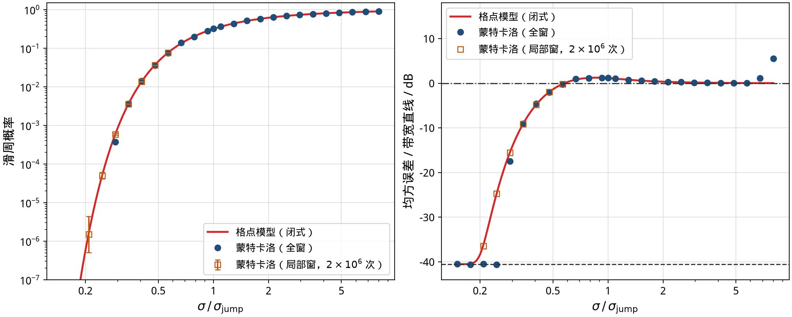

**图 4**　左：滑周概率；右：均方误差相对带宽直线。红线是格点模型，蓝点是全窗蒙特卡洛（每点 8000 或 20000 次），橙色方块是 $\pm4\lambda$ 局部窗内各 $2\times10^6$ 次的试验，误差棒是 95% Wilson 区间。

在 $u$ 从约 0.3 到 6 的范围内，格点模型与相干极大似然的蒙特卡洛结果相差不超过 0.18 dB；局部窗的大样本试验把验证推到滑周概率 $5\times10^{-5}$，偏差 0.04 dB。模型唯一的失效区是 $u \gtrsim 7$，那里单个相位开始被噪声折叠，是另一道门限（第 5 节、第 7 节）。

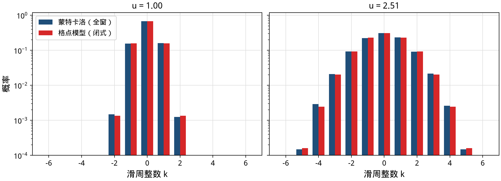

**图 5**　滑周整数 $k$ 的分布，蓝色是蒙特卡洛，红色是模型。在门限上（左）和门限下（右）都吻合到 $10^{-4}$ 的概率量级。

不只是均方误差：错几个波长的整个分布也吻合（图 5）。这意味着模型可以直接用来算任何你关心的指标——99% 分位误差、超过某个距离的概率、或者整周固定成功率。

> **与 GNSS 的联系**　GNSS 模糊度固定里的“bootstrapping 成功率” $P = 2\Phi(1/(2\sigma_{\hat a})) - 1$ 正是这里的 $1 - P(\text{滑周})$，其中 $\sigma_{\hat a} = s$。GNSS 文献研究的是成功率，不是均方误差随信噪比的整条曲线；把两者放在一起，跳跃的中心、脚和过冲都成了成功率公式的推论。

---

## 5 只和 R 有关

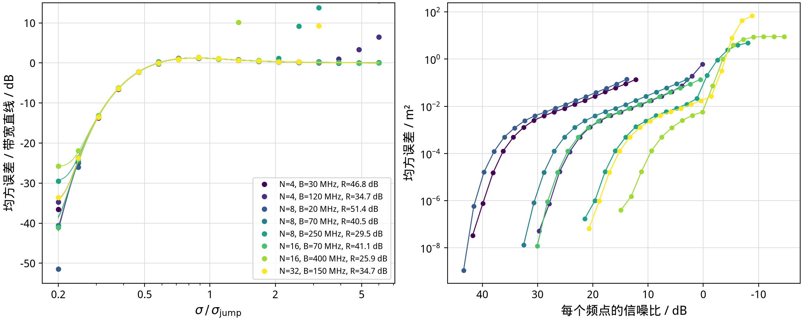

**图 6**　八组等间距设计（频点数 4 到 32，带宽 20 到 400 MHz，$R$ 从 25.9 到 51.4 dB）。右：原始的均方误差对信噪比，曲线散落各处。左：用 $u = \sigma/\sigma_{\mathrm{jump}}$ 和带宽直线归一后，全部落在同一条曲线上；细线是各自的格点模型，只在左下角的 $1/R$ 地板处不同。

格点模型说，除了左下角的 $1/R$ 地板之外，**归一化后的跳跃形状对所有设计都一样**。图 6 检验了这一点：八组等间距设计在原始坐标下四散，归一化以后叠在一起。所有试验点（只计至少 50 次滑周的点）与各自模型的偏差在全窗试验中不超过 0.94 dB，在局部窗大样本试验中不超过 0.41 dB。

右上角有四组设计提前离开了这条公共曲线。那是**第二道门限**：单个相位已经被噪声搅乱，粗尺本身也开始认错。离开处的总信噪比在 8 到 12 dB 之间，与频点数和带宽关系不大——这就是 Rife–Boorstyn 单音频率估计的门限：在等间距网格上，距离对频点序号而言正是一个“频率”。

> **命名提醒**　李巍与齐望东（arXiv:1202.1424）把从 MMSE 回到 HMSE 那一跳称作“第二门限”，把粗尺失效叫“第一门限”，顺序是从低信噪比往高信噪比数的。本文从高信噪比往下数：第一道门限是离开载频直线，第二道门限是离开带宽直线。

---

## 6 估计量的账和信息的账

跳跃是“极大似然这个估计量做得不好”，还是“数据里本来就没有足够的信息”？要回答这个问题，需要在**同一个先验**下比较估计量和下界。我们把真值放在长 14.99 m 的窗里均匀分布，计算三样东西：

- **相干极大似然**：选最高的齿。
- **后验均值**：把所有齿按后验概率加权平均（在这个先验下，它是均方误差意义上的最优估计）。
- **Ziv–Zakai 下界**：任何估计量都不可能低于它。这里的版本对谷底做了精细化，并做了谷填充，在高信噪比时精确回到载频直线（差 0.00 dB）。

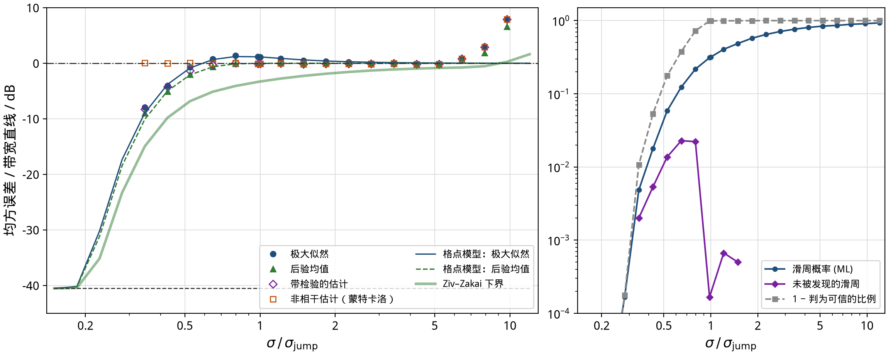

**图 7**　左：同一均匀先验下各估计量的均方误差（相对带宽直线）。蒙特卡洛每点 6000 次；预期滑周少于 3 次的点被略去，因为样本里看不到滑周时样本均方会低于下界。右：滑周概率、带检验估计里“判为可信但其实滑周”的比例。

在门限 $u = 1$ 上（单位 dB·m²）：

| 估计量 | 均方误差 | 相对带宽直线 |
| --- | --- | --- |
| 相干极大似然 | −23.09 | +1.12 |
| 后验均值 | −24.31 | −0.10 |
| 非相干估计（只用粗尺） | −24.30 | −0.08 |
| Ziv–Zakai 下界 | −27.50 | −3.29 |

于是账可以分清楚：

- **1.2 dB** 是极大似然的“硬判决”代价。门限上它以 32% 的概率选错齿；后验均值把相邻两颗齿加权平均，代价更小。格点模型同样预测了后验均值（−24.22 dB），误差 0.1 dB。
- **3.2 dB** 是界不紧：在这个先验下，没有任何估计量能比后验均值更好，而后验均值仍比下界高 3.2 dB。其中约 2.5 dB 是 Ziv–Zakai 界自己的：把测试点放在 $1\lambda$ 格点谷上的单测试点 Weiss–Weinstein 界是 −24.96 dB·m²，只比后验均值低 0.65 dB（[数学专文](math.zh.md) §2.5、§5）。门限下坡段（每频点约 25–29 dB）最紧的仍是 Ziv–Zakai 界，与后验均值差约 4.8 dB；多测试点或 Bell 扩展形式能否收回这一段，仍是开放问题。

两个工程上有用的推论：

1. **门限上，只用粗尺的非相干估计和最优估计一样好。** 也就是说，在跳跃区里“用载波相位”换不来任何东西；载波相位只在脚以上才值钱。
2. **带检验的估计量。** 先算出最高齿的后验概率，可信（大于 0.9）就用相干结果，否则退回后验均值。这个混合方案在门限附近只比后验均值差 0.1–0.8 dB；“判为可信但实际滑周”的比例最高 2.3%（$u \approx 0.65$）。工程上这就是“输出一个距离，同时输出一个可信标志”。

---

## 7 相位模型够用吗：复观测

真实接收机看到的是复数 $y_i = h\,e^{j2\pi f_i d/c} + n_i$，相位只是它的一部分。我们直接在复观测上跑相干极大似然，与只用相位的版本比较。

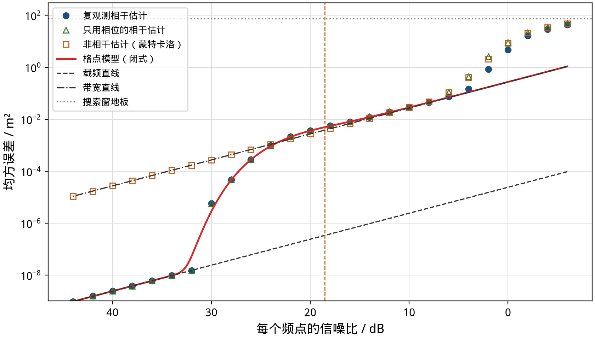

**图 8**　复观测上的相干极大似然（蓝）、只用相位的相干估计（绿三角）和非相干估计（橙方块）。红线是格点模型，横轴是每频点信噪比。

- 每频点 14 到 34 dB（覆盖整个第一道门限），两者相差不超过 0.12 dB。**相位模型在第一道门限上是精确的。**
- 低于约 6 dB，复观测开始明显占优（6 dB 处好 1.8 dB），在 2–4 dB 处好 4.7–4.9 dB。这是第二道门限：相位的实际标准差比 $1/\sqrt{2\,\mathrm{SNR}}$ 大，在 2 dB 处大 23%。

结论：讨论第一道门限，用相位模型就够了；讨论系统在多低的信噪比下彻底失效，要回到复观测。

---

## 8 偏差：谁移动门限，谁不移动

实际系统里，每个频点的相位都有确定性误差：天线和滤波器的群时延、本振的初始相位、多径反射。格点模型把任意一组相位偏差 $m_i$ 分成三部分：

1. **沿“细尺方向”的部分**：等价于整体距离平移，不影响门限。群时延 $\tau$ 正是这种：它让距离偏 $c\tau$（1 ns 是 30 cm），但 $\beta = 0$，滑周概率完全不变。
2. **沿“整周方向”的部分**：这就是 $\beta$，包络和载波对距离的看法出现分歧，判决阈值被推偏，门限因此移动。
3. 剩下的部分：二阶小量。

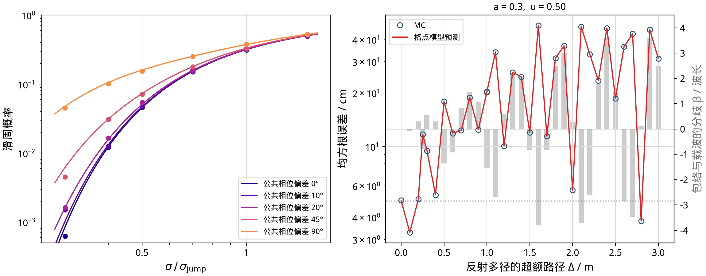

**图 9**　左：所有频点共有的相位偏差 $\varepsilon$ 让滑周概率上升，点是蒙特卡洛，线是模型。右：一条反射路径（幅度 0.3）的超额路程 $\Delta$ 从 0 到 3 m 变化时，$u = 0.5$ 处的均方根误差（左轴）与分歧 $\beta$（灰柱，右轴）。

**所有频点共有的相位偏差会移动门限。** 这一点容易想错：既然是“公共”的，似乎会被消掉。实际上公共相位 $\varepsilon$ 在细尺上相当于距离偏 $\varepsilon\lambda/2\pi$，在粗尺上却什么也不是，于是两把尺子出现分歧 $\beta = -\varepsilon/2\pi$（以波长计）。判决阈值从 $\pm\frac12$ 变成 $\pm\frac12 - \beta$，近侧的滑周概率变成 $Q((\frac12 - \lvert\beta\rvert)/s)$。

> **20° 规则**　在低滑周概率下，门限向高信噪比方向移动 $-20\log_{10}(1 - 2\lvert\beta\rvert)$ dB，$\lvert\beta\rvert = \lvert\varepsilon\rvert/360°$。$\lvert\varepsilon\rvert = 19.6°$ 时移动 1 dB；10° 时 0.5 dB；90° 时 6 dB。在实际关心的滑周概率（$10^{-2}$ 到 $10^{-4}$）上，移动量还要更小（20° 时 0.35–0.64 dB）。

**多径会让整数判决发生确定性错误。** 一条幅度 0.3 的反射，超额路程只要变化几十厘米，$\beta$ 就在 $\pm 3.8$ 个波长之间摆动（图 9 右）。$\lvert\beta\rvert > \frac12$ 时，即使没有噪声，估计也会落到错误的齿上，均方根误差从 3.4 cm 跳到 45 cm。格点模型把这些全部预测出来了：119 组偏差试验中，模型与蒙特卡洛的偏差多数在 0.5 dB 以内，最大 1.4 dB（出现在滑周只有几次的点上）。

工程含义：多径不是“让噪声变大一点”，而是在粗尺和细尺之间制造系统性分歧。校准群时延是为了距离准确；校准频点之间的相位分歧，是为了整数判决正确。

---

## 9 平台为什么会消失：一层一层的模糊

等间距设计的错误只发生在整数个波长上，所以门限下有一个平台：错误被限制在厘米级。换一种排频，情况可能完全不同。

### 9.1 几何间隔：错一次就是六米

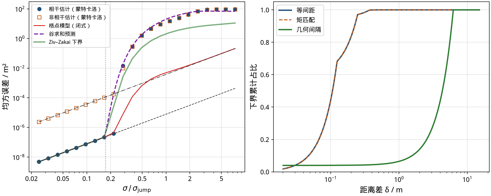

**图 10**　左：公比 1.02 的几何间隔频点。相干估计离开载频直线后直接越过带宽直线，中间没有平台。紫色虚线是谷混合预测，绿色是 Ziv–Zakai 下界，红线（格点模型）在这里不适用。右：在 $\sigma = 0.0836$ rad 处，下界沿距离的累计占比。等间距与矩匹配在 0.25 m 内积满，几何间隔要到 6.2 m。

几何间隔在 6.211 m 处有一个谷，深度和“错一个波长”完全相同。滑过去的概率一样，代价却是 $(6.2\ \mathrm{m})^2$，高约 34 dB。在等间距的门限噪声上，几何间隔的下界有 96% 来自从一个波长到 6.211 m 的这一段；$\sigma$ 从 0.12 rad 增加到 0.20 rad，99% 分位误差从 2 mm 直接跳到 6.21 m。

对这种设计，格点模型（只考虑整波长）不再适用。我们用**谷混合**近似代替：对每个谷 $k$ 算成对错误概率 $p_k = 2Q(\sqrt{J_k}/2\sigma)$，再让每个谷和正确的齿竞争，

$$
\mathrm{MSE} \approx \mathrm{HMSE} + \frac{\sum_k p_k \delta_k^2}{1 + \sum_k p_k}.
$$

它在滑周稀少时等于经典的“谷求和”，滑周频繁时仍然是一个真正的混合。和蒙特卡洛相比，它在门限脚附近误差约 1 dB 以内，在深过渡区偏保守（预测偏高）1–4.5 dB。成对错误概率之和高估了“被某个谷击败”的概率，这是保守的来源。

> 后来的[数学专文](math.zh.md) §4.6 给出了取代它的**多谷线性化模型**：把每个谷的残差向量投影掉 $g$，谷与谷的竞争变成同一组高斯噪声的联合线性统计量。在本节的几何与两簇设计上，它与蒙特卡洛的差分别不超过 0.15 dB 和 0.6 dB，全部落在蒙特卡洛的 95% 带内。本文的谷混合数字保留为历史上的搜索代理。

### 9.2 两簇频点：两级台阶

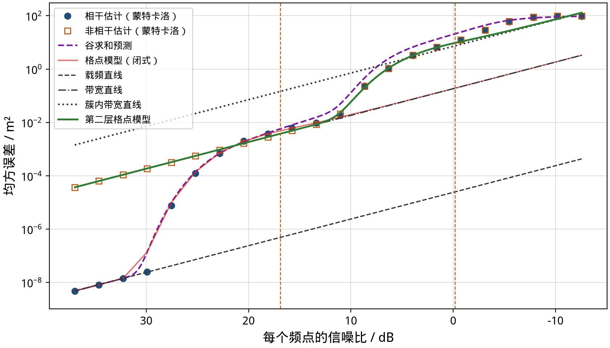

**图 11**　两簇各四个频点（2414–2426 与 2469–2481 MHz，簇中心相差 55 MHz）。均方误差先离开载频直线落到带宽直线，在 6–10 dB 处再跳一次，落向“簇内带宽直线”。绿色实线是把格点模型用在第二层上的预测，没有任何拟合参数。

两簇频点有两层模糊：第一层是载波波长 12.3 cm，第二层是簇中心之差对应的合成波长 $c/55\,\mathrm{MHz} = 5.45$ m。于是误差曲线有两级台阶（图 11）：

- 第一级：载频直线 → 带宽直线（门限 $\sigma_{\mathrm{jump}} = 0.101$ rad），99% 分位误差停在一个波长（0.12 m）。
- 第二级：带宽直线 → 簇内带宽直线。簇内的二阶矩 $S_{\mathrm{within}} = 160\ \mathrm{MHz}^2$，第二层的 $R_2 = S/S_{\mathrm{within}} = 15.9$ dB，第二层门限 $\sigma_{\mathrm{jump},2} = 0.72$ rad。

**格点模型可以一层一层地用。** 第二层的“细尺”是全带宽，“粗尺”是簇内带宽，把它们代进同一个公式，就得到图 11 的绿线：从每频点 20.5 dB 到 −0.8 dB，它和蒙特卡洛的偏差在 1.2 dB 以内，直到搜索窗的地板。

### 9.3 中国余数定理推迟不了门限

互素排频（中国余数定理）只改变“所有相位同时回到整周”的那个周期，也就是无模糊距离。第一道门限由 $\bar f$ 和 $S$ 决定，和最大公约数无关。把等间距改成二阶矩相同的不等间距（“矩匹配”，`2390, 2418, 2425, 2432, 2443, 2449, 2454, 2469` MHz），第一道门限纹丝不动：它与同一个格点模型的偏差在 0.93 dB 以内；二者要到噪声大一个数量级时才分开。

---

## 10 怎样排频点

### 10.1 第一道门限几乎只看 S

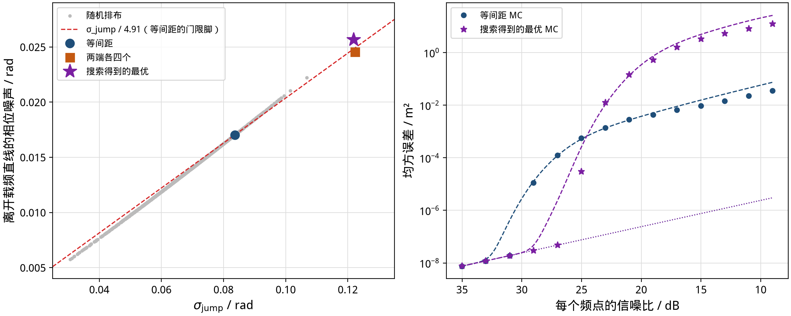

**图 12**　左：1500 组在 2400–2470 MHz 内随机选取的八个整数兆赫频点，横轴是 $\sigma_{\mathrm{jump}}$，纵轴是离开载频直线的相位噪声。所有点几乎落在一条直线上。右：等间距与“离开最晚”的设计的蒙特卡洛均方误差，虚线是谷混合预测。

离开载频直线的噪声与 $\sigma_{\mathrm{jump}}$ 之比，在 1500 组随机设计里只在 4.80 到 5.32 之间（中位数 4.98），对应信噪比 ±0.45 dB。**第一道门限几乎完全由频率的二阶矩 $S$ 决定。** 想推迟它，就要把频点往带宽两端推。

把频点全推到两端（`2400, 2401, 2402, 2404, 2467, 2468, 2469, 2470`），门限推迟 3.6 dB；但它在 4.49 m 处留下一个深谷（代价约为一个波长处的 2 倍），门限下没有平台，一滑就是四米半（图 12 右）。

### 10.2 等间距不是帕累托最优

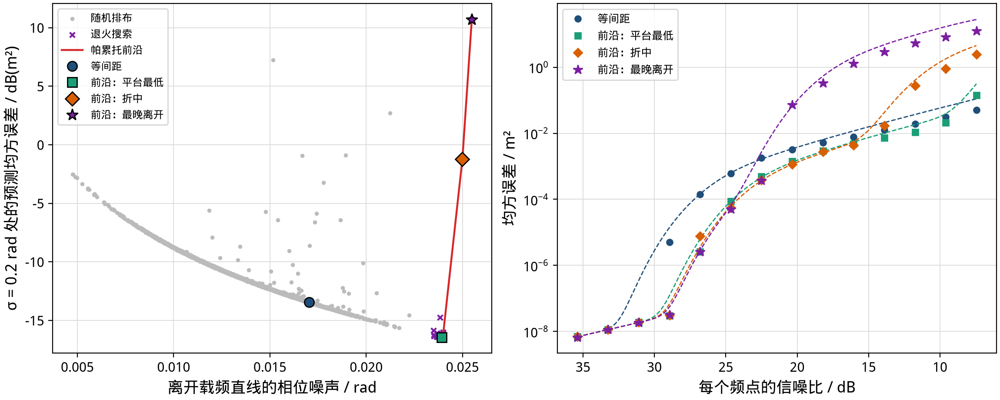

**图 13**　左：两个目标——离开载频直线的噪声（越大越好）和 $\sigma = 0.2$ rad（每频点约 11 dB）处的预测均方误差（越小越好）。灰点是随机设计，叉是模拟退火，红线是帕累托前沿。右：前沿上三组设计和等间距的蒙特卡洛（每点 6000 次）。

用两个目标同时衡量——门限出现得多晚，门限下误差有多大——等间距被**支配**了。设计

```
2400, 2401, 2402, 2409, 2450, 2468, 2469, 2470 MHz
```

离开载频直线晚 3.0 dB，门限下的平台还低 2–3 dB，99% 分位误差在每一个信噪比上都不比等间距差。蒙特卡洛确认了这一点：每频点 29 dB 时它是 −75.3 dB·m²（等间距 −52.9），18 dB 时 −25.3（等间距 −22.8）；只有低于约 8 dB，它的簇结构才让它输给等间距。

思路很简单：大部分频点放在两端，把 $S$ 拉大；中间放两个频点，把远处的深谷打碎，保住平台。前沿的另一端（离开最晚的设计）则把平台换成了四米级的滑周。这就是排频的真实取舍：**推迟门限是免费的，直到远处出现深谷为止。**

---

## 11 工程预算卡

| 问题 | 答案 |
| --- | --- |
| 两条直线差多少？ | $R = F/S$。等间距：$R \approx 1 + 9.3\,(\bar f/B)^2$（$N=8$）。 |
| 多高的信噪比才能用载频直线做预算？ | 总信噪比 $\gtrsim R_{\mathrm{dB}} - 12.95 + 20\log_{10}x(R)$（脚：$8x^2Q(x) = 1/R$）；$R\approx40$–45 dB 时约 $R_{\mathrm{dB}} + 1$ dB，其他 $R$ 查[数学专文](math.zh.md) §3.3 表。 |
| 跳跃中心在哪里？ | 总信噪比 $= (R-1)/2\pi^2$，约 $R_{\mathrm{dB}} - 13$ dB；此时粗尺误差 $= \lambda/2$，滑周概率 0.317。 |
| 门限下用什么预算？ | 带宽直线加 $\lambda^2/12$（等间距）；中心处过冲 +1.1 dB。 |
| 什么时候连带宽直线也保不住？ | 总信噪比低于约 8–12 dB（第二道门限），要用复观测分析。 |
| 群时延要校准吗？ | 为了距离准确要校；它不影响门限。 |
| 公共相位偏差容忍多少？ | 20° 以内门限移动不到 1 dB。 |
| 多径呢？ | 它制造粗尺与细尺的分歧 $\beta$，$\lvert\beta\rvert > \frac12$ 时整数判决确定性地出错。 |
| 怎样排频点？ | 先拉大 $S$；再检查每个深谷：$P_e(\delta)\delta^2$ 不能早于一个波长处超过载频直线；中间留几个频点打碎远谷。 |
| 用相干还是非相干？ | 脚以上用相干；门限区二者一样；给出可信标志的混合估计两边都不吃亏。 |
| 想要更好的估计量？ | 门限区后验均值比极大似然好 1.2 dB；再往下是界的问题，不是估计量的问题。 |

---

## 12 三个设计问题

### 12.1 起始频率变了会怎样？

频点数 $N$ 和间隔 $\Delta f$ 都固定，只改起始频率 $f_0$（因而改平均频率 $\bar f$），**会有影响，而且很大**——即使完全不考虑传播模型。原因是二阶矩 $S$ 只由间距决定，与 $f_0$ 无关：

$$
S = (\Delta f)^2\,\frac{N(N^2-1)}{12}\quad\text{（等间距）},
\qquad R = 1 + \frac{N\bar f^2}{S},
\qquad \sigma_{\mathrm{jump}} = \frac{\pi\sqrt S}{\bar f}.
$$

| 量 | 随 $\bar f$ 的变化 | 含义 |
| --- | --- | --- |
| $S$、带宽直线 MMSE | 不变 | 粗尺精度只看间距 |
| $R$、两条直线的间隔 | $\propto \bar f^2$ | 载频越贵，细尺相对粗尺越值钱 |
| HMSE、波长 $\lambda$ | $\propto 1/\bar f^2$、$1/\bar f$ | 细尺更细，滑一周的代价也更小 |
| $\sigma_{\mathrm{jump}}$（弧度） | $\propto 1/\bar f$ | 相位噪声门限变严 |
| 门限处的**信噪比** | $\propto \bar f^2$ | 载频越高，要保住细尺就越吃信噪比 |

数字（$N=8$，$\Delta f = 10$ MHz）：

| $f_0$ | $\bar f$ | $R$ | $\sigma_{\mathrm{jump}}$ | 门限 / 每频点 | 脚 / 每频点 | 35 dB 时载频 RMS |
| --- | --- | --- | --- | --- | --- | --- |
| 900 MHz | 935 | 32.2 dB | 0.218 rad | 10.2 dB | 23.3 dB | 0.23 mm |
| 2400 MHz | 2435 | 40.5 dB | 0.084 rad | 18.5 dB | 32.4 dB | 0.09 mm |
| 5800 MHz | 5835 | 48.1 dB | 0.035 rad | 26.1 dB | 40.6 dB | 0.04 mm |
| 24 GHz | 24035 | 60.4 dB | 0.0085 rad | 38.4 dB | 53.7 dB | 0.009 mm |

“脚”一列按各自的 $x(R)$（4.48 / 4.91 / 5.27 / 5.80）算，即门限 $+20\log_{10}x(R)$，而不是固定的 +13.8 dB（数字由 `computation/verify_math_idents.py` 给出）。

从 2.4 GHz 搬到 5.8 GHz，同样的 8×10 MHz，门限中心从 18.5 dB 升到 26.1 dB，脚从 32.4 dB 升到 40.6 dB。带宽直线的绝对精度不变（都是 9.3 mm RMS @ 35 dB），但想用上更细的载频尺子，信噪比预算要多给约 8 dB。24 GHz 上这个代价变成“门限就要 38 dB”——细尺几乎用不上。

> 若固定的是**相对带宽** $B/\bar f$ 而不是绝对间隔，则 $R$ 不变，门限的信噪比也不变。上面的效应来自“绝对间隔固定、载频升高 → 相对带宽变窄”。

### 12.2 从 M 个等间隔候选里抽 N 个，均匀随机是最好的吗？

**不是。** 但要把三个目标分开，否则会把等间距的真正优点说丢。

**等间距的整周模糊尺度是最小的。** 等间距下，代价面的所有深谷都落在平均波长的整数倍 $k\lambda$ 上：$J(k\lambda) = k^2 J(\lambda)$。第一跳只会错 1 个波长（这里 12.3 cm），不会出现“概率和错 1λ 一样、距离却是数米”的远谷。这是等间距独有的结构优点，也是它平台干净的原因。两端堆满、中间不留锚点的设计会在约 4.5 m 处留下与 $J(\lambda)$ 同量级的谷，模糊尺度一下子大三十多倍——门限是推迟了，整周模糊度却变差了。

所以比较方案时至少有三个旋钮，不能只看一个：

| 目标 | 等间距 | 均匀随机 | 两端 + 中间锚点 | 纯两端 |
| --- | --- | --- | --- | --- |
| 第一跳的模糊尺度 | **最小（$1\lambda$）** | 通常更大 | 可保持 $\sim 1\lambda$ | 差（数米） |
| 门限出现得多晚 | 中等 | 中位数更早 | **更晚** | 最晚 |
| 门限下的平台 MSE | 好 | 中位数更差 | **可以更好** | 无平台（悬崖） |

在 2400–2470 MHz、步长 1 MHz（$M = 71$）里取 $N = 8$：

| 方案 | 离开载频直线的 $\sigma$ | $\sigma = 0.2$ rad 处的预测 MSE | 最浅的非 $k\lambda$ 谷 |
| --- | --- | --- | --- |
| 均匀随机（中位数） | 0.014 | −11.7 dB·m² | 通常有 |
| 等间距 | 0.017 | −13.4 dB·m² | 5.73 m，$J \approx 672\,J(\lambda)$（浅谷全在 $k\lambda$） |
| 前沿：平台最低（`2400,2401,2402,2409,2450,2468,2469,2470`） | 0.024 | −16.4 dB·m² | 4.74 m，$J \approx 63\,J(\lambda)$（前几个深谷仍在 $k\lambda$） |
| 两端各四个 | 0.025 | +13.5 dB·m² | 4.49 m，$J \approx 1.5\,J(\lambda)$ |

（“预测 MSE”是谷混合近似。多谷线性化模型给出的值低 2.4–3.2 dB，但排序不变，见[数学专文](math.zh.md) §4.6、§6.6。）

关键一点：前沿那一组在**保持 $1\lambda$ 模糊尺度**的前提下，门限比等间距晚 3 dB，平台还低 2–3 dB；蒙特卡洛从每频点 29 dB 往下确认了这一点。均匀随机两个目标上中位数都不如等间距，约 12% 的样本能同时打赢等间距，但随机样本几乎进不了帕累托前沿。

> **结论（改过口径）：** 若唯一目标是“第一跳的整周模糊度最小”，等间距是结构上的正解。若还要推迟门限、压低平台，可以在不引入浅远谷的约束下做“两端密集 + 中间锚点”，它不牺牲模糊尺度，却能支配等间距。均匀随机不是最优；纯两端牺牲模糊尺度去换门限，多径或跌出门限时更危险。

$N \ll M$ 时，随机更难碰巧落到“无浅远谷”的结构上。中国余数式的互素抽取优化的是无模糊距离，推迟不了第一道门限，也不保证第一跳仍是 $1\lambda$（第 9.3 节）。

#### “两端 + 锚点”到底在做什么？

两端密集是为了拉大 $S$（推迟门限）。只放两端的代价是：两簇中心之差 $\Delta F$ 对应的合成波长 $c/\Delta F$ 附近会出现几乎一样深的远谷——两簇内部相位各自对齐，整段代价接近 0。对 2400 与 2470 MHz 两簇，$\Delta F = 70$ MHz，危险距离约 $c/70\,\mathrm{MHz} \approx 4.28$ m 一带（数值上最浅常在 4.5 m 附近）。

**中间的锚点不是再加一把尺子，而是专门把这座远谷填高。** 远谷处两端残差都接近 0，中间频率一般对不齐整周，单独就能贡献接近 $\pi^2 \approx 10$ 的代价。我们的八个频点例子里，4+4 两端无锚点时 4.49 m 处 $J \approx 1.5\,J(\lambda)$；只在 2435 MHz 加 1 个锚点，4.49 m 这座谷升到约 $150\,J(\lambda)$，变得实际上进不去。但中点锚点在两倍距离处与两端同相（混叠）：全窗最浅谷移到 8.99 m，只有 $6.0\,J(\lambda)$。单个锚点放在两端之间约 1/4 或 3/4 处最好（2419 或 2451 MHz，约 $39\,J(\lambda)$；[数学专文](math.zh.md) §6.4）。门限几乎不变（仍由 $S$ 决定），平台却保住了。这就是 `2400,2401,2402,2409,2450,2468,2469,2470` 一类设计的构造逻辑：两端负责 $S$，中间一两个负责填谷。

#### 两端很多、中间只插 1 个，会被噪声淹没吗？

**会，你的直觉是对的——但淹没的机制不是“那个频点的 SNR 不够”，而是代价面的相对高度。**

相干代价是 $N$ 项之和。两端各堆 $N_{\mathrm{side}}$ 个频点时：

- $J(\lambda)$ 随 $N_{\mathrm{side}}$ **线性变大**（每个频点都在 $1\lambda$ 处贡献一份残差）；
- 单个锚点对远谷的贡献有上限 $\pi^2$，而且谷底会**挪位置**来躲开这个锚点——数值上 1 个锚点往往只把 $J_{\mathrm{far}}$ 抬高约 0.2，远不到 $\pi^2$；
- 于是比值 $J_{\mathrm{far}} / J(\lambda)$ 随 $N_{\mathrm{side}}$ 掉下来。远谷相对变浅，又变得危险。

把两端压成两个精确频率（最极端的“两端”），中间均匀插 $K$ 个锚点时：

| 每端点数 | $K=0$ | $K=1$ | $K=2$ | $K=4$ | $K=8$ |
| --- | --- | --- | --- | --- | --- |
| 4 | $J_{\mathrm{far}}/J(\lambda) = 0.021$ | 0.184 | 0.021 | **210** | 318 |
| 64 | 0.021 | 0.184 | 0.021 | **15.0** | 24.8 |
| 256 | 0.021 | 0.184 | 0.021 | 3.81 | 6.29 |
| 512（两端共约 1000） | 0.021 | 0.184 | 0.021 | 1.92 | 3.16 |

（本表此前的版本没有生成脚本，$K=1,2,4$ 列有误；现值由 `computation/verify_math_idents.py` 复算，以[数学专文](math.zh.md) §6.4 为准。）

读表：

- **没有锚点**时远谷几乎是零，一滑就是数米。
- **$K=1,2$** 时，均匀插入的锚点落在两端之间的 1/2 或 1/3、2/3 处，在某一阶合成波长（2 倍或 3 倍 $c/\Delta F$）上与两端全体同相，那一阶的远谷完全没被填：比值恒为 0.184 和 0.021，与两端多厚无关。这是几何上的混叠，不是噪声问题。
- **$K \ge 3$ 且避开这些有理位置**时，每一阶远谷都被照顾到，抬升才到 $\pi^2$ 量级。但 $J(\lambda)\propto N$，两端再厚仍要把 $K$ 按比例加：每端 512 个点时 $K=8$ 也只有 3.2。

规则很简单：

> 锚点的预算应按两端规模缩放：$J_{\mathrm{far}} \gtrsim c\, J(\lambda)$（工程上 $c \sim 10$ 就够硬），而 $K$ 个散开锚点最多贡献约 $K\pi^2$。因此 $K \gtrsim c\, J(\lambda)/\pi^2 \propto N_{\mathrm{edge}}$。两端 8 个点时 1–2 个锚点够用；两端上千个点时，中间也要几十个，不能只插 1 个。

另一个看法：锚点有效的条件是它在远谷处的残差不被谷底重定位消掉，并且相对 $J(\lambda)$ 仍深。这是**几何**条件，与该频点自己的瞬时噪声无关——即使锚点 SNR 和两端一样，只要 $K/N_{\mathrm{edge}}$ 太小，远谷照样浅。

实务建议：

1. 先定两端，把 $S$ 拉到目标门限；
2. 在合成波长一带扫代价面，看最浅远谷的 $J_{\mathrm{far}}/J(\lambda)$；
3. 在两端之间均匀加锚点，直到该比值到约 10 以上，再停止——多加的锚点主要在凑 $N$，对填谷的边际效益下降；
4. 不要用“总点数里中间占多少比例”的感觉代替第 2 步；用 $J_{\mathrm{far}}/J(\lambda)$ 说话。

### 12.3 可描述的多径下，上述方案还最好吗？

对**单条可描述反射**（幅度 $a$、超额路程 $\Delta$、相位 $\psi$），格点模型仍然适用：多径只是在每个频点上制造确定性相位偏差 $m_i = \arg(1 + a\,e^{j(2\pi f_i\Delta/c + \psi)})$，再投影成分歧 $\beta$。于是问题变成：哪个频点排布在 $\Delta$ 变化时让 $|\beta|$ 更小、滑周更少。

在 $a = 0.3$、$\psi = \pi$、$\Delta$ 在 0.01–5 m 上均匀变化时（$\sigma$ 取等间距门限的一半）：

| 方案 | $\mathrm{rms}(\beta)$ / 波长 | $|\beta| > 1/2$ 的比例 | 平均滑周率 | 平均 MSE |
| --- | --- | --- | --- | --- |
| 均匀随机（中位） | 3.00 | 86% | 0.86 | −8.6 dB·m² |
| 等间距 | 1.99 | 82% | 0.81 | −12.0 dB·m² |
| 前沿：平台最低 | 1.72 | 72% | 0.72 | −13.4 dB·m² |
| 两端各四个 | 1.67 | 71% | 0.71 | −13.6 dB·m² |

$a = 0.1$ 时顺序不变，只是绝对值更小。直觉上：边缘密集的设计有更大的 $S$，同一个相位偏差向量投影到“整周方向”上的 $\beta$ 更小；多径相位虽然随频率更“花”，但在这一组单反射实验里，净效果仍然是边缘型更好。

**但不能说它在一切多径下都最优。** 三个保留：

1. 上面平均的是 $\Delta$ 均匀分布。若多径延迟集中在某个对边缘设计特别不利的 $\Delta$，排序可能翻转——标定或实测时要按自己的 $\Delta$ 分布重算 $\beta(\Delta)$。
2. “悬崖”型设计（两端各四、无中间锚点）在噪声门限下没有平台；多径一旦把估计推离主瓣，错的可能是数米的远谷，而上面的格点统计只计整波长。有多径时更应该选**带锚点的前沿设计**，不要选纯两端。
3. 多条反射、时变多径、或与衰落耦合的情形，不在本文范围内。

工程上的合并建议：在可描述单反射下，**仍然优先“两端密集 + 中间锚点”**；额外做的事是画出该设计的 $\beta(\Delta)$，标出 $|\beta| > 1/2$ 的危险延迟区，并在链路预算里给公共相位偏差留 20° 裕量（第 8 节）。

---

## 13 为什么这个界很少被细致研究

多频相位测距不是一个小问题，可是“它的均方误差下界和门限到底长什么样”，文献里很少有完整的回答。我们的看法是，这个问题恰好落在几个社区的缝隙里：

- **估计理论**的门限研究（Ziv–Zakai、Weiss–Weinstein、Bell 等人的扩展界、Athley 对门限区的分析）几乎都针对连续波形和平坦频谱。Weiss 与 Weinstein 的三区域图像，中间一区相对载频界抬高 $12(\omega_0/W)^2$——这正是本文 $R$ 在频点很多时的极限。离散的几个频点、包裹相位、整周结构，被当成了“特例”。
- **GNSS 模糊度固定**（Teunissen 的 LAMBDA、ADOP、bootstrapping 成功率）对整数结构研究得最透，但它关心的是“固定成功率”，不是均方误差随信噪比的整条曲线；而且多维格点的问题本身就难以给出闭式。我们这里只有一个整数，于是一切都能算到底。
- **中国余数定理与鲁棒余数**（Xia、Wang 等）研究的是确定性误差界（例如误差小于模数最大公约数的四分之一时可以恢复），不是随机噪声下的均方误差和门限。它优化的是无模糊距离，而这和第一道门限是两个不同的旋钮。
- **工程实现**（干涉仪、步进频率雷达、蓝牙信道探测）通常用“合成波长”的经验法则，用实测说话。门限区是“不能工作的区域”，没人有动机去刻画它的形状。
- 最接近的工作是李巍与齐望东（arXiv:1202.1424）：他们给出了两条直线的高度，并观察到“双门限”。他们用的是微扰方法，没有把门限写成频率集合的函数，也没有给出跳跃的形状。

还有一个技术原因：克拉美–罗界在这里完全没用（它不跳），而全局下界的数值计算出奇地容易出错。我们自己的存档计算就踩了两个坑：下界的谷底没有精细化时，低噪声端会算错 30 多 dB；极大似然只精化一个候选时，稀有滑周被高估 1.4–3 倍（附录 C）。一个“看起来简单”的模型，正确的数字并不容易得到。

---

## 14 局限与开放问题

- **格点模型的适用范围。** 它要求错误只发生在整数个平均波长上（等间距、矩匹配，以及一般“没有远处深谷”的设计），并且在第二道门限之前。几何间隔这类设计要用多谷模型：本文用的谷混合近似精度只有 1–4 dB，[数学专文](math.zh.md) §4.6 的多谷线性化模型在几何与两簇设计上与蒙特卡洛差不超过 0.6 dB。
- **噪声模型。** 本文假设各频点独立、等方差的高斯相位噪声。频点信噪比不同（衰落）时，格点模型的公式仍然成立（附录 A 里带权重的形式），但我们没有系统地验证。共用本振带来的相关相位噪声没有考虑。
- **界的松紧。** Ziv–Zakai 下界在门限上比后验均值低 3.2 dB；单测试点 Weiss–Weinstein 界把这个差收到约 0.7 dB（[数学专文](math.zh.md) §2.5）。门限下坡段两者都离后验均值约 4.8 dB，多测试点 Weiss–Weinstein 界或 Bell 的扩展界能否收回，我们没有算。
- **排频优化。** 第 10 节的搜索限于 2400–2470 MHz 内的八个整数兆赫频点，目标函数用的是谷混合近似（在 $\sigma = 0.2$ rad 上偏悲观约 2.5–3 dB，但不改变设计排序），最终结果用蒙特卡洛确认。在其他频段、频点数、或者加入蓝牙信道限制时，最优设计需要重新搜索（代码可以直接复用）。
- **多径。** 我们只研究了单条反射。多条反射的统计、以及利用格点模型做多径检测，是值得做的下一步。

---

## 附录

### 附录 A　格点模型的推导

记 $g_i = 2\pi f_i/c$（相位对距离的斜率），$a_i = 2\pi(f_i - \bar f)/\bar f$（距离偏一个平均波长时，第 $i$ 个频点去掉整周以后剩下的相位），权重 $W = \mathrm{diag}(w_i)$（匹配权重 $w_i = 1/\sigma_i^2$）。

在距离偏差 $\delta = k\lambda + \epsilon$ 处，只要残差远小于 $\pi$，加权代价是

$$
J(k, \epsilon) = \lVert e - k a - \epsilon g \rVert_W^2 .
$$

对 $\epsilon$ 求最小，得到 $\epsilon^*(k) = g^{\top}W(e - ka)/g^{\top}Wg$。把 $a$ 分解成平行于 $g$ 的部分和垂直于 $g$ 的部分 $\tilde a = a - (a^{\top}Wg/g^{\top}Wg)\,g$，代价变成

$$
J(k) = \text{常数} + \tilde a^{\top} W \tilde a\,(k - z)^2, \qquad z = \frac{\tilde a^{\top} W e}{\tilde a^{\top} W \tilde a}.
$$

所以最优整数是 $\hat k = \mathrm{round}(z)$，$z$ 是高斯的，方差 $s^2 = \tilde a^{\top}W\Sigma W\tilde a/(\tilde a^{\top}W\tilde a)^2$。等权重、等方差时，$\tilde a^{\top}\tilde a = 4\sigma_{\mathrm{jump}}^2(1 - 1/R)$，于是 $s = \sigma/(2\sigma_{\mathrm{jump}}\sqrt{1 - 1/R})$。

距离误差是 $\hat k\lambda + \epsilon^*(\hat k)$。$\epsilon^*$ 中与 $e$ 有关的部分是 $g^{\top}We/g^{\top}Wg$，它与 $z$ 不相关（因为 $\tilde a \perp_W g$），方差就是 HMSE；与 $\hat k$ 有关的部分是 $-\hat k\, a^{\top}Wg/g^{\top}Wg$。合起来误差是 $\hat k\lambda_{\mathrm{eff}} + (\text{独立的细误差})$，其中 $\lambda_{\mathrm{eff}} = \lambda - a^{\top}Wg/g^{\top}Wg$，等权重时 $= \lambda(1 - 1/R)$。

**确定性偏差** $m$：$z$ 的均值变成 $\beta = \tilde a^{\top}Wm/\tilde a^{\top}W\tilde a$，细误差多一个常数 $g^{\top}Wm/g^{\top}Wg$。群时延 $m = g\,c\tau$ 时 $\beta = 0$，细误差 $= c\tau$；公共相位 $m = \varepsilon\mathbf 1$ 时，等权重下 $\beta = -\varepsilon/2\pi$（精确到 $1/R$ 量级）。接收机权重与真实噪声不匹配时，上面的 $s$ 与 HMSE 用三明治形式，代码见 [`mfpr/lattice.py`](../computation/mfpr/lattice.py)。

**门限闭式**：$u = 1$ 时总信噪比 $N/(2\sigma_{\mathrm{jump}}^2) = N\bar f^2/(2\pi^2 S) = (R - 1)/(2\pi^2)$。

**脚**：记 $x = \sigma_{\mathrm{jump}}/\sigma$。滑周稀少时 $\mathbb E[\hat k^2] \approx 2Q(1/2s) \approx 2Q(x)$，滑周贡献 $\approx 2Q(x)\lambda^2$。用 $\lambda^2 = c^2/\bar f^2$、$\sigma_{\mathrm{jump}}^2 = \pi^2 S/\bar f^2$，

$$
\frac{2Q(x)\lambda^2}{\mathrm{HMSE}} = 2Q(x)\,\frac{4\pi^2 F}{\bar f^2\sigma^2} = 2Q(x)\,\frac{4\pi^2 F x^2}{\pi^2 S} = 8x^2Q(x)\,R .
$$

令它等于 1（总均方误差是载频直线的两倍），得 $8x^2Q(x) = 1/R$。

**平台**：$s \gg 1$ 时 $\mathbb E[\hat k^2] \approx s^2 + 1/12$，代回去得 $\mathrm{MSE} \approx \mathrm{MMSE} + \lambda^2/12$。

### 附录 B　复现

```bash
cd computation
pip install -r requirements.txt
./run_all.sh          # 测试、九个实验、全部图、numbers.md；四核约一小时
python3 -m pytest -q tests   # 20 个回归测试，覆盖本文与数学专文的主要闭式
python3 verify_math_idents.py   # 数学专文的全部核验，只读归档，约 45 s
```

| 文件 | 内容 |
| --- | --- |
| `mfpr/core.py` | 频点、二阶矩、两条直线、相位代价 |
| `mfpr/lattice.py` | 格点模型（含偏差、失配权重、后验均值） |
| `mfpr/estimators.py` | 相干 / 非相干 / 复观测极大似然，后验均值 |
| `mfpr/bounds.py` | 谷底精细化的 Ziv–Zakai 下界、谷分解、谷混合、单测试点 Weiss–Weinstein 界 |
| `mfpr/multivalley.py` | 多谷线性化模型（数学专文 §4.6） |
| `mfpr/design.py` | 格点 / 非格点谷、近区长度、离开载频直线的上界（数学专文 §6） |
| `experiments/e01`–`e09` | 下界、格点验证、坍缩、贝叶斯、复观测、偏差、多层模糊、排频、帕累托 |
| `figures_article.py` | 本文全部中英文图 |
| `article_numbers.py` | 本文引用的全部数字 |

每个实验的输出存在 `computation/data/v2/*.json`，带有生成时的 git 提交号。

### 附录 C　对存档笔记的勘误

存档的笔记（`notes/`）和数据（`computation/data/`）保持原样，以下是复核后发现的问题：

1. **存档的相干极大似然只精化一个候选**（`sim_threshold.py` 取网格上的最低点）。两颗齿代价接近时会选错，稀有滑周被高估 1.4–3 倍。新代码精化前 4 个候选（3 个以上即收敛）。门限附近的结论不受影响。
2. **`bound_valleys.json` 在低噪声端是错的**：例如 $\sigma = 0.0084$ rad 处给出 −117.0 dB，比下界必须趋近的载频直线（−84.7 dB）还低 32 dB，原因是谷底没有精细化（谷位置记为 0.1229 m，而不是 0.12312 m）。存档 `results.json` 里的下界数值本身与新计算相差不到 0.03 dB。
3. **README 原先把下界的先验写成“半长 14.990 m 的窗”，应为“长 14.990 m 的窗”**（长度 $T = 14.99$ m 上的均匀分布）。README 已更正。
4. 存档的 `make_figures.py` 写死了一个本地字体路径；新的 `figures_article.py` 自动选择可用的中文字体。

---

## 参考文献

- 李巍、齐望东. Optimization in Multi-Frequency Interferometry Ranging: Theory and Experiment. arXiv:1202.1424, 2012.
- D. C. Rife, R. R. Boorstyn. Single-Tone Parameter Estimation from Discrete-Time Observations. *IEEE Trans. Information Theory*, 20(5):591–598, 1974.
- J. Ziv, M. Zakai. Some Lower Bounds on Signal Parameter Estimation. *IEEE Trans. Information Theory*, 15(3):386–391, 1969.
- K. L. Bell, Y. Steinberg, Y. Ephraim, H. L. Van Trees. Extended Ziv–Zakai Lower Bound for Vector Parameter Estimation. *IEEE Trans. Information Theory*, 43(2):624–637, 1997.
- A. J. Weiss, E. Weinstein. Fundamental Limitations in Passive Time-Delay Estimation, Part I: Narrow-Band Systems. *IEEE Trans. ASSP*, 31(2):472–486, 1983.
- E. Weinstein, A. J. Weiss. A General Class of Lower Bounds in Parameter Estimation. *IEEE Trans. Information Theory*, 34(2):338–342, 1988.
- F. Athley. Threshold Region Performance of Maximum Likelihood Direction of Arrival Estimators. *IEEE Trans. Signal Processing*, 53(4):1359–1373, 2005.
- P. J. G. Teunissen. The Least-Squares Ambiguity Decorrelation Adjustment: A Method for Fast GPS Integer Ambiguity Estimation. *Journal of Geodesy*, 70:65–82, 1995.
- P. J. G. Teunissen. Success Probability of Integer GPS Ambiguity Rounding and Bootstrapping. *Journal of Geodesy*, 72:606–612, 1998.
- X.-G. Xia, G. Wang. Phase Unwrapping and a Robust Chinese Remainder Theorem. *IEEE Signal Processing Letters*, 14(4):247–250, 2007.
- Bluetooth SIG. Bluetooth Core Specification 6.0, Channel Sounding, 2024.
