# The jump between two rulers: thresholds in multi-frequency phase ranging

*中文版：[README.md](README.md). Every number is recomputed from the stored data by [`computation/article_numbers.py`](../computation/article_numbers.py); see [numbers.md](numbers.md).*

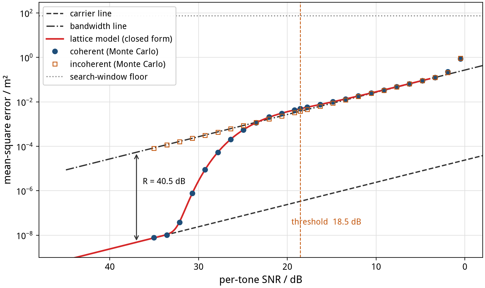

**Figure 1.** Mean-square range error from eight equally spaced tones (2400–2470 MHz, 10 MHz apart), against per-tone SNR, getting worse from left to right. Blue dots are Monte Carlo runs of coherent maximum likelihood (near the knee, $2\times10^6$ local trials). The red curve is the closed-form lattice model of this article, with no fitted parameters.

Measure a phase at a few frequencies and turn those phases into a range. That is how Bluetooth 6.0 Channel Sounding works, and stepped-frequency radar, multi-wavelength interferometers, and GNSS carrier-phase positioning do the same. Figure 1 is the typical error curve of all of them. At high SNR the error follows a very low straight line. At some SNR it jumps almost vertically by 40 dB and then follows a second, parallel line.

This article settles three things.

1. **Where the jump is, and how high, has a closed form.** One number, $R$, sets the gap between the two lines (40.5 dB here). The jump is centred at a total SNR of about $R_{\mathrm{dB}} - 13$ dB, and its foot is at about $R_{\mathrm{dB}} + 1$ dB. A one-dimensional rounding model gives the S-shaped curve in between. It agrees with Monte Carlo within 0.2 dB, checked down to slip probabilities of order $10^{-5}$.
2. **The jump can be split into an estimator account and an information account.** At the threshold, coherent maximum likelihood is 1.1 dB above the bandwidth line. The posterior mean recovers 1.2 dB. The remaining 3.2 dB to the Ziv–Zakai bound is looseness of the bound.
3. **It turns directly into engineering rules.** Group delay does not move the threshold. A phase offset common to all tones does move it, by less than 1 dB within 20°. Multipath makes the integer decision wrong deterministically. For tone placement, the first threshold depends almost only on the second moment of the frequencies, while distant deep valleys decide whether an error jumps from centimetres to metres. Equal spacing is not optimal: one eight-tone set is never worse from 35 dB down to 10 dB per tone, and strictly better from 29 dB down.

The article is written for engineers and for estimation theorists. The mathematics sits in separate boxes and appendices; skipping them does not hide any conclusion.

---

## Contents

1. [The problem: ranging from phases](#1-the-problem-ranging-from-phases)
2. [Two rulers](#2-two-rulers)
3. [Why it jumps: a multimodal likelihood](#3-why-it-jumps-a-multimodal-likelihood)
4. [The lattice model: the jump in closed form](#4-the-lattice-model-the-jump-in-closed-form)
5. [Only R matters](#5-only-r-matters)
6. [The estimator account and the information account](#6-the-estimator-account-and-the-information-account)
7. [Is the phase model enough? Complex observations](#7-is-the-phase-model-enough-complex-observations)
8. [Biases: what moves the threshold and what does not](#8-biases-what-moves-the-threshold-and-what-does-not)
9. [Why the shelf can vanish: layers of ambiguity](#9-why-the-shelf-can-vanish-layers-of-ambiguity)
10. [Placing the tones](#10-placing-the-tones)
11. [Engineering budget card](#11-engineering-budget-card)
12. [Three design questions](#12-three-design-questions)
13. [Why this bound has been studied so little](#13-why-this-bound-has-been-studied-so-little)
14. [Limits and open questions](#14-limits-and-open-questions)
15. [Appendices](#appendices)

---

## 1 The problem: ranging from phases

Over a distance $d$, the carrier phase at frequency $f$ turns by $2\pi f d/c$. The receiver only sees that angle modulo $2\pi$, the wrapped phase:

$$
\varphi_i = \mathrm{wrap}\left(\frac{2\pi f_i d}{c} + e_i\right), \qquad e_i \sim \mathcal{N}(0, \sigma^2), \quad i = 1,\dots,N .
$$

One tone only says where the range sits inside one wavelength. At 2.4 GHz the wavelength is 12.3 cm, so a single phase looks identical at 12.3 cm, 24.6 cm, 36.9 cm, and so on. Several tones are there to rule those candidates out.

The main example is eight tones from 2400 to 2470 MHz in 10 MHz steps, the same order as a Bluetooth Channel Sounding setup. Round-trip ranging only replaces $c$ by $c/2$; every threshold expressed in radians is unchanged.

At high SNR the phase noise and the per-tone SNR are related by $\sigma^2 = 1/(2\,\mathrm{SNR})$. Both units appear below. $\sigma$ is the convenient quantity for theory, and SNR is what an engineer can see.

---

## 2 Two rulers

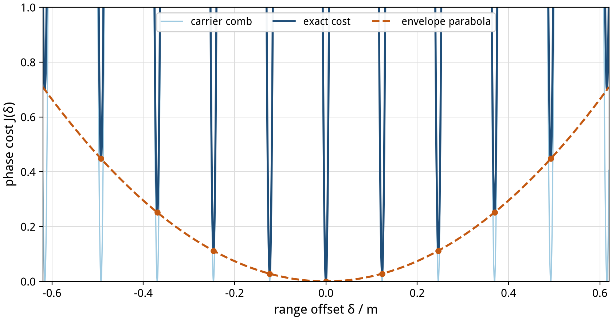

**Figure 2.** Phase cost $J(\delta)$ (sum of squared residuals over tones) at range offset $\delta$. The solid blue line is the exact cost. Light blue is the carrier comb, which returns to zero every mean wavelength. The orange dashed line is the envelope parabola, set only by the spacing between tones. The exact cost is comb plus parabola; orange dots mark the bottom of each tooth.

Put the eight phases together and two very different kinds of range information appear (Figure 2).

- **The carrier (the fine ruler).** All tones are near 2.4 GHz, so their phases turn together with period $\lambda = 12.3$ cm. This ruler is very fine, but it repeats every 12.3 cm.
- **The envelope (the coarse ruler).** The tones differ by tens of megahertz, so the phase differences change slowly with range. This ruler has coarse marks but does not repeat over tens of metres.

Each ruler has its own error line. Write $F = \sum f_i^2$ and $S = \sum (f_i - \bar f)^2$:

> **The two lines**
>
> $$\mathrm{HMSE} = \frac{c^2 \sigma^2}{4\pi^2 F} \quad(\text{carrier line}), \qquad \mathrm{MMSE} = \frac{c^2\sigma^2}{4\pi^2 S} \quad(\text{bandwidth line}).$$
>
> Both are proportional to $\sigma^2$, so on a log-log plot they are parallel, separated by
>
> $$R = \frac{F}{S} = 1 + \frac{N\bar f^2}{S}, \qquad \text{and for equal spacing } R = 1 + \frac{12(N-1)}{N+1}\left(\frac{\bar f}{B}\right)^2 .$$

For the eight example tones, $S = 4200\ \mathrm{MHz}^2$ and $R = 11295$, or 40.53 dB. In RMS terms the carrier line is 106 times more precise than the bandwidth line. At 35 dB per tone, the carrier line is 0.09 mm and the bandwidth line is 9.3 mm.

The fine ruler reads precisely but can pick the wrong period. The coarse ruler never picks the wrong period, but it reads coarsely. As long as the coarse error is much smaller than half a wavelength, the coarse ruler selects the right period and the fine ruler then reads the exact position: the error is on the carrier line. Once the coarse error approaches half a wavelength, period selection starts to fail.

---

## 3 Why it jumps: a multimodal likelihood

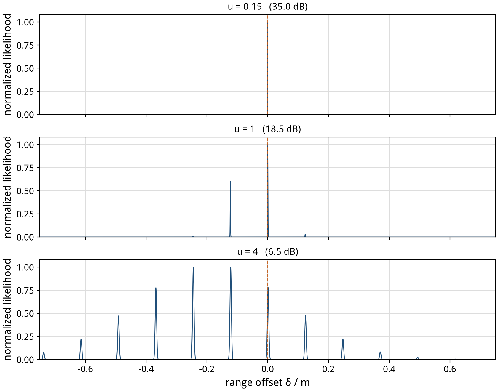

**Figure 3.** Normalized likelihood of one noise sample at three noise levels (horizontal axis: range relative to the truth). Animated version: [f03_likelihood.gif](figures/en/f03_likelihood.gif).

Statistically, this is indeed **maximum likelihood on a multimodal likelihood**. Figure 3 shows the likelihood of one measurement at three noise levels.

- Low noise (top): a row of narrow teeth, the central one far above the others. Maximum likelihood picks it reliably.
- Medium noise (middle): neighbouring teeth are almost equally tall. A small push from the noise and the tallest tooth becomes the next one, and the estimate is off by exactly one wavelength.
- High noise (bottom): the teeth are smeared out and only a broad envelope remains. The estimate relies on the coarse ruler alone.

The information in a single tone changes smoothly with noise, and the local Cramér–Rao bound does not jump. What jumps is the **global** estimate, which leaves the right tooth for its neighbour. This is the threshold effect Rife and Boorstyn described for single-tone frequency estimation in 1974. The difference is that here the wrong peaks are arranged very regularly.

That regularity is the way in. Multimodal problems usually have no closed form, but here all the wrong peaks lie on one line, and the problem reduces to one dimension.

---

## 4 The lattice model: the jump in closed form

### 4.1 The picture

Before the second threshold, while single phases are still far from being folded by the noise, each tone's residual splits into two parts: the part that belongs to "off by a whole number of wavelengths", and the part that belongs to "fine adjustment inside a tooth". Every "off by one wavelength" residual vector points in the same direction, and "off by $k$ wavelengths" is $k$ times that vector. Therefore:

- The estimator is really doing one thing: **rounding a continuous quantity $z$ to an integer $k$**.
- $z$ is Gaussian with zero mean (without bias), and its standard deviation $s$ is set by the noise and the tones.
- Range error = $k \times$ one wavelength + a fine error inside the tooth, and the two parts are statistically independent.

This is exactly the integer-ambiguity view of GNSS. Here there is only one integer, so everything can be computed to the end.

> **The lattice model** (derivation in Appendix A)
>
> $$\hat k = \mathrm{round}(z + \beta), \qquad z \sim \mathcal{N}(0, s^2), \qquad s = \frac{\sigma}{2\sigma_{\mathrm{jump}}\sqrt{1 - 1/R}},$$
>
> $$\mathrm{MSE} = \mathrm{HMSE} + \lambda_{\mathrm{eff}}^2\ \mathbb{E}[\hat k^2], \qquad \lambda_{\mathrm{eff}} = \lambda(1 - 1/R), \qquad \sigma_{\mathrm{jump}} = \frac{\pi\sqrt S}{\bar f}.$$
>
> $\beta$ is the disagreement between envelope and carrier caused by deterministic offsets, in wavelengths (Section 8); it is 0 without bias. Normalized by $u = \sigma/\sigma_{\mathrm{jump}}$, the whole curve is
>
> $$\frac{\mathrm{MSE}}{\mathrm{MMSE}} = \frac{1}{R} + \frac{4}{u^2}\left(1 - \frac1R\right)^2 \sum_k k^2\left[\Phi\left(\frac{k + \frac12}{s}\right) - \Phi\left(\frac{k - \frac12}{s}\right)\right].$$

### 4.2 Rules read directly from the model

| Quantity | Closed form | Example (8 tones, 70 MHz) |
| --- | --- | --- |
| Centre of the jump ($u = 1$) | total SNR $= (R-1)/(2\pi^2)$, about $R_{\mathrm{dB}} - 13$ dB | 18.5 dB per tone (27.6 dB total) |
| Physical meaning of the centre | coarse-ruler std equals $\lambda/2$ | 6.2 cm |
| Slip probability at the centre | $2Q(1)$ | 0.317 |
| Overshoot at the centre | above the bandwidth line | +1.14 dB |
| Foot (leaving the carrier line) | $8x^2 Q(x) = 1/R$, $\sigma = \sigma_{\mathrm{jump}}/x$ | $x = 4.908$, 32.4 dB per tone |
| Safe rule | total SNR $\gtrsim R_{\mathrm{dB}} + 1$ dB | $\gtrsim$ 32.5 dB per tone |
| Shelf below the threshold | $\mathrm{MMSE} + \lambda^2/12$ | — |

Some remarks:

- **The centre of the jump** is where the RMS error of the coarse ruler equals half a wavelength. This statement is exact: at $\sigma = \sigma_{\mathrm{jump}}$, $\sqrt{\mathrm{MMSE}} = \lambda/2$.
- **The foot** is where the slip contribution equals the carrier line, $20\log_{10}4.908 = 13.8$ dB above the centre. Above the foot, the carrier line is a safe budget.
- **The jump is about 14 dB wide** (from foot to centre), while the two lines are 40 dB apart. That is why the curve looks nearly vertical.
- The 1.14 dB overshoot comes from slips. At the threshold 32% of trials are off by at least one wavelength, and each slip costs $\lambda^2$, which is exactly 4 times the MMSE.

### 4.3 Comparison with Monte Carlo

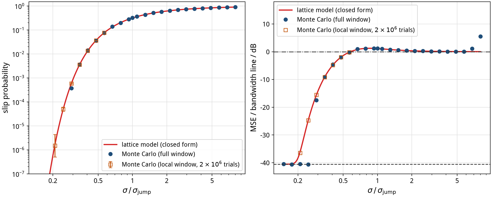

**Figure 4.** Left: slip probability. Right: MSE relative to the bandwidth line. Red is the lattice model, blue dots are full-window Monte Carlo (8000 or 20000 trials per point), and orange squares are $2\times10^6$ trials each in a $\pm4\lambda$ local window, with 95% Wilson intervals.

For $u$ from about 0.3 to 6, the lattice model and the coherent maximum-likelihood Monte Carlo differ by at most 0.18 dB. The large local-window runs extend the check to a slip probability of $5\times10^{-5}$, with a 0.04 dB deviation. The model only fails at $u \gtrsim 7$, where single phases start to be folded by the noise. That is a different threshold (Sections 5 and 7).

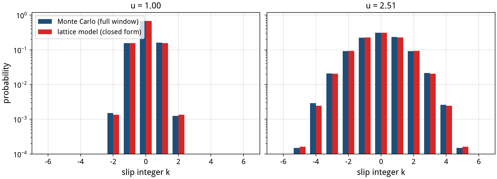

**Figure 5.** Distribution of the slip integer $k$: blue is Monte Carlo, red is the model. They agree down to probabilities of $10^{-4}$, at the threshold (left) and below it (right).

Not only the MSE but the whole distribution of how many wavelengths the estimate is off agrees (Figure 5). The model can therefore be used directly for any metric of interest: the 99th-percentile error, the probability of exceeding a distance, or the ambiguity-fixing success rate.

> **Connection to GNSS.** The bootstrapping success rate of GNSS ambiguity fixing, $P = 2\Phi(1/(2\sigma_{\hat a})) - 1$, is exactly $1 - P(\text{slip})$ here, with $\sigma_{\hat a} = s$. The GNSS literature studies the success rate, not the whole MSE-versus-SNR curve. Put side by side, the centre, the foot, and the overshoot of the jump all follow from the success-rate formula.

---

## 5 Only R matters

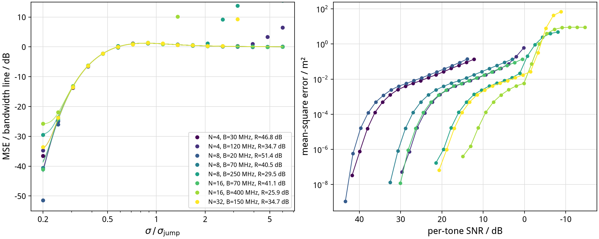

**Figure 6.** Eight equal-spacing designs (4 to 32 tones, 20 to 400 MHz bandwidth, $R$ from 25.9 to 51.4 dB). Right: raw MSE against SNR, scattered everywhere. Left: normalized by $u = \sigma/\sigma_{\mathrm{jump}}$ and the bandwidth line, all fall on one curve. The thin lines are each design's own lattice model; they differ only in the $1/R$ floor at the lower left.

The lattice model says that apart from the $1/R$ floor, **the normalized shape of the jump is the same for every design**. Figure 6 tests that: eight equal-spacing designs scatter in raw coordinates and overlap after normalization. All trial points with at least 50 slips agree with their own model within 0.94 dB for full-window runs and within 0.41 dB for large local-window runs.

Four designs leave the common curve at the upper right. That is the **second threshold**: single phases are scrambled by the noise and the coarse ruler itself starts to fail. They leave at a total SNR between 8 and 12 dB, largely independent of tone count and bandwidth. This is the Rife–Boorstyn threshold of single-tone frequency estimation: on an equal grid, range is exactly a "frequency" along the tone index.

> **A naming note.** Li and Qi (arXiv:1202.1424) call the jump from MMSE back to HMSE the "second threshold" and the coarse-ruler failure the "first threshold", counting from low SNR upward. This article counts from high SNR downward: the first threshold is leaving the carrier line, the second is leaving the bandwidth line.

---

## 6 The estimator account and the information account

Is the jump a failure of the maximum-likelihood estimator, or is the information simply not in the data? Answering that requires comparing estimators and the bound under **the same prior**. We put the true range uniformly in a 14.99 m window and compute three things.

- **Coherent maximum likelihood**: pick the tallest tooth.
- **Posterior mean**: average all teeth weighted by their posterior probability. Under this prior it is the MSE-optimal estimator.
- **The Ziv–Zakai bound**: no estimator can go below it. This version refines the valley bottoms and fills valleys, and it returns exactly to the carrier line at high SNR (0.00 dB difference).

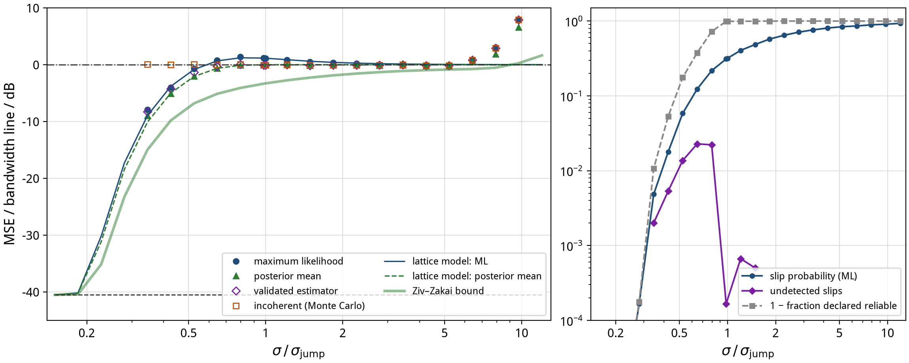

**Figure 7.** Left: MSE of each estimator under the same uniform prior, relative to the bandwidth line. 6000 Monte Carlo trials per point. Points where fewer than 3 slips are expected are omitted, because a sample with no slips has a sample MSE below the bound. Right: slip probability, and the fraction of trials a validated estimator declared reliable although they had slipped.

At the threshold $u = 1$ (in dB·m²):

| Estimator | MSE | Relative to bandwidth line |
| --- | --- | --- |
| Coherent maximum likelihood | −23.09 | +1.12 |
| Posterior mean | −24.31 | −0.10 |
| Incoherent (coarse ruler only) | −24.30 | −0.08 |
| Ziv–Zakai bound | −27.50 | −3.29 |

So the accounts separate cleanly.

- **1.2 dB** is the price of maximum likelihood's hard decision. At the threshold it picks the wrong tooth with probability 32%; the posterior mean averages neighbouring teeth and pays less. The lattice model predicts the posterior mean as well (−24.22 dB), within 0.1 dB.
- **3.2 dB** is looseness of the bound. Under this prior no estimator beats the posterior mean, and the posterior mean is still 3.2 dB above the bound. A bound that is a few dB loose in the threshold region is not unusual; how much a tighter global bound (Weiss–Weinstein, or Bell's extended form) would recover is an open question.

Two useful consequences for engineering:

1. **At the threshold, the incoherent estimator, which uses only the coarse ruler, is as good as the optimal one.** In the jump region, using the carrier phase buys nothing. The carrier phase only pays above the foot.
2. **A validated estimator.** Compute the posterior probability of the tallest tooth. If it is reliable (above 0.9), use the coherent result; otherwise fall back to the posterior mean. Near the threshold this hybrid is only 0.1–0.8 dB worse than the posterior mean, and the fraction declared reliable while actually slipped peaks at 2.3% (at $u \approx 0.65$). In engineering terms: output a range together with a reliability flag.

---

## 7 Is the phase model enough? Complex observations

A real receiver sees complex samples $y_i = h\,e^{j2\pi f_i d/c} + n_i$, of which the phase is only a part. We ran coherent maximum likelihood directly on the complex observations and compared it with the phase-only version.

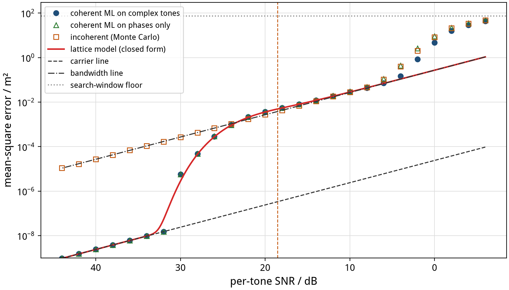

**Figure 8.** Coherent maximum likelihood on complex tones (blue), on phases only (green triangles), and the incoherent estimator (orange squares). Red is the lattice model; the horizontal axis is per-tone SNR.

- From 14 to 34 dB per tone, which covers the entire first threshold, the two differ by at most 0.12 dB. **The phase model is exact at the first threshold.**
- Below about 6 dB, complex observations start to win clearly (1.8 dB at 6 dB per tone), by 4.7–4.9 dB at 2–4 dB per tone. That is the second threshold: the actual phase standard deviation exceeds $1/\sqrt{2\,\mathrm{SNR}}$, by 23% at 2 dB.

Conclusion: for the first threshold the phase model is enough. To decide how low an SNR the system survives at all, go back to complex observations.

---

## 8 Biases: what moves the threshold and what does not

In a real system every tone has a deterministic phase error: group delay in antennas and filters, the initial phase of the local oscillator, multipath reflections. The lattice model splits any set of phase offsets $m_i$ into three parts.

1. **The part along the fine-ruler direction** is equivalent to a global range shift and does not affect the threshold. Group delay $\tau$ is exactly this: it biases the range by $c\tau$ (30 cm per nanosecond), but $\beta = 0$ and the slip probability is unchanged.
2. **The part along the integer direction** is $\beta$. The envelope and the carrier disagree about the range, the decision boundary is pushed off centre, and the threshold moves.
3. What is left is second order.

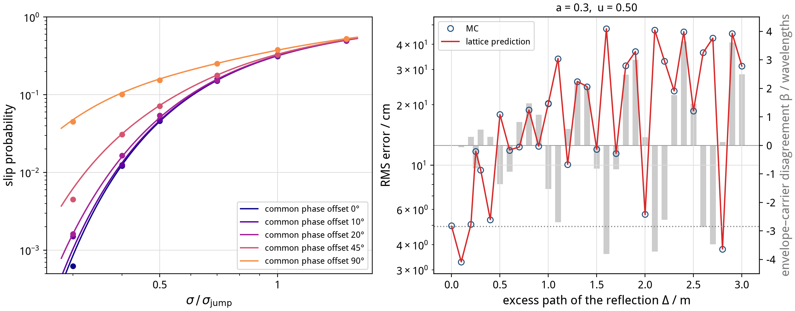

**Figure 9.** Left: a phase offset $\varepsilon$ common to all tones raises the slip probability; dots are Monte Carlo, lines are the model. Right: one reflection (amplitude 0.3) with excess path $\Delta$ from 0 to 3 m, RMS error at $u = 0.5$ (left axis) and disagreement $\beta$ (grey bars, right axis).

**A phase offset common to all tones does move the threshold.** It is easy to get this wrong: being common, it seems it should cancel. But a common phase $\varepsilon$ looks like a range shift of $\varepsilon\lambda/2\pi$ to the fine ruler and like nothing at all to the coarse ruler. The two rulers then disagree by $\beta = -\varepsilon/2\pi$ wavelengths. The decision boundaries move from $\pm\frac12$ to $\pm\frac12 - \beta$, and the slip probability on the near side becomes $Q((\frac12 - \lvert\beta\rvert)/s)$.

> **The 20° rule.** At low slip probability, the threshold moves toward higher SNR by $-20\log_{10}(1 - 2\lvert\beta\rvert)$ dB, with $\lvert\beta\rvert = \lvert\varepsilon\rvert/360°$. The shift is 1 dB at $\lvert\varepsilon\rvert = 19.6°$, 0.5 dB at 10°, and 6 dB at 90°. At the slip probabilities that matter in practice ($10^{-2}$ to $10^{-4}$) the shift is smaller still (0.35–0.64 dB at 20°).

**Multipath makes the integer decision wrong deterministically.** With one reflection of amplitude 0.3, a change of a few tens of centimetres in excess path swings $\beta$ between $\pm 3.8$ wavelengths (Figure 9, right). Once $\lvert\beta\rvert > \frac12$, the estimate lands on the wrong tooth even without noise, and the RMS error jumps from 3.4 cm to 45 cm. The lattice model predicts all of this. Over 119 bias trials, model and Monte Carlo mostly agree within 0.5 dB, at most 1.4 dB (at points with only a few slips).

The engineering meaning: multipath does not "add a bit of noise"; it creates a systematic disagreement between the coarse and the fine ruler. Calibrating group delay is for range accuracy. Calibrating the disagreement between tones is for getting the integer right.

---

## 9 Why the shelf can vanish: layers of ambiguity

On an equal grid errors only happen at whole wavelengths, so below the threshold there is a shelf: the error stays at the centimetre level. Another tone placement can behave completely differently.

### 9.1 Geometric spacing: one slip costs six metres

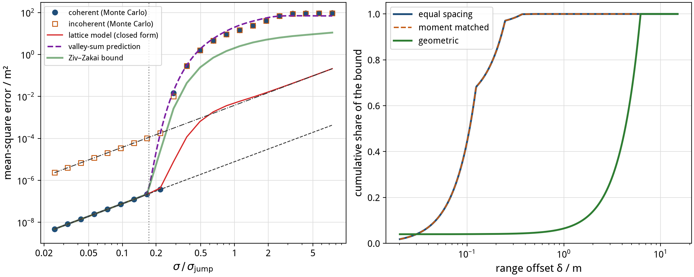

**Figure 10.** Left: tones in geometric progression with ratio 1.02. After leaving the carrier line, coherent ML goes straight past the bandwidth line with no shelf. The purple dashed line is the valley mixture, green is the Ziv–Zakai bound, and the red lattice model does not apply here. Right: cumulative share of the bound along range at $\sigma = 0.0836$ rad. Equal and moment-matched designs are complete within 0.25 m; the geometric one needs 6.2 m.

The geometric design has a valley at 6.211 m exactly as deep as "off by one wavelength". Slipping into it is just as likely, but it costs $(6.2\ \mathrm{m})^2$, about 34 dB more. At the equal grid's threshold noise, 96% of the geometric design's bound comes from the segment between one wavelength and 6.211 m. As $\sigma$ grows from 0.12 to 0.20 rad, its 99th-percentile error jumps from 2 mm straight to 6.21 m.

For such designs the lattice model (whole wavelengths only) does not apply. We use a **valley mixture** instead: for each valley $k$ compute the pairwise error probability $p_k = 2Q(\sqrt{J_k}/2\sigma)$, and let every valley compete with the true tooth:

$$
\mathrm{MSE} \approx \mathrm{HMSE} + \frac{\sum_k p_k \delta_k^2}{1 + \sum_k p_k}.
$$

When slips are rare this equals the classical valley sum; when they are frequent it is still a proper mixture. Against Monte Carlo it is within about 1 dB near the foot and conservative (too high) by 1–4.5 dB deep in the transition. The sum of pairwise probabilities overestimates the chance of being beaten by some valley, which is where the conservatism comes from.

### 9.2 Two clusters: a staircase

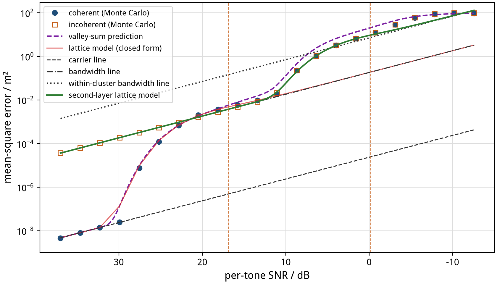

**Figure 11.** Two clusters of four tones (2414–2426 and 2469–2481 MHz, cluster centres 55 MHz apart). The MSE first leaves the carrier line for the bandwidth line, then jumps again around 6–10 dB toward the within-cluster bandwidth line. The solid green line applies the lattice model to the second layer, with no fitted parameters.

Two clusters give two layers of ambiguity: the carrier wavelength of 12.3 cm, and the synthetic wavelength of the cluster-centre difference, $c/55\,\mathrm{MHz} = 5.45$ m. The error curve has two steps (Figure 11).

- First step: carrier line to bandwidth line (threshold $\sigma_{\mathrm{jump}} = 0.101$ rad). The 99th-percentile error stays at one wavelength (0.12 m).
- Second step: bandwidth line to the within-cluster bandwidth line. The within-cluster second moment is $S_{\mathrm{within}} = 160\ \mathrm{MHz}^2$, the second layer's $R_2 = S/S_{\mathrm{within}} = 15.9$ dB, and the second-layer threshold is $\sigma_{\mathrm{jump},2} = 0.72$ rad.

**The lattice model can be applied layer by layer.** In the second layer the "fine ruler" is the full bandwidth and the "coarse ruler" is the within-cluster bandwidth. Substituting them into the same formula gives the green line in Figure 11. From 20.5 dB to −0.8 dB per tone it agrees with Monte Carlo within 1.2 dB, all the way to the search-window floor.

### 9.3 The Chinese remainder theorem cannot postpone the threshold

Coprime placement (the Chinese remainder theorem) only changes the period after which all phases return to whole cycles at once, the unambiguous range. The first threshold is set by $\bar f$ and $S$ and has nothing to do with the greatest common divisor. Changing the equal grid into an unequal one with the same second moment ("moment matched", `2390, 2418, 2425, 2432, 2443, 2449, 2454, 2469` MHz) leaves the first threshold exactly where it was: it agrees with the same lattice model within 0.93 dB. The two only separate at noise an order of magnitude larger.

---

## 10 Placing the tones

### 10.1 The first threshold depends almost only on S

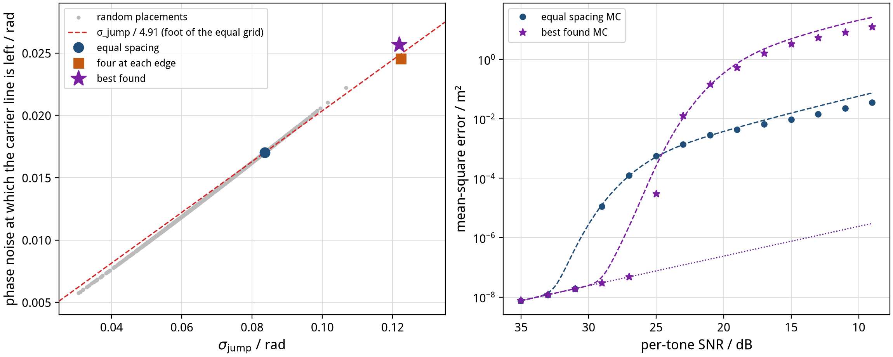

**Figure 12.** Left: 1500 random sets of eight integer-MHz tones within 2400–2470 MHz, with $\sigma_{\mathrm{jump}}$ on the horizontal axis and the phase noise at which the carrier line is left on the vertical axis. All points fall almost on one line. Right: Monte Carlo MSE of the equal grid and of the latest-departure design; dashed lines are the valley mixture.

Across the 1500 random designs, the ratio of $\sigma_{\mathrm{jump}}$ to the noise at which the carrier line is left stays between 4.80 and 5.32 (median 4.98), which is ±0.45 dB of SNR. **The first threshold is set almost entirely by the second moment $S$ of the frequencies.** To postpone it, push the tones toward the band edges.

Pushing all tones to the edges (`2400, 2401, 2402, 2404, 2467, 2468, 2469, 2470`) postpones the threshold by 3.6 dB. But it leaves a deep valley at 4.49 m (cost about twice that at one wavelength), so there is no shelf below the threshold: one slip costs four and a half metres (Figure 12, right).

### 10.2 Equal spacing is not Pareto optimal

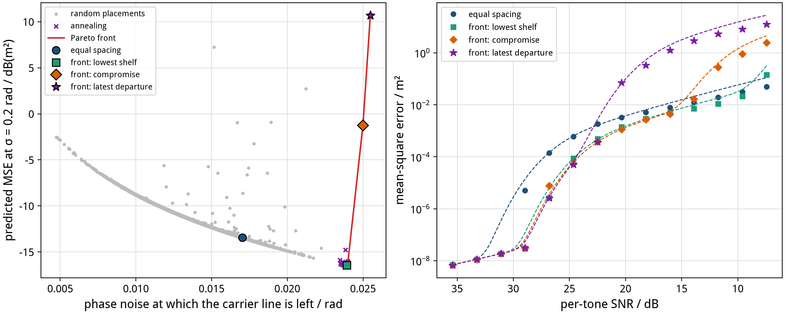

**Figure 13.** Left: two objectives, the noise at which the carrier line is left (larger is better) and the predicted MSE at $\sigma = 0.2$ rad, about 11 dB per tone (smaller is better). Grey dots are random designs, crosses are simulated annealing, and the red line is the Pareto front. Right: Monte Carlo (6000 trials per point) for three designs on the front and for the equal grid.

Measured on both objectives at once, how late the threshold arrives and how large the error is below it, the equal grid is **dominated**. The design

```
2400, 2401, 2402, 2409, 2450, 2468, 2469, 2470 MHz
```

leaves the carrier line 3.0 dB later, has a shelf 2–3 dB lower, and its 99th-percentile error is no worse than the equal grid's at any SNR. Monte Carlo confirms it: at 29 dB per tone it gives −75.3 dB·m² (equal grid −52.9), at 18 dB −25.3 (equal grid −22.8). Only below about 8 dB does its cluster structure make it lose to the equal grid.

The idea is simple. Put most tones at the edges to make $S$ large, and put two tones in the middle to break up the distant deep valleys and keep the shelf. The other end of the front, the latest-departure design, trades the shelf for slips of four metres. That is the real trade-off in tone placement: **postponing the threshold is free until a distant deep valley appears.**

---

## 11 Engineering budget card

| Question | Answer |
| --- | --- |
| How far apart are the two lines? | $R = F/S$. Equal spacing: $R \approx 1 + 9.3\,(\bar f/B)^2$ for $N = 8$. |
| What SNR allows a carrier-line budget? | Total SNR $\gtrsim R_{\mathrm{dB}} + 1$ dB (foot: $8x^2Q(x) = 1/R$). |
| Where is the centre of the jump? | Total SNR $= (R-1)/2\pi^2$, about $R_{\mathrm{dB}} - 13$ dB; there the coarse error is $\lambda/2$ and the slip probability 0.317. |
| What budget below the threshold? | Bandwidth line plus $\lambda^2/12$ (equal spacing); +1.1 dB overshoot at the centre. |
| When is even the bandwidth line lost? | Total SNR below about 8–12 dB (second threshold); analyse complex observations. |
| Must group delay be calibrated? | Yes, for range accuracy. It does not move the threshold. |
| How much common phase offset is tolerable? | Within 20° the threshold moves by less than 1 dB. |
| And multipath? | It creates a coarse–fine disagreement $\beta$; once $\lvert\beta\rvert > \frac12$ the integer is wrong deterministically. |
| How to place tones? | First make $S$ large. Then check every deep valley: $P_e(\delta)\delta^2$ must not exceed the carrier line earlier than the one-wavelength valley does. Keep a few tones in the middle to break distant valleys. |
| Coherent or incoherent? | Coherent above the foot; the two are equal in the threshold region; a hybrid with a reliability flag loses nothing on either side. |
| Want a better estimator? | In the threshold region the posterior mean beats ML by 1.2 dB; beyond that it is the bound, not the estimator. |

---

## 12 Three design questions

### 12.1 Does changing the starting frequency matter?

With $N$ and the spacing $\Delta f$ fixed, changing only the starting frequency $f_0$ (and thus $\bar f$) **does matter, a lot** — even with no propagation model. The second moment $S$ is set only by the spacings and is independent of $f_0$:

$$
S = (\Delta f)^2\,\frac{N(N^2-1)}{12}\quad\text{(equal spacing)},
\qquad R = 1 + \frac{N\bar f^2}{S},
\qquad \sigma_{\mathrm{jump}} = \frac{\pi\sqrt S}{\bar f}.
$$

| Quantity | Scaling with $\bar f$ | Meaning |
| --- | --- | --- |
| $S$, bandwidth line MMSE | unchanged | coarse-ruler precision depends only on spacing |
| $R$, gap between the two lines | $\propto \bar f^2$ | the higher the carrier, the more the fine ruler is worth relative to the coarse one |
| HMSE, wavelength $\lambda$ | $\propto 1/\bar f^2$, $1/\bar f$ | finer ruler, cheaper per-wavelength slip |
| $\sigma_{\mathrm{jump}}$ (radians) | $\propto 1/\bar f$ | tighter phase-noise threshold |
| SNR at the threshold | $\propto \bar f^2$ | higher carriers need more SNR to keep the fine ruler |

Numbers for $N = 8$, $\Delta f = 10$ MHz:

| $f_0$ | $\bar f$ | $R$ | $\sigma_{\mathrm{jump}}$ | threshold / tone | foot / tone | carrier RMS @ 35 dB |
| --- | --- | --- | --- | --- | --- | --- |
| 900 MHz | 935 | 32.2 dB | 0.218 rad | 10.2 dB | 24.0 dB | 0.23 mm |
| 2400 MHz | 2435 | 40.5 dB | 0.084 rad | 18.5 dB | 32.4 dB | 0.09 mm |
| 5800 MHz | 5835 | 48.1 dB | 0.035 rad | 26.1 dB | 40.0 dB | 0.04 mm |
| 24 GHz | 24035 | 60.4 dB | 0.0085 rad | 38.4 dB | 52.2 dB | 0.009 mm |

Moving from 2.4 GHz to 5.8 GHz with the same 8×10 MHz raises the threshold centre from 18.5 to 26.1 dB per tone and the foot from 32.4 to 40.0 dB. The absolute precision of the bandwidth line is unchanged (9.3 mm RMS at 35 dB), but keeping the finer carrier ruler costs about 8 dB more SNR. At 24 GHz the threshold itself is 38 dB — the fine ruler is almost unusable.

> If what you hold fixed is the **relative** bandwidth $B/\bar f$ rather than the absolute spacing, then $R$ and the threshold SNR stay put. The effect above comes from “absolute spacing fixed, carrier up → relative bandwidth down”.

### 12.2 Drawing N out of M equal-spaced candidates: is uniform random best?

**No.** Two different “uniforms” must be kept apart.

1. **Deterministic equal spacing** (every $M/N$-th candidate): the classic design with the nicest shelf, but not Pareto optimal.
2. **Uniform random draws**: on the two objectives (how late the threshold arrives, how large the error is below it) the median is worse than equal spacing. About 11–13% of random samples strictly beat equal spacing on both objectives, but the Pareto front is occupied almost entirely by “dense at the edges + a few anchors in the middle”, not by random samples.

Numbers for 8 tones drawn from 2400–2470 MHz at 1 MHz steps ($M = 71$):

| Design | $\sigma$ at leaving the carrier line | predicted MSE at $\sigma = 0.2$ rad |
| --- | --- | --- |
| Uniform random (median) | 0.014 | −11.6 dB·m² |
| Equal spacing | 0.017 | −13.4 dB·m² |
| Front, lowest shelf (`2400,2401,2402,2409,2450,2468,2469,2470`) | 0.024 | −16.4 dB·m² |
| Four at each edge | 0.025 | +13.5 dB·m² (a cliff) |

Monte Carlo confirms: the front design is strictly better than equal spacing from 29 dB per tone downward, until about 8 dB. The principle is

> **First make $S$ large (postpone the threshold), then leave anchors in the middle to break distant valleys (keep the shelf).**

When $N \ll M$, a random draw is even less likely to hit that structure. Equal spacing is still not optimal, and searching or constructing “edges + anchors” is still worth doing. Coprime / Chinese-remainder draws optimize the unambiguous range and do not postpone the first threshold (Section 9.3).

### 12.3 With describable multipath, is that still best?

For a **single describable reflection** (amplitude $a$, excess path $\Delta$, phase $\psi$), the lattice model still applies: multipath only puts a deterministic phase offset $m_i = \arg(1 + a\,e^{j(2\pi f_i\Delta/c + \psi)})$ on each tone, which then projects to the disagreement $\beta$. The question becomes which placement keeps $\lvert\beta\rvert$ smaller and slips rarer as $\Delta$ varies.

With $a = 0.3$, $\psi = \pi$, and $\Delta$ uniform on 0.01–5 m ($\sigma$ at half the equal grid’s threshold):

| Design | $\mathrm{rms}(\beta)$ / wavelengths | fraction $\lvert\beta\rvert > 1/2$ | mean slip rate | mean MSE |
| --- | --- | --- | --- | --- |
| Uniform random (median) | 3.00 | 86% | 0.86 | −8.6 dB·m² |
| Equal spacing | 1.99 | 82% | 0.81 | −12.0 dB·m² |
| Front, lowest shelf | 1.72 | 72% | 0.72 | −13.4 dB·m² |
| Four at each edge | 1.67 | 71% | 0.71 | −13.6 dB·m² |

At $a = 0.1$ the order is unchanged, only the absolute values shrink. Intuitively: edge-heavy designs have larger $S$, so the same phase-offset vector projects to a smaller $\beta$ along the integer direction. Multipath phases vary more across a wider span, but in this single-reflection sweep the net effect still favours the edge-type designs.

**That does not make them optimal under every multipath.** Three caveats:

1. The average above is over uniform $\Delta$. If delays concentrate on a $\Delta$ that is particularly bad for an edge design, the ranking can flip — recompute $\beta(\Delta)$ for your own delay distribution.
2. “Cliff” designs (four at each edge, no middle anchors) have no shelf under noise; once multipath pushes the estimate off the main lobe, the error may be a multi-metre far valley, while the lattice statistics above only count whole wavelengths. With multipath, prefer a **front design with anchors**, not pure edges.
3. Several reflections, time-varying multipath, or coupling to fading are outside this article.

Combined engineering advice: under a describable single reflection, **still prefer “dense edges + middle anchors”**; additionally plot $\beta(\Delta)$ for that design, mark the dangerous delays where $\lvert\beta\rvert > 1/2$, and leave a 20° margin for common phase offset in the link budget (Section 8).

---

## 13 Why this bound has been studied so little

Multi-frequency phase ranging is not a small problem, yet the literature rarely gives a complete answer to "what do the MSE bound and the threshold actually look like". Our view is that the problem falls into the gaps between several communities.

- **Estimation theory.** Threshold studies (Ziv–Zakai, Weiss–Weinstein, Bell's extended bounds, Athley's threshold-region analysis) almost all address continuous waveforms and flat spectra. In Weiss and Weinstein's three-region picture the middle region sits $12(\omega_0/W)^2$ above the carrier bound, which is the many-tone limit of this article's $R$. A few discrete tones, wrapped phases, and the integer structure were treated as a special case.
- **GNSS ambiguity resolution** (Teunissen's LAMBDA, ADOP, bootstrapping success rate) has studied the integer structure most thoroughly, but it cares about the fixing success rate rather than the whole MSE-versus-SNR curve, and multi-dimensional lattices resist closed forms. Here there is a single integer, so everything can be computed.
- **The Chinese remainder theorem and robust remaindering** (Xia, Wang, and others) study deterministic error bounds, for example recovery when the errors are below a quarter of the greatest common divisor of the moduli, not MSE and thresholds under random noise. They optimize the unambiguous range, which is a different knob from the first threshold.
- **Engineering practice** (interferometers, stepped-frequency radar, Bluetooth Channel Sounding) usually relies on synthetic-wavelength rules of thumb and measurement. The threshold region is "where it does not work", and nobody has a reason to characterize its shape.
- The closest work is Li and Qi (arXiv:1202.1424). They give the heights of the two lines and observe a "double threshold". Their tool is perturbation; they do not write the threshold as a function of the frequency set or give the shape of the jump.

There is also a technical reason. The Cramér–Rao bound is useless here (it does not jump), and global bounds are surprisingly easy to get wrong numerically. Our own archived computation hit two traps: without refining the valley bottoms, the bound is off by more than 30 dB at low noise; and when maximum likelihood refines only one candidate, rare slips are overestimated by a factor of 1.4–3 (Appendix C). A model that looks simple does not easily give correct numbers.

---

## 13 Limits and open questions

- **Scope of the lattice model.** It requires errors to occur only at whole mean wavelengths (equal spacing, moment-matched designs, and generally designs without distant deep valleys), and it holds before the second threshold. Designs like the geometric one need the valley mixture, which is only accurate to 1–4.5 dB.
- **Noise model.** We assume independent, equal-variance Gaussian phase noise on each tone. With unequal per-tone SNR (fading) the lattice formulas still hold in their weighted form (Appendix A), but we have not validated that systematically. Correlated phase noise from a shared oscillator is not considered.
- **Tightness of the bound.** The Ziv–Zakai bound is 3.2 dB loose in the threshold region. Weiss–Weinstein or Bell's extended bound may be tighter; we have not computed them.
- **Tone placement.** The search in Section 10 is restricted to eight integer-MHz tones within 2400–2470 MHz, with the valley mixture as objective and Monte Carlo as the final check. For other bands, tone counts, or with Bluetooth channel restrictions, the search has to be redone (the code can be reused as is).
- **Multipath.** We studied a single reflection only. Statistics over several reflections, and using the lattice model to detect multipath, are worthwhile next steps.

---

## Appendices

### Appendix A. Derivation of the lattice model

Write $g_i = 2\pi f_i/c$ (slope of phase with range), $a_i = 2\pi(f_i - \bar f)/\bar f$ (the phase left on tone $i$, after removing whole cycles, when the range is off by one mean wavelength), and weights $W = \mathrm{diag}(w_i)$ (matched weights $w_i = 1/\sigma_i^2$).

At range offset $\delta = k\lambda + \epsilon$, as long as residuals are much smaller than $\pi$, the weighted cost is

$$
J(k, \epsilon) = \lVert e - k a - \epsilon g \rVert_W^2 .
$$

Minimizing over $\epsilon$ gives $\epsilon^*(k) = g^{\top}W(e - ka)/g^{\top}Wg$. Split $a$ into a part parallel to $g$ and the orthogonal part $\tilde a = a - (a^{\top}Wg/g^{\top}Wg)\,g$. The cost becomes

$$
J(k) = \text{const} + \tilde a^{\top} W \tilde a\,(k - z)^2, \qquad z = \frac{\tilde a^{\top} W e}{\tilde a^{\top} W \tilde a}.
$$

The best integer is therefore $\hat k = \mathrm{round}(z)$, with $z$ Gaussian of variance $s^2 = \tilde a^{\top}W\Sigma W\tilde a/(\tilde a^{\top}W\tilde a)^2$. With equal weights and equal variances, $\tilde a^{\top}\tilde a = 4\sigma_{\mathrm{jump}}^2(1 - 1/R)$, so $s = \sigma/(2\sigma_{\mathrm{jump}}\sqrt{1 - 1/R})$.

The range error is $\hat k\lambda + \epsilon^*(\hat k)$. The part of $\epsilon^*$ that depends on $e$ is $g^{\top}We/g^{\top}Wg$. It is uncorrelated with $z$ (because $\tilde a \perp_W g$), and its variance is the HMSE. The part that depends on $\hat k$ is $-\hat k\, a^{\top}Wg/g^{\top}Wg$. Together the error is $\hat k\lambda_{\mathrm{eff}} + (\text{independent fine error})$, with $\lambda_{\mathrm{eff}} = \lambda - a^{\top}Wg/g^{\top}Wg$, which equals $\lambda(1 - 1/R)$ for equal weights.

**Deterministic offsets** $m$: the mean of $z$ becomes $\beta = \tilde a^{\top}Wm/\tilde a^{\top}W\tilde a$, and the fine error gains the constant $g^{\top}Wm/g^{\top}Wg$. For group delay, $m = g\,c\tau$, so $\beta = 0$ and the fine error is $c\tau$. For a common phase, $m = \varepsilon\mathbf 1$, and with equal weights $\beta = -\varepsilon/2\pi$ (to order $1/R$). When the receiver's weights do not match the true noise, $s$ and the HMSE take the sandwich form; see [`mfpr/lattice.py`](../computation/mfpr/lattice.py).

**Threshold closed form**: at $u = 1$ the total SNR is $N/(2\sigma_{\mathrm{jump}}^2) = N\bar f^2/(2\pi^2 S) = (R - 1)/(2\pi^2)$.

**Foot**: write $x = \sigma_{\mathrm{jump}}/\sigma$. When slips are rare, $\mathbb E[\hat k^2] \approx 2Q(1/2s) \approx 2Q(x)$, and the slip contribution is about $2Q(x)\lambda^2$. With $\lambda^2 = c^2/\bar f^2$ and $\sigma_{\mathrm{jump}}^2 = \pi^2 S/\bar f^2$,

$$
\frac{2Q(x)\lambda^2}{\mathrm{HMSE}} = 2Q(x)\,\frac{4\pi^2 F}{\bar f^2\sigma^2} = 2Q(x)\,\frac{4\pi^2 F x^2}{\pi^2 S} = 8x^2Q(x)\,R .
$$

Setting it to 1 (total MSE twice the carrier line) gives $8x^2Q(x) = 1/R$.

**Shelf**: for $s \gg 1$, $\mathbb E[\hat k^2] \approx s^2 + 1/12$; substituting gives $\mathrm{MSE} \approx \mathrm{MMSE} + \lambda^2/12$.

### Appendix B. Reproduction

```bash
cd computation
pip install -r requirements.txt
./run_all.sh                 # tests, nine experiments, all figures, numbers.md; about an hour on four cores
python3 -m pytest -q tests   # 11 regression tests covering the main closed forms
```

| File | Contents |
| --- | --- |
| `mfpr/core.py` | tone sets, moments, the two lines, phase cost |
| `mfpr/lattice.py` | lattice model (with offsets, mismatched weights, posterior mean) |
| `mfpr/estimators.py` | coherent / incoherent / complex ML, posterior mean |
| `mfpr/bounds.py` | Ziv–Zakai bound with refined valleys, valley attribution, valley mixture |
| `experiments/e01`–`e09` | bounds, lattice validation, collapse, Bayes, complex tones, biases, layered ambiguity, tone placement, Pareto |
| `figures_article.py` | every figure of this article, in Chinese and English |
| `article_numbers.py` | every number quoted in this article |

Each experiment writes `computation/data/v2/*.json` with the git commit it was generated from.

### Appendix C. Errata for the archived notes

The archived notes (`notes/`) and data (`computation/data/`) are left as they were. A review found the following.

1. **The archived coherent ML refines a single candidate** (`sim_threshold.py` takes the lowest grid point). When two teeth have similar cost it picks the wrong one, and rare slips are overestimated by a factor of 1.4–3. The new code refines the best 4 candidates (3 or more converge). Conclusions near the threshold are not affected.
2. **`bound_valleys.json` is wrong at low noise.** For example, at $\sigma = 0.0084$ rad it gives −117.0 dB, 32 dB below the carrier line (−84.7 dB) that the bound must approach, because valley bottoms were not refined (the valley sits at 0.1229 m instead of 0.12312 m). The bound values stored in the archived `results.json` agree with the new computation within 0.03 dB.
3. **The README said "window of half-length 14.990 m" for the bound's prior; it is a window of length 14.990 m** (uniform over $T = 14.99$ m). The README is now corrected.
4. The archived `make_figures.py` hard-codes a local font path; the new `figures_article.py` picks an available CJK font automatically.

---

## References

- Wei Li, Wangdong Qi. Optimization in Multi-Frequency Interferometry Ranging: Theory and Experiment. arXiv:1202.1424, 2012.
- D. C. Rife, R. R. Boorstyn. Single-Tone Parameter Estimation from Discrete-Time Observations. *IEEE Trans. Information Theory*, 20(5):591–598, 1974.
- J. Ziv, M. Zakai. Some Lower Bounds on Signal Parameter Estimation. *IEEE Trans. Information Theory*, 15(3):386–391, 1969.
- K. L. Bell, Y. Steinberg, Y. Ephraim, H. L. Van Trees. Extended Ziv–Zakai Lower Bound for Vector Parameter Estimation. *IEEE Trans. Information Theory*, 43(2):624–637, 1997.
- A. J. Weiss, E. Weinstein. Fundamental Limitations in Passive Time-Delay Estimation, Part I: Narrow-Band Systems. *IEEE Trans. ASSP*, 31(2):472–486, 1983.
- E. Weinstein, A. J. Weiss. A General Class of Lower Bounds in Parameter Estimation. *IEEE Trans. Information Theory*, 34(2):338–342, 1988.
- F. Athley. Threshold Region Performance of Maximum Likelihood Direction of Arrival Estimators. *IEEE Trans. Signal Processing*, 53(4):1359–1373, 2005.
- P. J. G. Teunissen. The Least-Squares Ambiguity Decorrelation Adjustment: A Method for Fast GPS Integer Ambiguity Estimation. *Journal of Geodesy*, 70:65–82, 1995.
- P. J. G. Teunissen. Success Probability of Integer GPS Ambiguity Rounding and Bootstrapping. *Journal of Geodesy*, 72:606–612, 1998.
- X.-G. Xia, G. Wang. Phase Unwrapping and a Robust Chinese Remainder Theorem. *IEEE Signal Processing Letters*, 14(4):247–250, 2007.
- Bluetooth SIG. Bluetooth Core Specification 6.0, Channel Sounding, 2024.
