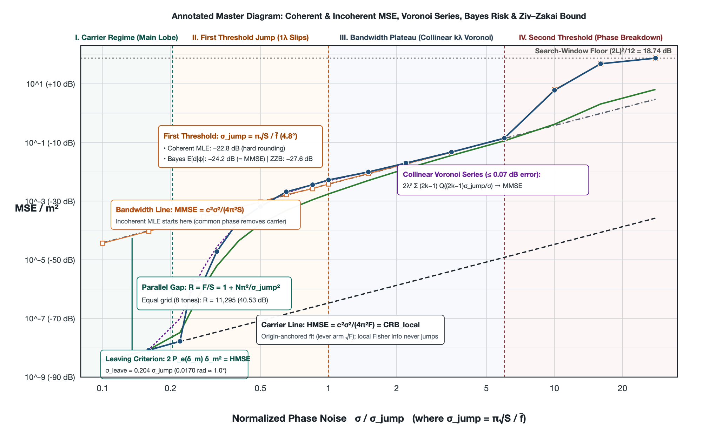

# 多频相位测距的门限

2026 年 10 月

## 摘要

在 \(N\) 个频率 \(f_1,\dots,f_N\) 上观测受独立高斯噪声 \(e_i \sim \mathcal{N}(0,\sigma^2)\) 污染的包裹相位 \(\varphi_i = \mathrm{wrap}(2\pi f_i d/c + e_i)\)，最小化包裹残差平方和的相干极大似然距离估计在双对数图上呈现由两条平行渐近线与两次跳变构成的三段式结构（见总览图）。在低噪声主瓣内，包裹操作不起作用，相干估计利用各频点相对同一本振的绝对相位拟合过原点的直线，力臂为频点到原点的绝对距离 \(\sqrt{F}\)（\(F = \sum_i f_i^2\)），均方误差沿**载频直线** \(\mathrm{HMSE} = \frac{c^2\sigma^2}{4\pi^2 F}\) 变化；当噪声跨过第一道门限后，各频点的整周计数失守，绝对载波相位不再提供距离信息，估计退化为仅依赖中心化频偏 \(S = \sum_i (f_i-\bar f)^2\) 的双参数斜率拟合（力臂缩回频点簇自身展宽 \(\sqrt{S}\)），均方误差跳上与之平行的**带宽直线** \(\mathrm{MMSE} = \frac{c^2\sigma^2}{4\pi^2 S}\)（Li and Qi, 2012；大 \(N\) 极限对应 Weinstein and Weiss, 1984 的连续谱因子）。由正交分解 \(F = S + N\bar f^2\)，两条平行线的纵向落差 \(R = F/S = 1 + N\bar f^2/S\) 与噪声无关——在 2400 至 2470 MHz 的八频点等间距基准上，窄带比 \(\bar f/B \approx 35\) 将两线拉开 \(R = 11295\) 倍（\(40.53\,\mathrm{dB}\)）。当 \(\sigma\) 增至 \(0.5\text{–}1\,\mathrm{rad}\) 量级时（第二道门限），高信噪比相位边缘模型本身失效，误差升至搜索窗先验地板；此时回到复基带观测 \(y_i = e^{\mathrm{j}2\pi f_i d/c}+n_i\)，相干极大似然自带的包络幅度权重 \(|y_i|\) 能自动抑制深衰落频点的均匀相位噪声，在 \(6\,\sigma_{\mathrm{jump}}\)（单频点 \(\mathrm{SNR}\approx 3\,\mathrm{dB}\)）处比纯相位最小二乘挽回 \(5.37\,\mathrm{dB}\)，而第一道门限位置不变。

总览图　包裹多频相位测距在双对数平面上的四区结构与数学解剖（以 2400–2470 MHz 八频点等间距基准实例化）。图中标出了载频直线 \(\mathrm{HMSE}\)（局部克拉美–罗界）、带宽直线 \(\mathrm{MMSE}\)（非相干估计从 \(\sigma\to 0\) 起即在此线上）、纵横耦合定律 \(R = 1 + N\pi^2/\sigma_{\mathrm{jump}}^2\)、离开点判据 \(2P_e(\delta_m)\delta_m^2 = \mathrm{HMSE}\)、第一道门限 \(\sigma_{\mathrm{jump}} = \pi\sqrt{S}/\bar f\) 处的三层风险分解，以及精确托住带宽平台的共线多波长 Voronoi 级数。

第一道门限发生在单次相位噪声远小于折叠边界 \(\pm\pi\)（\(180^\circ\)）的地方：在等间距基准上，门限尺度仅为 \(\sigma_{\mathrm{jump}} = 0.0836\,\mathrm{rad} \approx 4.8^\circ\)，离单次读数折回边界还差近四十倍。包裹在此处起作用，并非因为单个读数被噪声推过 \(\pm\pi\)，而是因为距离假设每平移一个平均波长 \(\lambda = c/\bar f\)，所有频点的真实相位便集体转过一整周 \(2\pi\)，包裹操作抹去整周后仅留下微小的相对频偏折扇 \(\alpha_i(\lambda) = 2\pi(f_i-\bar f)/\bar f\)。由此导出的二元高斯检验特征尺度 \(\sigma_{\mathrm{jump}} = \pi\sqrt{S}/\bar f\) 与两线纵向落差由同一个无量纲二阶矩 \(S/\bar f^2\) 唯一锁定：

\[
R = 1 + \frac{N\pi^2}{\sigma_{\mathrm{jump}}^2}.
\]

窄带系统在载频直线上获得的增益 \(R\) 越高，第一道门限就被按 \(1/\sqrt{R}\) 压缩在越窄的相位噪声走廊里。消去未知公共相位的非相干估计从最低噪声起即躺在带宽直线上，证明 \(\sigma_{\mathrm{jump}}\) 是使用绝对载波相位的估计量的门限，而非观测本身的信息论奇点（Rife and Boorstyn, 1974 的单音频率门限亦属同类结构）。相干估计在 \(2Q(\sigma_{\mathrm{jump}}/\sigma)\lambda^2 = \mathrm{HMSE}\)（等间距为 \(0.204\,\sigma_{\mathrm{jump}} = 0.0170\,\mathrm{rad} \approx 1^\circ\)）处离开载频直线，在门限以内由一波长滑移 \(r_{\mathrm{slip}}\lambda^2\) 主导；在门限以上（\(1.5\text{–}6\,\sigma_{\mathrm{jump}}\)），由于近处 \(k\lambda\) 谷的未包裹残差向量 \(\boldsymbol{\alpha}(k\lambda) = k\boldsymbol{\alpha}(\lambda)\) 沿中心化频偏方向严格共线，相邻谷的 Voronoi 判决边界位于中点 \((2k-1)\sigma_{\mathrm{jump}}\)，多波长滑移级数 \(\bigl(1-2Q(\sigma_{\mathrm{jump}}/\sigma)\bigr)\mathrm{HMSE} + 2\lambda^2\sum_{k\ge 1}(2k-1)Q\bigl((2k-1)\sigma_{\mathrm{jump}}/\sigma\bigr)\) 与试验均方相差不超过 \(0.07\,\mathrm{dB}\)，并在 \(\sigma > \sigma_{\mathrm{jump}}\) 时由黎曼和解析收敛于带宽直线 \(\mathrm{MMSE}\)。

包裹正态分布的局部 Fisher 信息只度量主瓣顶点曲率，其克拉美–罗界直到 \(10\,\sigma_{\mathrm{jump}}\) 仍与载频直线相差不到 \(0.03\,\mathrm{dB}\)。要从信息论下界刻画跨谷跳变，需引入先验区间 \([0, L]\) 上的谷填充 Ziv–Zakai 下界（Ziv and Zakai, 1969；Bellini and Tartara, 1974）：它由加权成对错误概率 \((L-\delta)P_e(\delta)\) 自右向左的累积最大值积分给出，在低噪声端严格收敛于 \(\mathrm{HMSE}\)，在等间距门限处由 \(1\lambda\) 与 \(2\lambda\) 两个谷段贡献 \(96\%\) 的积分（给出 \(-27.60\,\mathrm{dB}\)，低于窗中心极大似然试验 \(-22.78\,\mathrm{dB}\) 共 \(4.82\,\mathrm{dB}\)）。由于包裹残差平方和 \(C(d) = \sum_i \mathrm{wrap}(\varphi_i - 2\pi f_i d/c)^2\) 在相邻相位折叠断点之间是曲率恒为 \(\beta^2 = 4\pi^2 F/c^2\) 的严格分段抛物线，在同一半窗均匀先验下解析求出贝叶斯后验均值 \(\hat d_{\mathrm{Bayes}} = \mathbb{E}[d\mid\boldsymbol{\varphi}]\)，即可将门限处的 \(4.82\,\mathrm{dB}\) 差距精确拆清：先验边界截断占 \(0.24\,\mathrm{dB}\)；极大似然硬取整相对贝叶斯 Boltzmann 软加权的过冲占 \(1.20\,\mathrm{dB}\)（\(\hat d_{\mathrm{Bayes}}\) 为 \(-24.22\,\mathrm{dB}\)，恰好消除过冲并落在 \(\mathrm{MMSE} = -24.21\,\mathrm{dB}\) 上）；其余 \(3.38\,\mathrm{dB}\)（占 \(70\%\)）则来自 Ziv–Zakai 下界将多谷同时竞争降维为成对二元检验的固有松弛。

当频点间隔不等时，代价函数 \(J(\delta) = \sum_i \mathrm{wrap}(2\pi f_i\delta/c)^2\) 在不同距离尺度上的形态受控于三个互不替代的正交设计量：（1）**相对二阶矩 \(S/\bar f^2\)** 唯一决定一波长近谷深度 \(J(\lambda) = 4\sigma_{\mathrm{jump}}^2\) 与两线落差 \(R\)；（2）**中远距离深谷的 \(\bigl(J(\delta),\delta^2\bigr)\)**（\(\lambda \ll \delta \le L\)）决定跳出主瓣后是否仍在带宽平台上停留；（3）**频率间隔的最大公约数 \(\gcd\)** 仅决定所有相位同时归零（\(J(\delta)=0\)）的精确无模糊周期。保持 \(S\) 不变的矩匹配排频将精确周期从 \(30\,\mathrm{m}\) 拉长十倍至 \(300\,\mathrm{m}\)，但 \(2\,\mathrm{m}\) 内的 \(J(\delta)\) 与第一道门限丝毫未动（仅在 \(10\,\sigma_{\mathrm{jump}}\) 处因 \(10.6\text{–}11.3\,\mathrm{m}\) 远谷簇高出 \(1.38\,\mathrm{dB}\)，换用精确包裹正态似然比后差值扩大为 \(1.70\,\mathrm{dB}\)）；反之，公比 \(1.02\) 的几何间隔虽靠 \(4.8\) 倍跨度增大了 \(S\)，却在平均间隔对应的 \(c/\overline{\Delta f} = 6.211\,\mathrm{m}\)（约 \(50\lambda\)）处留下与 \(J(\lambda)\) 等深的非共线远谷，使均方直接越过带宽直线跃升 \(21\,\mathrm{dB}\)。工程排频必须最大化半窗内所有谷底上 \(2P_e(\delta_m)\delta_m^2 = \mathrm{HMSE}(\sigma)\) 的最早解 \(\sigma_{\mathrm{leave}}\)：在等间距同一 \(70\,\mathrm{MHz}\) 带宽与 \(1\,\mathrm{MHz}\) 步长下，盲目将频点全推向两端的极端双簇会在 \(4.494\,\mathrm{m}\) 处造成双簇拍频深谷（\(J = 1.51\,J(\lambda)\)）反超一波长谷；而将最内侧一对频点向内微错开 \(2\,\mathrm{MHz}\)（`2400, 2401, 2402, 2405, 2465, 2468, 2469, 2470 MHz`），即可在保持一切 \(\delta \ge 2\lambda\) 远谷均不低于 \(4.00\,J(\lambda)\) 的前提下，将离开载频直线的门限从 \(0.0170\,\mathrm{rad}\) 推迟 \(49.1\%\) 至 \(0.0254\,\mathrm{rad}\)。

## 1 观测模型

在 \(N\) 个频率 \(f_1,\dots,f_N\) 上各测一个相位，用这些相位估计距离 \(d\)。第 \(i\) 个频率上的读数是

\[
\varphi_i = \mathrm{wrap}(2\pi f_i d/c + e_i), \qquad e_i \sim \mathcal{N}(0,\sigma^2),
\]

各 \(e_i\) 独立，\(c = 299\,792\,458\,\mathrm{m/s}\)。\(\mathrm{wrap}(\theta) = \bigl((\theta + \pi)\bmod 2\pi\bigr) - \pi\) 把角度对 \(2\pi\) 取模，折回主值区间 \((-\pi,\pi]\)。

真实相位 \(2\pi f_i d/c\) 是若干整周加一个零头，读数只留下零头。距离改变 \(\delta\) 时，第 \(i\) 个读数转过 \(2\pi f_i\delta/c\)；如果每个频率转过的角度都接近整周，所有读数几乎不变，\(d\) 与 \(d+\delta\) 就难以区分。记平均频率为 \(\bar f = \frac{1}{N}\sum_i f_i\)，平均波长为 \(\lambda = c/\bar f\)。当 \(\delta = \lambda\) 时，第 \(i\) 个读数转过

\[
\frac{2\pi f_i \lambda}{c} = \frac{2\pi f_i}{\bar f} = 2\pi + \frac{2\pi(f_i-\bar f)}{\bar f},
\]

只比一整周多出一个正比于相对频偏的小角度，频点越靠近平均频率，这个角度越小；当所有 \(f_i\delta/c\) 恰好都是整数时，读数完全不变。所以有限个包裹相位只能把距离确定到一组别名为止：平均波长整数倍附近的近似别名，以及由频率间隔的最大公约数决定的精确周期。

高斯误差 \(e_i \sim \mathcal{N}(0,\sigma^2)\) 经 \(\mathrm{wrap}\) 折叠后，包裹残差 \(\psi_i = \mathrm{wrap}(\varphi_i - 2\pi f_i d/c) \in (-\pi,\pi]\) 服从包裹正态分布（wrapped normal distribution），其密度函数为所有整周平移分支的叠加：

\[
p_{\mathrm{WN}}(\psi;\sigma) = \frac{1}{\sqrt{2\pi}\sigma}\sum_{k=-\infty}^{\infty} \exp\!\left(-\frac{(\psi + 2\pi k)^2}{2\sigma^2}\right), \qquad \psi \in (-\pi,\pi].
\]

当 \(\sigma \ll \pi\) 时，\(k \neq 0\) 的折叠尾项在主值区间内不超过 \(O(e^{-\pi^2/(2\sigma^2)})\)，可以忽略，对数似然 \(\sum_i \ln p_{\mathrm{WN}}(\psi_i;\sigma)\) 退化为 \(-\frac{1}{2\sigma^2}\sum_i \psi_i^2\)。此时的极大似然估计就是最小化包裹残差平方和的相干估计：

\[
\hat d = \arg\min_{d} \sum_{i=1}^N \mathrm{wrap}\bigl(\varphi_i - 2\pi f_i d/c\bigr)^2 .
\]

它使用各频点相对同一本振的绝对相位，载频本身因此进入距离信息。

若各频点还共有一个未知的公共相位 \(\theta\)（例如收发两端没有公共相位参考），观测模型为 \(\varphi_i = \mathrm{wrap}(2\pi f_i d/c + \theta + e_i)\)。在单位相量或余弦目标函数

\[
\sum_{i=1}^N \cos(\varphi_i - 2\pi f_i d/c - \theta) = \mathrm{Re}\!\left(e^{-\mathrm{j}\theta}\sum_{i=1}^N e^{\mathrm{j}(\varphi_i - 2\pi f_i d/c)}\right)
\]

中，先对 \(\theta\) 求极大，当 \(\theta\) 取复相量和的幅角时实部达到最大，其值等于相量和的模。由此得到非相干估计：

\[
\hat d_{\mathrm{inc}} = \arg\max_{d} \Bigl|\sum_{i=1}^N e^{\mathrm{j}(\varphi_i - 2\pi f_i d/c)}\Bigr| .
\]

所有相量同乘一个 \(e^{\mathrm{j}\theta}\) 不改变模，公共相位随之消去。由于载频项 \(2\pi\bar f d/c\) 在各频点上也是同一个常数，它与公共相位无法区分，随之一并消去；剩下的距离信息只来自中心化频偏 \(f_i-\bar f\)，即频率间距。

以下各节用参数估计里现成的数学工具——主瓣线性最小二乘、二元假设检验与共线 Voronoi 划分、包裹正态的 Fisher 信息与克拉美–罗界、Bellini–Tartara 谷填充 Ziv–Zakai 下界、分段抛物线上的贝叶斯后验均值，以及精确包裹似然比——把相干估计的均方误差随 \(\sigma\) 增大的全过程逐项算清。

## 2 现象：两条平行直线与一跳

取 2400 到 2470 MHz、间隔 10 MHz 的八个频点（下称等间距例子），在一组 \(\sigma\) 上重复试验，记录相干估计的样本均方误差，得到图 1。横轴是 \(\sigma\) 与第 3 节导出的尺度 \(\sigma_{\mathrm{jump}} = 0.0836\,\mathrm{rad}\) 之比。图中下面的黑色虚线是载频直线 HMSE（high-SNR mean-square error，高信噪比区间的均方误差），上面的灰色点划线是带宽直线 MMSE（moderate-SNR mean-square error，中等信噪比区间的均方误差，注意此处按文献惯例指代中等信噪比渐近线，而非贝叶斯最小均方误差）。

图 1　等间距八个频点上相干估计的均方误差。蓝色圆点是试验，每点 1600 或 8000 次，随机种子 7；黑色虚线是载频直线（HMSE），灰色点划线是带宽直线（MMSE）；绿色曲线是半窗 Ziv–Zakai 下界（第 5 节），灰色点线是搜索窗地板，橙色竖线标出 \(\sigma = \sigma_{\mathrm{jump}}\)。

从左往右读这张图。\(\sigma\) 不超过 \(0.22\,\sigma_{\mathrm{jump}}\) 时，圆点落在载频直线上：每个频率上的整周都判对了，载频本身在测距离。\(\sigma\) 再增大不到三倍，到约 \(0.65\,\sigma_{\mathrm{jump}}\)，圆点几乎垂直地升到带宽直线上；从那里到 \(6\,\sigma_{\mathrm{jump}}\)，它比带宽直线最多高 1.4 分贝。这一段里整周已不可靠，能用的只剩频率间距。两条直线平行，相距 40.53 分贝。\(\sigma\) 继续增大，均方离开带宽直线，升到搜索窗地板，即估计不再携带信息、误差在整个搜索窗上均匀分布时的均方。按噪声增大的顺序，前面那一跳是第一道门限，这里是第二道门限，出现在相位噪声到 \(1\,\mathrm{rad}\) 量级时。上面的相位模型是复观测 \(y_i = \exp(\mathrm{j}\,2\pi f_i d/c) + n_i\) 在高信噪比下的极限；第 4.2 节将直接回到复观测复核这两道门限。

两条直线的高度可以直接由主瓣内的线性最小二乘导出。主瓣指真值 \(d_0\) 附近、相位残差尚未跨过 \(\pm\pi\) 发生包裹的那一段。当估计值 \(d = d_0 + \epsilon\) 留在主瓣内时，\(\mathrm{wrap}\) 可以去掉，记样本偏差 \(y_i = \varphi_i - 2\pi f_i d_0/c\)，观测退化为线性模型：

- **相干估计（单参数过原点拟合）**：直接最小化 \(\sum_i (y_i - \frac{2\pi f_i}{c}\epsilon)^2\)。对 \(\epsilon\) 求导令为零，得 \(\hat\epsilon = \frac{c}{2\pi}\frac{\sum_i f_i y_i}{\sum_i f_i^2}\)。因 \(y_i = e_i\) 独立且方差为 \(\sigma^2\)，估计方差为 \(\mathrm{Var}(\hat\epsilon) = \frac{c^2}{4\pi^2}\frac{\sum_i f_i^2 \sigma^2}{(\sum_i f_i^2)^2}\)。
- **非相干或消去公共相位后的估计（双参数带截距拟合）**：同时对公共相位 \(\theta\) 与距离误差 \(\epsilon\) 最小化 \(\sum_i (y_i - \theta - \frac{2\pi f_i}{c}\epsilon)^2\)。先对 \(\theta\) 求导得 \(\hat\theta = \bar y - \frac{2\pi\bar f}{c}\hat\epsilon\)，代回目标函数即把频率中心化为 \(f_i - \bar f\)，解得 \(\hat\epsilon_{\mathrm{inc}} = \frac{c}{2\pi}\frac{\sum_i (f_i-\bar f)y_i}{\sum_i (f_i-\bar f)^2}\)。

记二阶矩 \(F = \sum_{i=1}^N f_i^2\)，中心化二阶矩 \(S = \sum_{i=1}^N (f_i-\bar f)^2\)，两条均方直线便是

\[
\mathrm{HMSE} = \frac{c^2\sigma^2}{4\pi^2 F}, \qquad \mathrm{MMSE} = \frac{c^2\sigma^2}{4\pi^2 S}.
\]

几何上，以相位对频率作图，相干估计知道直线必须穿过原点 \((0,0)\)，用来锚定斜率的力臂是频点到原点的绝对距离 \(\sqrt{F}\)；一旦整周计数失守或失去公共相位，原点锚定失效，力臂就缩回频点簇自身的展宽 \(\sqrt{S}\)。因为 \(\sum_i (f_i-\bar f) = 0\)，展开 \(F = \sum_i (f_i - \bar f + \bar f)^2\) 得到正交分解

\[
F = S + N\bar f^2, \qquad R = \frac{\mathrm{MMSE}}{\mathrm{HMSE}} = \frac{F}{S} = 1 + \frac{N\bar f^2}{S}.
\]

二者都正比于 \(\sigma^2\)，比值 \(R\) 与 \(\sigma\) 无关，所以在双对数图上严格平行。等间距例子里 \(\bar f = 2435\,\mathrm{MHz}\)，\(S = 4200\,\mathrm{MHz}^2\)，\(R = 11295\)（即 40.53 分贝），平均波长 \(\lambda = 0.12312\,\mathrm{m}\)。

这两条渐近高度由 Li 与 Qi 用微扰分析给出（见其式 (30) 与式 (42)），HMSE 与 MMSE 两个名称也沿用自该文。他们按信噪比升高的方向编号，把从 MMSE 落到 HMSE 的过渡称为第二道门限（即本文的第一道门限），但微扰法局限于单个模糊盆地内部，没有把这一跳所在的噪声写成频率集合的函数。

对 \(N\) 个间隔为 \(\Delta f\)、总跨度为 \(B = (N-1)\Delta f\) 的等间距频点，\(f_i - \bar f = \bigl(i - \frac{N+1}{2}\bigr)\Delta f\)。利用平方和恒等式 \(\sum_{i=1}^N \bigl(i - \frac{N+1}{2}\bigr)^2 = \frac{N(N^2-1)}{12}\)，中心化二阶矩可写为

\[
S = \frac{N(N^2-1)}{12}\Delta f^2 = \frac{N(N+1)}{12(N-1)}B^2, \qquad R = 1 + \frac{12(N-1)}{N+1}\left(\frac{\bar f}{B}\right)^2 .
\]

这与连续时间被动时延估计中的三段结构相通：Weinstein 与 Weiss 用改进的 Ziv–Zakai 下界得到，高信噪比时下界与克拉美–罗界重合，中等信噪比时高出 \(12(\omega_0/W)^2\) 倍（\(\omega_0\) 为中心频率，\(W\) 为带宽），低信噪比时趋于由先验区间决定的常数。当 \(N \to \infty\) 时，上式中的系数 \(\frac{12(N-1)}{N+1}\) 趋于 12，回到同一极限；但有限个离散包裹相位并非连续平坦谱，\(N = 8\) 时系数为 \(9.33\)，比同一 \(\bar f/B\) 下的连续谱值低约 1.1 分贝。

## 3 第一道门限的相位尺度与多波长过渡

### 3.1 相位尺度 \(\sigma_{\mathrm{jump}}\) 与二元高斯检验

两个距离假设 \(d_0\) 与 \(d_0+\delta\) 在第 \(i\) 个频率上的真实相位差是 \(2\pi f_i\delta/c\)。折回主值区间后，相位差向量 \(\boldsymbol{\alpha}(\delta)\) 的第 \(i\) 个分量为 \(\alpha_i(\delta) = \mathrm{wrap}(2\pi f_i\delta/c)\)，其欧氏长度平方记为

\[
J(\delta) = \|\boldsymbol{\alpha}(\delta)\|^2 = \sum_{i=1}^N \mathrm{wrap}(2\pi f_i\delta/c)^2 .
\]

\(J(0) = 0\)。\(J\) 在 \(\delta \neq 0\) 处的局部极小称为谷；谷底的 \(J(\delta)\) 越小，相距 \(\delta\) 的两个距离越难区分。图 2 是等间距例子的 \(J(\delta)\)。

图 2　等间距例子的 \(J(\delta)\)（单位 rad²），只画出 \(J \le 2\) 的部分；橙色竖线是平均波长 \(\lambda\)。谷位于 \(\lambda\) 的整数倍附近，第 \(k\) 个谷底的 \(J\) 约为 \(k^2 J(\lambda)\)。平均波长处的谷底 \(J = 0.028\)，在这个纵轴上几乎贴着零。

在未发生边界折回的高斯噪声 \(\mathbf{e} \sim \mathcal{N}(\mathbf{0},\sigma^2\mathbf{I}_N)\) 下，在等先验的 \(d_0\) 与 \(d_0+\delta\) 之间做最大似然判决，等价于将观测投影到单位差向量 \(\mathbf{u} = \boldsymbol{\alpha}(\delta)/\sqrt{J(\delta)}\) 上。投影噪声 \(e_\parallel = \mathbf{u}^\top\mathbf{e} \sim \mathcal{N}(0,\sigma^2)\) 只要越过两假设的中点 \(\sqrt{J(\delta)}/2\) 就会判错，因此二元假设检验的错误概率是

\[
P_e(\delta) = \mathbb{P}\!\left(e_\parallel > \frac{\sqrt{J(\delta)}}{2}\right) = Q\!\left(\frac{\sqrt{J(\delta)}}{2\sigma}\right), \qquad Q(x) = \frac{1}{\sqrt{2\pi}}\int_x^\infty e^{-t^2/2}\,\mathrm{d}t.
\]

取 \(\delta = \lambda\)。此时第 \(i\) 个相位差 \(2\pi f_i/\bar f = 2\pi + 2\pi(f_i-\bar f)/\bar f\) 去掉整周 \(2\pi\) 后只剩 \(2\pi(f_i-\bar f)/\bar f\)，故 \(J(\lambda) = \frac{4\pi^2 S}{\bar f^2}\)，向量长度为 \(\sqrt{J(\lambda)} = 2\pi\sqrt{S}/\bar f\)。定义特征相位尺度

\[
\sigma_{\mathrm{jump}} = \frac{\pi\sqrt{S}}{\bar f},
\]

则 \(\sqrt{J(\lambda)} = 2\sigma_{\mathrm{jump}}\)，且一波长处的成对错误概率简化为 \(P_e(\lambda) = Q(\sigma_{\mathrm{jump}}/\sigma)\)：\(\sigma_{\mathrm{jump}}\) 正是区分相距一个平均波长的两个距离时的噪声尺度。当 \(\sigma = \sigma_{\mathrm{jump}}\) 时，向 \(+\lambda\) 与 \(-\lambda\) 两侧各错一个波长的概率合计为 \(2Q(1) = 0.317\)。主瓣外第一个谷的精确谷底位于 \(\delta = \lambda(1-1/R)\)，那里 \(J = (1-1/R)\,J(\lambda)\)，与 \(J(\lambda)\) 仅差 \(1/R\)。

将 \(\sigma_{\mathrm{jump}}\) 代回 \(R = 1 + N\bar f^2/S\)，立即得到纵横尺度的耦合恒等式：

\[
R = 1 + \frac{N\pi^2}{\sigma_{\mathrm{jump}}^2}.
\]

第一道门限的横向相位尺度 \(\sigma_{\mathrm{jump}}\) 与两条直线的纵向间隔 \(R\) 由同一个无量纲几何量 \(S/\bar f^2\) 唯一锁定：窄带系统在载频直线上获得的增益 \(R\) 越高，第一道门限就被压缩在越窄的相位噪声走廊里。

等间距例子里 \(\sigma_{\mathrm{jump}} = 0.0836\,\mathrm{rad}\)，约 \(4.8^\circ\)。在这个噪声上，单个读数离折叠边界 \(\pm\pi\)（\(180^\circ\)）还差近四十倍；包裹之所以在 \(4.8^\circ\) 的微弱噪声下就引发 40 分贝的跳变，不是因为单次读数被噪声推过了 \(\pm\pi\)，而是因为距离假设每平移一个平均波长 \(\lambda\)，所有频点的真实相位就集体转过一整周，只留下微小的相对频偏折扇来抵抗噪声。

上面的 \(P_e(\delta)\) 来自欧氏高斯向量检验；当各频点残差 \(\alpha_i(\delta)\) 远小于 \(\pi\) 时，它与包裹正态下的精确似然比检验几乎重合（在 \(\delta=\lambda, \sigma=\sigma_{\mathrm{jump}}\) 处两者相差仅 \(0.9\%\)）；残差接近 \(\pi\) 的远谷将在 6.3 节用精确包裹似然比单独计算。对于往返测距，相位变为 \(4\pi f d/c\)，相当于把 \(c\) 换成 \(c/2\)：波长与精确周期减半，两条均方直线都除以 4，而只依赖频率比值的 \(\sigma_{\mathrm{jump}}\) 弧度值不变。

### 3.2 一波长混合近似与离开载频直线的位置

在门限起始区，高阶滑移的概率远小于一波长滑移。设一次试验以概率 \(p = 2Q(\sigma_{\mathrm{jump}}/\sigma)\) 滑入 \(\pm\lambda\)，否则留在主瓣，则均方误差的一波长混合近似为

\[
\mathrm{MSE} \approx (1-p)\,\mathrm{HMSE} + p\lambda^2 .
\]

当滑移项 \(p\lambda^2\) 追上主瓣方差 \(\mathrm{HMSE}\) 时，均方开始离开载频直线。由于 \(\lambda^2 / \mathrm{HMSE} = 4R(\sigma_{\mathrm{jump}}/\sigma)^2\)，令 \(p\lambda^2 = \mathrm{HMSE}\) 在等间距例子上解出 \(\sigma = 0.0170\,\mathrm{rad}\)，即 \(0.204\,\sigma_{\mathrm{jump}}\)。在门限 \(\sigma = \sigma_{\mathrm{jump}}\) 处，注意到

\[
\mathrm{MMSE} = \frac{c^2\sigma_{\mathrm{jump}}^2}{4\pi^2 S} = \frac{c^2}{4\bar f^2} = \frac{\lambda^2}{4},
\]

代入 \(p = 2Q(1) = 0.317\)，得 \(p\lambda^2 = 4p\,\mathrm{MMSE} = 1.269\,\mathrm{MMSE}\)，比带宽直线高 \(1.0\,\mathrm{dB}\)：到了 \(\sigma_{\mathrm{jump}}\)，仅一波长滑移就足以把均方抬到带宽直线的高度。

### 3.3 等间距试验与共线多波长 Voronoi 级数

相干估计在以真值 \(12.345\,\mathrm{m}\) 为中心、半长 \(L = 14.990\,\mathrm{m}\)（整窗长 \(29.979\,\mathrm{m} = c/\Delta f\)，即等间距精确周期）的搜索窗内取全局最小：先在步长 \(\lambda/8\) 的粗网格上定位，再做局部高斯–牛顿迭代细化。\(0.22\) 到 \(0.50\,\sigma_{\mathrm{jump}}\) 的六个噪声点每点重复 8000 次，其余每点 1600 次，随机种子为 7，数据归档于 [`computation/data/`](../computation/data/)。定义滑移为误差绝对值超过 \(\lambda/2\) 的事件；下文分贝值均相对于 \(1\,\mathrm{m}^2\)。

在 \(0.10\) 到 \(0.22\,\sigma_{\mathrm{jump}}\) 的三个噪声点上没有滑移，样本均方与载频直线相差不超过 \(0.35\,\mathrm{dB}\)。在 \(0.25\,\sigma_{\mathrm{jump}}\) 处，8000 次试验中出现 1 次滑移，样本均方升至 \(-57.2\,\mathrm{dB}\)，恰好等于单次一波长误差摊到 8000 次上的贡献 \(\lambda^2/8000 = -57.2\,\mathrm{dB}\)。有限次试验曲线从哪里开始抬升取决于试验次数 \(M\)：期望在 \(M\) 次试验中看到 1 次滑移需要 \(p = 1/M\)，当 \(M=8000\) 时对应 \(0.26\,\sigma_{\mathrm{jump}}\)。

从 \(0.25\,\sigma_{\mathrm{jump}}\) 到 \(1.0\,\sigma_{\mathrm{jump}}\)，样本均方等于“滑移率 \(\times \lambda^2\)”，误差在 \(0.1\,\mathrm{dB}\) 以内。在门限 \(\sigma = \sigma_{\mathrm{jump}}\) 上，样本滑移率为 \(0.344\)，样本均方为 \(-22.78\,\mathrm{dB}\)，比带宽直线（\(-24.21\,\mathrm{dB}\)）高 \(1.43\,\mathrm{dB}\)，与一波长混合近似预测的 \(+1.0\,\mathrm{dB}\) 一致。

当 \(\sigma \ge 1.5\,\sigma_{\mathrm{jump}}\) 时，一部分滑移落入 \(\pm 2\lambda, \pm 3\lambda,\dots\)，样本均方开始高于“滑移率 \(\times \lambda^2\)”。此时若直接用成对错误概率 \(Q(k\sigma_{\mathrm{jump}}/\sigma)\) 对 \((k\lambda)^2\) 加权，会在 \(1.5\text{–}6\,\sigma_{\mathrm{jump}}\) 区间内比试验均方系统性高估 \(2.7\text{–}4.1\,\mathrm{dB}\)。原因在于几何共线性：只要 \(|k(f_i-\bar f)/\bar f| < 1/2\)（等间距例子下可维持到 \(k \le 34\)），第 \(k\) 个波长谷的相位差向量 \(\boldsymbol{\alpha}(k\lambda) = k\boldsymbol{\alpha}(\lambda)\) 都严格共线于同一个一维方向 \(\mathbf{u} \propto (f_i - \bar f)\)，位于距离原点 \(2k\sigma_{\mathrm{jump}}\) 处。当所有 \(k\lambda\) 谷在同一条直线上同时竞争时，第 \((k-1)\lambda\) 谷屏蔽了第 \(k\lambda\) 谷：投影噪声 \(e_\parallel\) 从 \((k-1)\lambda\) 跨入 \(k\lambda\) 的 Voronoi 判决边界位于两者中点 \((2k-1)\sigma_{\mathrm{jump}}\)（而非与原点成对检验的中点 \(k\sigma_{\mathrm{jump}}\)）。因此，估计值落入 \(\pm k\lambda\) 谷的概率是

\[
p_k = 2\left[Q\!\left(\frac{(2k-1)\sigma_{\mathrm{jump}}}{\sigma}\right) - Q\!\left(\frac{(2k+1)\sigma_{\mathrm{jump}}}{\sigma}\right)\right].
\]

利用阿贝尔分部求和（每跨过一道阈值 \((2k-1)\sigma_{\mathrm{jump}}\)，平方误差从 \((k-1)^2\lambda^2\) 增至 \(k^2\lambda^2\)，增量为 \((2k-1)\lambda^2\)），共线多波长滑移的二阶矩写成 Voronoi 级数：

\[
\mathrm{MSE}_{\mathrm{Voronoi}}(\sigma) = \bigl(1 - 2Q(\sigma_{\mathrm{jump}}/\sigma)\bigr)\,\mathrm{HMSE}(\sigma) + 2\lambda^2 \sum_{k=1}^{K} (2k-1)\,Q\!\left(\frac{(2k-1)\sigma_{\mathrm{jump}}}{\sigma}\right).
\]

在等间距例子 \(1.5, 2.2, 3.5, 6.0\,\sigma_{\mathrm{jump}}\) 四个噪声点上，该式给出 \(-20.09, -17.08, -13.22, -8.61\,\mathrm{dB}\)，与试验样本均方（\(-20.06, -17.03, -13.28, -8.54\,\mathrm{dB}\)）相差仅 \(+0.03, +0.05, -0.07, +0.07\,\mathrm{dB}\)。更进一步，当 \(\sigma \gg \sigma_{\mathrm{jump}}\) 时，令 \(u_k = (2k-1)\sigma_{\mathrm{jump}}/\sigma\)，步长 \(\Delta u = 2\sigma_{\mathrm{jump}}/\sigma\)，上述离散级数直接化为连续黎曼积分。利用分部积分恒等式

\[
\int_0^\infty u\,Q(u)\,\mathrm{d}u = \int_0^\infty \phi(t)\!\left(\int_0^t u\,\mathrm{d}u\right)\mathrm{d}t = \frac{1}{2}\int_0^\infty t^2\phi(t)\,\mathrm{d}t = \frac{1}{4},
\]

级数在 \(\sigma/\sigma_{\mathrm{jump}} > 1\) 时解析收敛于带宽直线：

\[
2\lambda^2 \sum_{k=1}^{\infty} (2k-1)\,Q\!\left(\frac{(2k-1)\sigma_{\mathrm{jump}}}{\sigma}\right) \longrightarrow \lambda^2 \left(\frac{\sigma}{\sigma_{\mathrm{jump}}}\right)^2 \int_0^\infty u\,Q(u)\,\mathrm{d}u = \frac{\lambda^2\sigma^2}{4\sigma_{\mathrm{jump}}^2} = \frac{c^2\sigma^2}{4\pi^2 S} = \mathrm{MMSE}.
\]

这从数学上完整解释了图 1 的平台：相干估计跳出主瓣后之所以贴在斜率为 \(1/S\) 的带宽直线 MMSE 上，正是因为沿中心化频偏方向共线排列的 \(\pm k\lambda\) 离散整周滑移在 Voronoi 边界下累加成了连续的带宽方差。

## 4 局部信息不跳；非相干反例与复观测复核

### 4.1 克拉美–罗界与非相干估计的反例

单个包裹正态相位 \(\varphi_i \sim p_{\mathrm{WN}}(\varphi_i - \mu_i;\sigma)\) 关于其均值 \(\mu_i = 2\pi f_i d/c\) 的 Fisher 信息为

\[
I_\varphi(\sigma) = \int_{-\pi}^{\pi} \frac{\bigl[\partial_\psi p_{\mathrm{WN}}(\psi;\sigma)\bigr]^2}{p_{\mathrm{WN}}(\psi;\sigma)}\,\mathrm{d}\psi,
\]

它是 \(\sigma\) 的无穷次光滑函数。由链式法则，\(N\) 个独立频点关于距离 \(d\) 的 Fisher 信息与克拉美–罗界（CRB）为

\[
I_d(\sigma) = \sum_{i=1}^N \left(\frac{2\pi f_i}{c}\right)^2 I_\varphi(\sigma) = \frac{4\pi^2 F}{c^2} I_\varphi(\sigma), \qquad \mathrm{CRB}(d) = \frac{c^2}{4\pi^2 F\,I_\varphi(\sigma)}.
\]

当 \(\sigma \ll \pi\) 时，\(I_\varphi(\sigma) \to 1/\sigma^2\)，\(\mathrm{CRB}(d)\) 严格重合于载频直线 \(\mathrm{HMSE}\)；等间距例子里，一直到 \(\sigma = 0.84\,\mathrm{rad}\)（\(10\,\sigma_{\mathrm{jump}}\)），\(\mathrm{CRB}(d)\) 与载频直线仍只差 \(0.03\,\mathrm{dB}\)。Fisher 信息只度量真值所在主瓣顶点的局部曲率，看不见主瓣以外的谷，因此它不发生跳跃。单音频率的极大似然估计具有完全相同的结构：Rife 与 Boorstyn 指出，高信噪比时方差贴着克拉美–罗界，低于一道门限后估计落入错误的谱峰而离开该界。

非相干估计则说明这一跳属于谁。它与相干估计使用同一批包裹相位观测、同一组频点，只是消去了绝对载波相位。图 3 中，非相干估计从最低噪声起就躺在带宽直线上：\(0.10\,\sigma_{\mathrm{jump}}\) 处为 \(-44.4\,\mathrm{dB}\)（带宽直线为 \(-44.2\,\mathrm{dB}\)）。因为公共相位一开始就把载频信息抹去，它下面没有更低的载频直线可以离开，也就没有第一道门限。所以 \(\sigma_{\mathrm{jump}}\) 是使用绝对载波相位的估计量的门限，而非观测本身的信息论奇点；不存在“一切估计量都在 \(\sigma_{\mathrm{jump}}\) 上跳跃”的定理。

图 3　等间距例子中相干估计（蓝色圆点）与非相干估计（橙色方点）的均方误差，横轴以 \(\sigma_{\mathrm{jump}}\) 归一。非相干估计从最低噪声起就在带宽直线上；约 2 倍门限以后两条曲线几乎重合，10 倍门限处一起离开带宽直线。

### 4.2 回到复观测复核第一道与第二道门限

相位模型是复基带观测 \(y_i = e^{\mathrm{j}2\pi f_i d/c} + n_i\) 在高信噪比下的边缘极限，其中 \(n_i \sim \mathcal{CN}(0, 2\sigma^2)\) 为独立圆对称复高斯噪声，单频点复信噪比为 \(\mathrm{SNR} = 1/(2\sigma^2)\)。直接对复观测 \(y_i = |y_i|e^{\mathrm{j}\varphi_i}\) 做相干极大似然估计，等价于以包络幅度 \(|y_i|\) 为权重最大化余弦和：

\[
\hat d_{\mathrm{complex}} = \arg\max_{d} \sum_{i=1}^N \mathrm{Re}\!\left(y_i e^{-\mathrm{j}2\pi f_i d/c}\right) = \arg\max_{d} \sum_{i=1}^N |y_i|\cos(\varphi_i - 2\pi f_i d/c).
\]

在同一组等间距频点上直接运行复观测极大似然（结果归档于 [`computation/data/open_questions.json`](../computation/data/open_questions.json)），并与从 \(y_i\) 提取相位 \(\varphi_i = \arg(y_i)\) 后的纯相位最小二乘及包裹正态模型对照，得到两个明确结论：

1. **第一道门限与带宽平台前半段（\(\sigma \le 3.5\,\sigma_{\mathrm{jump}} = 0.293\,\mathrm{rad}\)，即单频点 \(\mathrm{SNR} \ge 7.66\,\mathrm{dB}\)）丝毫不动**：在门限 \(\sigma = \sigma_{\mathrm{jump}}\)（\(\mathrm{SNR} = 18.54\,\mathrm{dB}\)）处，复观测相干极大似然与纯相位提取的样本均方均为 \(-23.03\,\mathrm{dB}\)（滑移率 \(0.321\)），与包裹正态模型的 \(-22.78\,\mathrm{dB}\)（滑移率 \(0.344\)）在样本涨落内完全一致。
2. **第二道门限（\(\sigma \ge 6\,\sigma_{\mathrm{jump}} = 0.502\,\mathrm{rad}\)，\(\mathrm{SNR} \le 2.98\,\mathrm{dB}\)）提前出现，且分离出包络幅度加权的抗衰落增益**：在 \(6\,\sigma_{\mathrm{jump}}\)（\(\mathrm{SNR} = 2.98\,\mathrm{dB}\)）处，包裹正态模型仍贴在带宽直线上（\(-8.54\,\mathrm{dB}\)）；但在真实复观测中，部分频点因噪声相消出现幅度深衰落（\(|y_i| \approx 0\)），其相位近似在 \((-\pi,\pi]\) 上均匀分布。若丢弃幅度、只用 \(\arg(y_i)\) 做等权最小二乘，这些深衰落频点会把均方误差提前拉高到 \(-0.90\,\mathrm{dB}\)（高出带宽直线 \(7.75\,\mathrm{dB}\)）；而复观测极大似然自带权重 \(|y_i|\)，自动抑制了深衰落频点的坏相位，将均方误差压在 \(-6.27\,\mathrm{dB}\)，比纯相位估计低 \(5.37\,\mathrm{dB}\)。到 \(10\,\sigma_{\mathrm{jump}}\)（\(\sigma = 0.836\,\mathrm{rad},\,\mathrm{SNR} = -1.46\,\mathrm{dB}\)），复观测相干与非相干极大似然均升至 \(10.1\,\mathrm{dB}\)，随后在 \(16\text{–}28\,\sigma_{\mathrm{jump}}\) 抵达搜索窗地板。

## 5 半窗 Ziv–Zakai 下界与同先验贝叶斯均方

### 5.1 下界的四步导出与逐谷分解

图 1 的绿色曲线在试验之前就离开了载频直线。为看清它约束什么，先把 Ziv–Zakai 下界与 Bellini–Tartara 谷填充的完整推导写出来。设真值 \(d\) 在长度 \(L\) 的先验区间 \([0, L]\) 上均匀分布，任意估计量 \(\hat d\) 的误差记为 \(\epsilon = \hat d - d\)：

1. **尾概率积分恒等式**：对任意非负随机变量 \(|\epsilon|\)，分部积分给出 \(\mathbb{E}[\epsilon^2] = 2\int_0^\infty x\,\mathbb{P}(|\epsilon|\ge x)\,\mathrm{d}x\)。作代换 \(x = \delta/2\)，并注意先验区间内最大可能误差不超过 \(L\)，有
   \[
   \mathbb{E}[\epsilon^2] = \frac{1}{2}\int_0^L \delta\,\mathbb{P}\!\left(|\epsilon| \ge \frac{\delta}{2}\right)\mathrm{d}\delta.
   \]
2. **成对假设检验下界**：对任意固定的距离差 \(\delta \in (0, L)\) 和起点 \(d_0 \in [0, L-\delta]\)，若估计量在 \(d = d_0\) 和 \(d = d_0+\delta\) 下的误差都小于 \(\delta/2\)，就能以此无误地判决 \(d_0\) 与 \(d_0+\delta\)。因此两处误差超过 \(\delta/2\) 的平均概率不低于等先验二元假设检验的最小错误概率 \(P_e(\delta)\)：
   \[
   \frac{1}{2}\Bigl[\mathbb{P}\bigl(|\epsilon|\ge \delta/2 \mid d = d_0\bigr) + \mathbb{P}\bigl(|\epsilon|\ge \delta/2 \mid d = d_0+\delta\bigr)\Bigr] \ge P_e(\delta).
   \]
   将上式对 \(d_0 \in [0, L-\delta]\) 积分并除以 \(L\)，左端两项各自覆盖区间的一部分，合并后不超过全区间的平均尾概率 \(\mathbb{P}(|\epsilon|\ge \delta/2)\)，故有
   \[
   \frac{L}{2}\mathbb{P}\!\left(|\epsilon| \ge \frac{\delta}{2}\right) \ge (L-\delta)\,P_e(\delta).
   \]
3. **Bellini–Tartara 谷填充**：左端的 \(\frac{L}{2}\mathbb{P}(|\epsilon|\ge \delta/2)\) 是关于 \(\delta\) 的单调不增函数，因此对任意 \(\eta \ge \delta\) 都有 \(\frac{L}{2}\mathbb{P}(|\epsilon|\ge \delta/2) \ge \frac{L}{2}\mathbb{P}(|\epsilon|\ge \eta/2) \ge (L-\eta)P_e(\eta)\)。对所有 \(\eta \ge \delta\) 取最大值，便把右端函数 \(h(\delta) = (L-\delta)P_e(\delta)\) 的局部洼地填平为自右向左的累积最大值 \(G[h](\delta) = \max_{\eta\ge\delta} h(\eta)\)。
4. **代入二阶矩恒等式**：将填平后的下界代回第一步积分，即得谷填充 Ziv–Zakai 下界：
   \[
   \mathrm{ZZB} = \frac{1}{L}\int_0^L \delta\, G\bigl[(L-\delta)\,P_e(\delta)\bigr]\,\mathrm{d}\delta, \qquad G[h](\delta) = \max_{\eta\ge\delta} h(\eta).
   \]

这里取 \(L = 14.990\,\mathrm{m}\)（搜索窗长度的一半），称为半窗下界：试验误差不会超过半个窗长，而若把 \(L\) 取成整段精确周期 \(29.979\,\mathrm{m}\)，周期远端 \(D-\lambda\) 处的复制谷会把下界非物理地抬高。当噪声极小时，只有主瓣对积分有贡献：主瓣内 \(\sqrt{J(\delta)} \approx \beta\delta\)（\(\beta = 2\pi\sqrt{F}/c\)），\(P_e(\delta) \approx Q(\beta\delta/(2\sigma))\) 单调递减，算子 \(G\) 不起作用，积分化为 \((2\sigma/\beta)^2\int_0^\infty u\,Q(u)\,\mathrm{d}u = \sigma^2/\beta^2 = \mathrm{HMSE}\)。等间距例子在 \(\sigma = 0.008\,\mathrm{rad}\) 上，下界与 \(\mathrm{HMSE}\) 相差 \(0.00\,\mathrm{dB}\)，对积分有贡献的距离差仅到约 \(0.5\,\mathrm{mm}\)。

在门限附近，谷填充不是把各个谷的错误概率简单相加。按 \(G\) 的定义，自右向左扫描加权错误概率 \(h(\delta) = (L-\delta)P_e(\delta)\)：每当在某个谷底 \(\delta_a\) 创出新高，该值就水平向左拉平被积函数，直到左边第一个使 \(h\) 更高的位置 \(\delta_b\)。这一平坦段 \([\delta_b, \delta_a]\) 对下界积分的贡献为

\[
\frac{1}{L}\int_{\delta_b}^{\delta_a} \delta\,(L-\delta_a)P_e(\delta_a)\,\mathrm{d}\delta = \frac{L-\delta_a}{L}\, P_e(\delta_a)\, \frac{\delta_a^2-\delta_b^2}{2}.
\]

若左端 \(\delta_b\) 落在主瓣斜坡上，由 \(P_e(\delta_b) \approx P_e(\delta_a)\) 可得 \(\delta_b \approx \sqrt{J(\delta_a)}/\beta\)。等间距例子在门限 \(\sigma = 0.0836\,\mathrm{rad}\) 上，自右向左的新高点依次落在 \(k\lambda\) 谷上：一倍、二倍、三倍平均波长三段的贡献分别为 \(-29.2\)、\(-32.9\) 与 \(-43.0\,\mathrm{dB}\)，三段相加为 \(-27.6\,\mathrm{dB}\)，与半窗数值积分完全一致（其中 \(1\lambda\) 段左端 \(\delta_b\) 仅 \(1.2\,\mathrm{mm}\)，占总积分的 \(67\%\)，\(2\lambda\) 段占 \(29\%\)；更远的 \(k\lambda\) 谷因 \(J \propto k^2\) 使 \(Q(k\sigma_{\mathrm{jump}}/\sigma)\) 呈高斯尾衰减，远快于 \(\delta^2\) 的增长，几乎不进入积分）。

### 5.2 约束的边界与门限处 \(4.82\,\mathrm{dB}\) 差距的三方归属

在 \(0.22\,\sigma_{\mathrm{jump}}\) 处，半窗下界已经比载频直线高约 \(3\,\mathrm{dB}\)（\(-74.8\,\mathrm{dB}\)），而 8000 次试验尚未出现滑移，样本均方为 \(-77.8\,\mathrm{dB}\)，看似落在下界之下。这并不矛盾：下界约束的是包含罕见大误差在内的**期望均方**。该点处一波长滑移概率约为 \(5.5\times 10^{-6}\)，8000 次试验的泊松期望滑移次数仅 \(0.044\) 次，逾 \(95\%\) 的批次一次也抽不到，样本均值因而停留在主瓣方差上；一旦计入罕见滑移的真实期望（混合近似给出 \(-70.0\,\mathrm{dB}\)），期望均方严格位于下界之上。

在门限 \(\sigma = \sigma_{\mathrm{jump}} = 0.0836\,\mathrm{rad}\) 处，半窗下界为 \(-27.60\,\mathrm{dB}\)，带宽直线为 \(-24.21\,\mathrm{dB}\)，窗中心固定真值的相干极大似然试验为 \(-22.78\,\mathrm{dB}\)，试验与下界相差 \(4.82\,\mathrm{dB}\)。为了严格判定这 \(4.82\,\mathrm{dB}\) 属于先验差异、估计量次优还是下界松弛，需要在同一个半窗均匀先验 \(d \sim \mathrm{Unif}[0, L]\) 下直接计算贝叶斯后验均值估计量（即最小均方误差估计量）

\[
\hat d_{\mathrm{Bayes}}(\boldsymbol{\varphi}) = \mathbb{E}[d \mid \boldsymbol{\varphi}] = \frac{\int_0^L d\,\exp\!\bigl(-C(d)/(2\sigma^2)\bigr)\,\mathrm{d}d}{\int_0^L \exp\!\bigl(-C(d)/(2\sigma^2)\bigr)\,\mathrm{d}d}, \qquad C(d) = \sum_{i=1}^N \mathrm{wrap}\bigl(\varphi_i - 2\pi f_i d/c\bigr)^2 .
\]

注意到每个频点的包裹残差 \(\mathrm{wrap}(\varphi_i - 2\pi f_i d/c)\) 关于 \(d\) 是斜率为 \(-2\pi f_i/c\) 的分段线性函数，仅在穿过 \(-\pi\) 时发生 \(+2\pi\) 的跳变。在整个半窗 \([0, L]\) 上，8 个频点共有约 \(8L/\lambda \approx 976\) 个跳变断点；在任意两个相邻断点 \([a_j, a_{j+1}]\) 之间，没有任何频点发生折叠，目标函数 \(C(d)\) 是曲率恒等于 \(\beta^2 = 4\pi^2 F/c^2\) 的**严格二次抛物线**：

\[
C(d) = C_j^* + \beta^2 (d - d_j^*)^2, \qquad d \in [a_j, a_{j+1}].
\]

因此，相干极大似然 \(\hat d_{\mathrm{ML}}\) 只是从这约 977 段抛物线中挑出顶点最低的一段，而贝叶斯后验均值 \(\hat d_{\mathrm{Bayes}}\) 则对每一段抛物线上的高斯积分解析求和，无需网格近似即可精确算出后验重心（计算代码与全网格结果见 [`computation/open_questions.py`](../computation/open_questions.py)）。在门限 \(\sigma = 0.0836\,\mathrm{rad}\) 处，这 \(4.82\,\mathrm{dB}\) 被精确拆解为三部分：

1. **先验边界效应（占 \(0.24\,\mathrm{dB}\)）**：将真值从窗中心固定点改为半窗均匀分布 \(\mathrm{Unif}[0, L]\)，相干极大似然的均方从 \(-22.78\,\mathrm{dB}\) 微降至 \(-23.02\,\mathrm{dB}\)（共线解析期望为 \(-23.07\,\mathrm{dB}\)）。因为 \(\lambda = 0.123\,\mathrm{m} \ll L = 14.99\,\mathrm{m}\)，只有真值落在距区间两端 \(\lambda\) 以内时，向边界外侧的滑移才被截断。
2. **极大似然硬判决相对贝叶斯软加权的过冲（占 \(1.20\,\mathrm{dB}\)）**：在同一半窗均匀先验下，贝叶斯后验均值 \(\hat d_{\mathrm{Bayes}}\) 的均方为 \(-24.29\,\mathrm{dB}\)（共线解析期望为 \(-24.22\,\mathrm{dB}\)），恰好落在带宽直线 \(\mathrm{MMSE} = -24.21\,\mathrm{dB}\) 上，完全消除了门限处的过冲。原因在于：沿共线 \(k\lambda\) 阶梯投影时，极大似然对标准正态投影噪声 \(Z\) 执行硬取整阶梯 \(\lambda\,\mathrm{round}\bigl(\frac{\sigma}{2\sigma_{\mathrm{jump}}}Z\bigr)\)，只要旁瓣似然微超主瓣就整步跳出 \(\pm\lambda\)；而 \(\hat d_{\mathrm{Bayes}}\) 按后验概率 \(w_k(Z) \propto \exp\bigl(-\frac{1}{2}(Z - 2k\sigma_{\mathrm{jump}}/\sigma)^2\bigr)\) 做平滑 Sigmoid 加权 \(\lambda\sum_k k\,w_k(Z)\)，在 \(0.40\,\sigma_{\mathrm{jump}} \le \sigma \le 1.0\,\sigma_{\mathrm{jump}}\) 的过渡带内比 \(\hat d_{\mathrm{ML}}\) 低 \(1.15\text{–}1.30\,\mathrm{dB}\)。一旦进入 \(\sigma \ge 2.2\,\sigma_{\mathrm{jump}}\) 的带宽直线平台，后验分布同时铺开在多个波长上，软硬阶梯之差缩小到 \(0.3\,\mathrm{dB}\) 以内。
3. **Ziv–Zakai 下界本身的成对检验松弛（占 \(3.38\,\mathrm{dB}\)）**：即使是最优的贝叶斯后验均值（\(-24.22\,\mathrm{dB}\)），在门限处仍比半窗 ZZB（\(-27.60\,\mathrm{dB}\)）高 \(3.38\,\mathrm{dB}\)（占 \(4.82\,\mathrm{dB}\) 总差距的 \(70\%\)）。这部分差距属于下界本身：ZZB 把 \(0, \pm\lambda, \pm 2\lambda,\dots\) 的多假设同时竞争降维成了每次只比两个点的二元检验。这表明，对整周模糊做贝叶斯边沿积分最多只能在门限过渡带挽回约 \(1.2\,\mathrm{dB}\)，无法填平下界那 \(3.4\,\mathrm{dB}\) 的固有松弛。

## 6 非等间隔：三个正交设计量

把频率间隔做成不等，能改变什么？频率集合在不同距离尺度上的表现由三个彼此正交、互不替代的设计量分别控制：

1. **相对频偏二阶矩 \(S/\bar f^2\)** 唯一决定一波长近谷的深度 \(J(\lambda) = 4\sigma_{\mathrm{jump}}^2\) 与两条直线的纵向间隔 \(R = 1 + N\pi^2/\sigma_{\mathrm{jump}}^2\)。只有把频点从平均频率向两侧拉开以增大 \(S/\bar f^2\)，第一道门限才会移向更大的相位噪声，同时跳变高度变矮。
2. **中远距离深谷的谷底代价 \(J(\delta)\) 与距离平方 \(\delta^2\)**（\(\lambda \ll \delta \le L\)）决定相干估计离开载频直线后是否还在带宽直线上停留，以及单次滑移的代价是 \(\lambda^2\) 还是数米的平方。一旦某处 \(\delta\) 的局部间距近似公度使 \(J(\delta)\) 跌到与 \(J(\lambda)\) 相当的深度，滑入该谷的概率就与错一个波长相同，但平方误差放大 \((\delta/\lambda)^2\) 倍。
3. **频率间隔的最大公约数 \(\gcd\)** 决定所有相位同时严格回到整周（\(J(\delta)=0\)）的精确周期，即无模糊距离。互素或中国剩余定理式的排频只移动这个最外层精确周期，丝毫不改变前两个统计量。

### 6.1 保持 \(S\) 不变：矩匹配

第二组频点保持与等间距完全相同的频点数 \(N=8\)、平均频率 \(\bar f = 2435\,\mathrm{MHz}\) 和中心化二阶矩 \(S = 4200\,\mathrm{MHz}^2\)（下称矩匹配）：2390、2418、2425、2432、2443、2449、2454、2469 MHz。各频点取整数兆赫，相邻间隔的最大公约数为 \(1\,\mathrm{MHz}\)，精确周期从等间距的 \(29.98\,\mathrm{m}\) 延长十倍至约 \(300\,\mathrm{m}\)。由于 \(\bar f\) 与 \(S\) 未变，\(R\) 与 \(\sigma_{\mathrm{jump}}\) 与等间距完全相同。

在 \(\delta \le 2\,\mathrm{m}\) 范围内，两组频点的 \(J(\delta)\) 在所有 \(J \le 14\) 的谷底附近完全重合：这一距离内各频点的中心化相位差 \(2\pi(f_i-\bar f)\delta/c\) 尚未发生包裹，\(J(\delta)\) 仅由 \(N\)、\(\bar f\) 与 \(S\) 决定。在 \(\sigma = 0.0836\,\mathrm{rad}\) 上，半窗下界的逐谷分段也与等间距毫无二致；在 \(1.5\text{–}3.5\,\sigma_{\mathrm{jump}}\) 的带宽平台上，3.3 节的共线 Voronoi 级数与矩匹配试验均方之差同样只有 \(0.13\text{–}0.21\,\mathrm{dB}\)。只把等间隔改成不等间隔而保持 \(S\) 不变，取消不了第一道门限；两组频点的差别要到接近第二道门限的大噪声下才出现（6.3 节）。

### 6.2 几何间隔：与一波长同样深的远谷与非共线加权

第三组频点是公比 \(1.02\) 的等比数列，从 2272 到 2610 MHz，几何中心 2435 MHz，算术平均 \(2437.5\,\mathrm{MHz}\)。总跨度约 \(338\,\mathrm{MHz}\)，是等间距例子的 \(4.8\) 倍；\(S \approx 9.78\times 10^4\,\mathrm{MHz}^2\)，约为等间距的 \(23\) 倍。由此 \(R\) 降到 \(26.87\,\mathrm{dB}\)，\(\sigma_{\mathrm{jump}}\) 升到 \(0.403\,\mathrm{rad}\)，平均波长仍为 \(0.1230\,\mathrm{m}\)。这是第一个设计量的变化：第一道门限的相位尺度变大，两条平行直线靠近。

但变化同时落在了第二个设计量上。图 4 是这组频点的 \(J(\delta)\)：在 \(\delta = 6.211\,\mathrm{m}\) 处出现了一个谷底 \(J = 0.650\) 的远谷，与一波长谷底 \(J(\lambda) = 0.650\) 完全相等，八个频点的相位残差绝对值都不超过 \(0.44\,\mathrm{rad}\)。这个远谷来自近似均匀的局部间隔：七个相邻频率间隔在 \(45.4\) 到 \(51.2\,\mathrm{MHz}\) 之间，平均间隔 \(\overline{\Delta f} = 48.26\,\mathrm{MHz}\)，而 \(c/\overline{\Delta f} = 6.212\,\mathrm{m}\)；在 \(6.211\,\mathrm{m}\) 上，相邻频点之间的相位差都在 \(0.94\) 到 \(1.06\) 周之间，\(2\%\) 的公比没有把这个近似周期打散。由于 \(6.211\,\mathrm{m} \approx 50.5\,\lambda\)，滑入该谷的概率与错一个波长相同，平方误差却高出 \(50.5^2 \approx 2550\) 倍（\(34.1\,\mathrm{dB}\)）。

图 4　几何间隔的 \(J(\delta)\)，只画出 \(J \le 10\) 的部分。橙色竖线是平均波长，绿色竖线是 6.21 m，两处谷底都是 0.65；12.4 m 附近还有一簇谷，最深处约 2.6。

在半窗积分里，这个远谷因 \(L-\delta\) 较小，加权错误概率 \((L-\delta)P_e(\delta)\) 低于一波长谷，填不到主瓣；它控制的一段从 \(\lambda\) 一直延伸到 \(6.211\,\mathrm{m}\)，单独占去半窗积分的 \(96\%\)（其中一半来自 \(4.3\,\mathrm{m}\) 以外，九成来自 \(5.9\,\mathrm{m}\) 以内）。图 5 在 \(\sigma = 0.0836\,\mathrm{rad}\) 上对比了三组频点的下界累计占比：等间距与矩匹配在 \(0.25\,\mathrm{m}\) 处已积满 \(96\%\)，几何间隔则要到 \(6.21\,\mathrm{m}\) 才积满。

图 5　半窗下界沿距离的累计占比，噪声取等间距门限 0.0836 rad。等间距与矩匹配两条曲线重合，0.25 m 处积到 96%，0.4 m 以内积满；几何间隔（绿色）要到 6.21 m 才积满。

在试验中（图 6），到自身门限的 \(0.31\) 倍（\(\sigma = 0.1254\,\mathrm{rad}\)），相干与非相干估计的样本均方双双跳至约 \(-13.2\,\mathrm{dB}\)，直接越过该组的带宽直线（\(-34.36\,\mathrm{dB}\)）高出 \(21\,\mathrm{dB}\)，中间没有任何平台。由于 \(6.211\,\mathrm{m}\) 等远谷处各频点相位已经历不同整周数的折叠，其残差向量与一波长谷不再共线，各创纪录深谷与主瓣近似独立竞争。此时，用 5.1 节自右向左创出加权错误概率新高的谷集合 \(\mathcal{R}\) 对滑移距离平方做条件加权：

\[
\mathrm{MSE}_{\mathrm{rec}}(\sigma) \approx r_{\mathrm{slip}}(\sigma)\,\overline{\delta^2}_{\mathrm{rec}}(\sigma), \qquad \overline{\delta^2}_{\mathrm{rec}}(\sigma) = \frac{\sum_{m\in\mathcal{R}} P_e(\delta_m)\,\delta_m^2}{\sum_{m\in\mathcal{R}} P_e(\delta_m)},
\]

在几何间隔的 \(0.31, 0.46, 0.73\,\sigma_{\mathrm{jump}}\) 上给出 \(-12.20, +1.05, +9.03\,\mathrm{dB}\)，与试验样本均方（\(-13.17, +1.38, +8.46\,\mathrm{dB}\)）相差仅 \(0.33\text{–}0.96\,\mathrm{dB}\)（而单一波长乘积 \(r_{\mathrm{slip}}\lambda^2\) 在这三点上偏低逾 \(30\,\mathrm{dB}\)）。

图 6　几何间隔的均方误差，横轴以这一组自身的门限 0.403 rad 归一。黑色虚线是载频直线，灰色点划线是带宽直线，绿色曲线是半窗下界。相干估计（蓝色圆点）离开载频直线后直接越过带宽直线；非相干估计（橙色方点）从带宽直线出发，在同一噪声上越过它。

### 6.3 更大噪声上的远谷簇与精确包裹似然比检验

矩匹配与等间距要到 \(\sigma = 0.836\,\mathrm{rad}\)（\(10\,\sigma_{\mathrm{jump}}\)，第二道门限区）才分开：此时两者的半窗高斯检验下界分别为 \(-2.42\,\mathrm{dB}\) 与 \(-3.80\,\mathrm{dB}\)（相差 \(1.38\,\mathrm{dB}\)），相干试验样本均方分别为 \(10.33\,\mathrm{dB}\) 与 \(7.80\,\mathrm{dB}\)（由上节非共线创纪录谷加权公式 \(r_{\mathrm{slip}}\overline{\delta^2}_{\mathrm{rec}}\) 算出的值分别为 \(10.74\,\mathrm{dB}\) 与 \(7.99\,\mathrm{dB}\)，误差仅 \(0.41\,\mathrm{dB}\) 与 \(0.20\,\mathrm{dB}\)）。下界相差的 \(1.38\,\mathrm{dB}\) 来自 \(10.6\) 到 \(11.3\,\mathrm{m}\) 的一串远谷：矩匹配在该区间的谷底 \(J \approx 13.95\text{–}14.09\)（其中 \(10.65\,\mathrm{m}\) 处创出加权错误概率新高，单独占去矩匹配积分的 \(29\%\)），而等间距在同一区间的谷底都不低于 \(22.88\)。

然而，这些谷底的单个频点相位差 \(\alpha_i = \mathrm{wrap}(2\pi f_i\delta/c)\) 最大可达 \(2.44\text{–}2.64\,\mathrm{rad}\)，已逼近折叠边界 \(\pi\)，是 3.1 节欧氏高斯向量检验最可能失真的地方。为严格核验这 \(1.38\,\mathrm{dB}\) 是否受高斯检验近似影响，将该区间换为**包裹正态分布下的精确似然比检验（Exact Wrapped-Normal Likelihood Ratio Test）**：在零假设 \(H_0: \varphi_i \sim p_{\mathrm{WN}}(\cdot;\sigma)\) 与备择假设 \(H_1: \varphi_i \sim p_{\mathrm{WN}}(\mathrm{wrap}(\cdot-\alpha_i);\sigma)\) 下，第 \(i\) 个频点的精确对数似然比为

\[
\ell_i(\varphi_i) = \ln p_{\mathrm{WN}}\bigl(\mathrm{wrap}(\varphi_i - \alpha_i);\sigma\bigr) - \ln p_{\mathrm{WN}}(\varphi_i;\sigma).
\]

因为 8 个频点相互独立，总对数似然比 \(\Lambda = \sum_{i=1}^8 \ell_i(\varphi_i)\) 在 \(H_0\) 下的精确分布可由各频点一维密度经 8 重离散卷积直接算出，精确成对错误概率为 \(P_e^{\mathrm{WN}}(\delta) = \mathbb{P}(\Lambda > 0 \mid H_0) + \frac{1}{2}\mathbb{P}(\Lambda = 0 \mid H_0)\)。

计算结果（归档于 [`computation/data/open_questions.json`](../computation/data/open_questions.json)）表明：当真实相位差 \(\alpha_i\) 接近 \(\pi\) 时，反方向的噪声一旦跨过 \(\pm\pi\) 折回，就会从圆周另一侧落入备择假设的高密度区，因此**相位包裹实际上比未包裹高斯检验增大了错误概率**。在 \(\sigma = 0.836\,\mathrm{rad}\) 下，矩匹配在 \(10.6\text{–}11.3\,\mathrm{m}\) 各谷底的 \(P_e^{\mathrm{WN}}\) 比高斯检验高出 \(21\%\text{–}24\%\)（例如 \(11.02\,\mathrm{m}\) 处从 \(1.28\times 10^{-2}\) 升至 \(1.55\times 10^{-2}\)）。仅在 \(10.6\text{–}11.3\,\mathrm{m}\) 这串谷上换用精确 \(P_e^{\mathrm{WN}}\)，等间距半窗下界从 \(-3.80\,\mathrm{dB}\) 微升至 \(-3.76\,\mathrm{dB}\)，而矩匹配半窗下界从 \(-2.42\,\mathrm{dB}\) 升至 \(-2.05\,\mathrm{dB}\)，两者的下界差从 \(1.38\,\mathrm{dB}\) 扩大到 \(1.70\,\mathrm{dB}\)（若在半窗内所有 \(J \le 30\) 的谷上全部换用 \(P_e^{\mathrm{WN}}\)，两者分别为 \(-1.83\,\mathrm{dB}\) 与 \(-3.17\,\mathrm{dB}\)，差值为 \(1.34\,\mathrm{dB}\)）。这证实大噪声下矩匹配与等间距的分离完全来自远谷簇的真实深度差异，而非高斯检验的近似误差。

## 7 工程规则与按最坏谷排频

### 7.1 预算区间与离开载频直线的判据

以下规则适用于相位模型成立的区间（单频点 \(\mathrm{SNR} = 1/(2\sigma^2) \gtrsim 8\,\mathrm{dB}\)）；当 \(\sigma\) 接近 \(0.5\,\mathrm{rad}\)（\(\mathrm{SNR} \approx 3\,\mathrm{dB}\)）进入第二道门限时，预算应改用带包络幅度权重 \(|y_i|\) 的复观测极大似然（4.2 节）。

- **有公共相位参考（相干估计）**：仅当工作点低于最早离开点 \(\sigma_{\mathrm{leave}}\)（对等间距约为 \(0.20\,\sigma_{\mathrm{jump}} = 0.0170\,\mathrm{rad} \approx 1^\circ\)，单频点 \(\mathrm{SNR} \approx 32.4\,\mathrm{dB}\)）时，才按载频直线 \(\mathrm{HMSE}\) 做预算；在 \(0.5\,\sigma_{\mathrm{jump}}\) 到 \(3.5\,\sigma_{\mathrm{jump}}\) 之间，若半窗内无深远谷则按带宽直线 \(\mathrm{MMSE}\)（或 3.3 节的共线 Voronoi 级数）做预算；在两者之间的起跳段（\(0.25\text{–}1.0\,\sigma_{\mathrm{jump}}\)），均方近似等于 \(r_{\mathrm{slip}}\lambda^2\)。
- **无公共相位参考（非相干估计）**：从最低噪声起直接按带宽直线 \(\mathrm{MMSE}\) 做预算，不存在第一道门限。但若半窗内存在 \(J(\delta) \approx J(\lambda)\) 的深远谷，去掉公共相位只消去了载频直线，消不去滑入该远谷引起的剧烈抬升（如几何间隔在 \(0.31\,\sigma_{\mathrm{jump}}\) 处跃升 \(21\,\mathrm{dB}\)）。

因此，评估一组频点何时离开载频直线，不能只报 \(\sigma_{\mathrm{jump}}\)，而必须对半窗 \((0, L]\) 内所有局部谷底 \(\delta_m\) 求解

\[
2P_e(\delta_m)\,\delta_m^2 = \mathrm{HMSE}(\sigma), \qquad \sigma_{\mathrm{leave}} = \min_{\delta_m \in (0, L]} \sigma(\delta_m).
\]

左端是滑入 \(\pm\delta_m\) 一对谷的期望平方误差贡献；最早达到 \(\mathrm{HMSE}(\sigma)\) 的那个谷决定了系统真正离开载频直线的噪声门限。

### 7.2 按最坏的谷排频：同带宽下的双簇拍频陷阱与最优解

在总带宽 \(B = 70\,\mathrm{MHz}\)（频点落在 \([2400, 2470]\,\mathrm{MHz}\) 内）、频点数 \(N=8\)、平均频率 \(\bar f = 2435\,\mathrm{MHz}\) 且合成器步长为 \(1\,\mathrm{MHz}\)（整数兆赫）的约束下，能否通过排频让 \(\sigma_{\mathrm{leave}}\) 显著晚于等间距的 \(0.0170\,\mathrm{rad}\)，同时不在 \(\delta \gg \lambda\) 处留下 \(J(\delta) \approx J(\lambda)\) 的危险远谷？

若只看第一个设计量 \(S/\bar f^2\)，最大化 \(S\) 的做法是把 8 个整数兆赫频点全部推向频带两端，排成**极端双簇**：\(2400, 2401, 2402, 2403, 2467, 2468, 2469, 2470\,\mathrm{MHz}\)（频偏 \([\pm 32, \pm 33, \pm 34, \pm 35]\,\mathrm{MHz}\)）。此时 \(S\) 从等间距的 \(4200\,\mathrm{MHz}^2\) 增至最大值 \(8988\,\mathrm{MHz}^2\)，\(\sigma_{\mathrm{jump}}\) 从 \(0.0836\,\mathrm{rad}\) 升至 \(0.1223\,\mathrm{rad}\)，一波长谷的离开点推迟到 \(0.0258\,\mathrm{rad}\)。**但这两个紧缩在两端的 4 频点簇相当于间距约 \(66.7\,\mathrm{MHz}\) 的双频干涉仪**，在拍频周期 \(\delta = 4.4938\,\mathrm{m}\)（约 \(36.5\,\lambda\)）处产生了一个深谷 \(J(4.494\,\mathrm{m}) = 0.0902 = 1.51\,J(\lambda)\)。由于 \(\delta^2\) 放大了 \(1333\) 倍，该远谷在 \(\sigma = 0.0248\,\mathrm{rad}\) 时就率先突破 \(\mathrm{HMSE}\)，反超了一波长谷（若跨度放宽到几何间隔的 \(338\,\mathrm{MHz}\)，极端双簇在 \(3.571\,\mathrm{m}\) 处的拍频远谷深达 \(0.043\,J(\lambda)\)，会把离开点拉回 \(0.0210\,\mathrm{rad}\)）。

对 \([2400, 2470]\,\mathrm{MHz}\) 内全部 \(\binom{34}{3} = 5984\) 组对称零均值整数兆赫频点做完备穷举（并经非对称搜索复核，见 [`computation/open_questions.py`](../computation/open_questions.py)），只需将最内侧一对频点从簇边缘向内微移 \(1\text{–}2\,\mathrm{MHz}\)，即可打破双簇拍频，同时保留 \(97\%\) 以上的最大 \(S\)：

- **全局最晚离开解**：`2400, 2401, 2402, 2404, 2466, 2468, 2469, 2470 MHz`（内侧一对内移 \(1\,\mathrm{MHz}\) 至 \(\pm 31\,\mathrm{MHz}\)）。此时 \(S = 8862\,\mathrm{MHz}^2\)，\(\sigma_{\mathrm{jump}} = 0.1215\,\mathrm{rad}\)，最早离开点由一波长谷决定，推迟至 **\(0.0256\,\mathrm{rad}\)**（比等间距晚 \(50.3\%\)），而 \(4.494\,\mathrm{m}\) 处的远谷被抬高至 \(J = 0.1560 = 2.64\,J(\lambda)\)（其离开点推迟到 \(0.0332\,\mathrm{rad}\)）。
- **谐波干净最优解（一切 \(\delta \ge 2\lambda\) 远谷均满足 \(J(\delta) \ge 4\,J(\lambda)\)）**：`2400, 2401, 2402, 2405, 2465, 2468, 2469, 2470 MHz`（内侧一对内移 \(2\,\mathrm{MHz}\) 至 \(\pm 30\,\mathrm{MHz}\)）。此时 \(S = 8740\,\mathrm{MHz}^2\)，\(\sigma_{\mathrm{jump}} = 0.1206\,\mathrm{rad}\)，最早离开点为 **\(0.0254\,\mathrm{rad}\)**（比等间距晚 \(49.1\%\)），且 \(4.49\,\mathrm{m}\) 处的拍频谷被彻底抹平，整个半窗内除 \(\lambda\) 以外最深的谷严格回到二倍波长 \(2\lambda\)（\(J(2\lambda) = 0.2327 = 4.00\,J(\lambda)\)，离开点 \(0.0432\,\mathrm{rad}\)）。

| 频点设计（均满足 \(N=8\)） | \(\bar f\) | \(S\) | \(R\) | \(\sigma_{\mathrm{jump}}\) | 最早离开点 \(\sigma_{\mathrm{leave}}\) | 决定它的谷 | 半窗最深远谷 (\(\delta\ge 2\lambda\)) |
| --- | --- | --- | --- | --- | --- | --- | --- |
| 等间距（`2400, 2410, ..., 2470`） | 2435 MHz | \(4200\,\mathrm{MHz}^2\) | 40.53 dB | 0.0836 rad | 0.0170 rad | 0.123 m (\(\lambda\)) | \(4.00\,J(\lambda)\) (0.246 m) |
| 矩匹配（`2390, 2418, ..., 2469`） | 2435 MHz | \(4200\,\mathrm{MHz}^2\) | 40.53 dB | 0.0836 rad | 0.0170 rad | 0.123 m (\(\lambda\)) | \(4.00\,J(\lambda)\) (0.246 m) |
| 几何间隔（公比 1.02，跨度 338 MHz） | 2437.5 MHz | \(9.78\times 10^4\,\mathrm{MHz}^2\) | 26.87 dB | 0.403 rad | 0.0693 rad | **6.211 m** | \(1.00\,J(\lambda)\) (6.211 m) |
| 同带宽极端双簇（`2400..2403, 2467..2470`） | 2435 MHz | \(8988\,\mathrm{MHz}^2\) | 37.23 dB | 0.1223 rad | 0.0248 rad | **4.494 m** | \(1.51\,J(\lambda)\) (4.494 m) |
| **同带宽边缘微错开**（`2400..2402, 2405, 2465, 2468..2470`） | 2435 MHz | \(8740\,\mathrm{MHz}^2\) | 37.35 dB | 0.1206 rad | **0.0254 rad** | 0.123 m (\(\lambda\)) | \(4.00\,J(\lambda)\) (0.246 m) |

表 1　五组频点的矩、门限尺度、最早离开点 \(\sigma_{\mathrm{leave}}\) 及半窗最深远谷对比。

## 8 结论总览：现成工具给出的完整图景

本文没有引入任何新的估计理论。把参数估计里现成的数学工具逐一用到极致，包裹多频相位测距的门限问题便在四个不同尺度上彻底理清：

1. **主瓣内的曲率与两条平行线**：主瓣内的单参数（过原点）与双参数（带截距）线性最小二乘直接给出载频直线 \(\mathrm{HMSE} = \frac{c^2\sigma^2}{4\pi^2 F}\) 与带宽直线 \(\mathrm{MMSE} = \frac{c^2\sigma^2}{4\pi^2 S}\)。正交分解 \(F = S + N\bar f^2\) 决定两线平行，落差为 \(R = F/S = 1 + N\pi^2/\sigma_{\mathrm{jump}}^2\)。包裹正态的局部 Fisher 信息与克拉美–罗界只描述主瓣曲率，直到 \(\sigma = 0.84\,\mathrm{rad}\) 仍紧贴载频直线，对跨谷跳变无话可说。
2. **一波长近谷、\(\sigma_{\mathrm{jump}}\) 与共线多波长 Voronoi 级数**：距离每平移一个平均波长 \(\lambda\)，各频点集体转过一整周并留下相对频偏残差，二元高斯检验给出第一道门限的特征尺度 \(\sigma_{\mathrm{jump}} = \pi\sqrt{S}/\bar f\)。非相干估计从最低噪声起就在带宽直线上，证明 \(\sigma_{\mathrm{jump}}\) 属于使用绝对载波相位的估计量而非观测本身。相干估计在 \(0.204\,\sigma_{\mathrm{jump}}\)（等间距）离开载频直线，在 \(0.25\text{–}1.0\,\sigma_{\mathrm{jump}}\) 之间由一波长滑移 \(r_{\mathrm{slip}}\lambda^2\) 主导，在 \(1.5\text{–}6.0\,\sigma_{\mathrm{jump}}\) 之间则由共线 \(k\lambda\) 谷的 Voronoi 级数 \(2\lambda^2\sum_{k\ge 1}(2k-1)Q\bigl((2k-1)\sigma_{\mathrm{jump}}/\sigma\bigr)\) 精确刻画（误差 \(\le 0.07\,\mathrm{dB}\)），并在黎曼和极限下解析收敛于带宽直线 \(\mathrm{MMSE}\)。
3. **半窗 Ziv–Zakai 下界与分段抛物线贝叶斯风险**：包裹残差平方和 \(C(d)\) 在半窗内是由约 \(N L/\lambda\) 个折叠断点分隔的等曲率分段抛物线。在等间距门限处，相干试验（\(-22.78\,\mathrm{dB}\)）与半窗 ZZB（\(-27.60\,\mathrm{dB}\)）之间的 \(4.82\,\mathrm{dB}\) 差距分解为：先验边界截断 \(0.24\,\mathrm{dB}\)、极大似然硬取整相对贝叶斯后验均值软加权的过冲 \(1.20\,\mathrm{dB}\)（\(\hat d_{\mathrm{Bayes}}\) 恰好落在带宽直线 \(-24.22\,\mathrm{dB}\) 上）、以及 ZZB 将多谷竞争化为成对检验的固有松弛 \(3.38\,\mathrm{dB}\)。
4. **非等间隔的三个正交旋钮与排频准则**：二阶矩 \(S/\bar f^2\)、中远距离深谷 \(\bigl(J(\delta),\delta^2\bigr)\) 与最大公约数 \(\gcd\) 互不替代。矩匹配证明保持 \(S\) 打乱间隔不改变第一道门限（大噪声下 \(10.6\text{–}11.3\,\mathrm{m}\) 远谷簇造成的 \(1.4\,\mathrm{dB}\) 差距经精确包裹似然比核实扩大为 \(1.70\,\mathrm{dB}\)）；几何间隔证明近似均匀间隔留下的 \(6.211\,\mathrm{m}\) 远谷会直接抹掉带宽平台；而在同带宽 \(70\,\mathrm{MHz}\) 下将频点推向两端并把最内侧一对频点内移 \(2\,\mathrm{MHz}\)，即可在不产生拍频远谷的前提下把离开载频直线的门限推迟 \(49.1\%\)。到 \(\sigma \ge 0.5\,\mathrm{rad}\) 的第二道门限区，回到复观测做包络幅度加权相比纯相位估计可额外挽回 \(5.37\,\mathrm{dB}\) 的抗衰落增益。

## 文献

Wei Li and Wangdong Qi, Optimization in Multi-Frequency Interferometry Ranging: Theory and Experiment, arXiv:1202.1424, 2012。式 (30) 与式 (42) 由微扰分析给出 HMSE 与 MMSE。

A. J. Weiss and E. Weinstein, Fundamental Limitations in Passive Time-Delay Estimation—Part I: Narrow-Band Systems, IEEE Transactions on Acoustics, Speech, and Signal Processing, vol. 31, no. 2, pp. 472–486, 1983; E. Weinstein and A. J. Weiss, Part II: Wide-Band Systems, same journal, vol. 32, no. 5, pp. 1064–1078, 1984。第二部分用改进的 Ziv–Zakai 下界在连续时间被动时延估计中得到高、中、低三段，中等信噪比区间比克拉美–罗界高 \(12(\omega_0/W)^2\) 倍。

J. Ziv and M. Zakai, Some Lower Bounds on Signal Parameter Estimation, IEEE Transactions on Information Theory, vol. 15, no. 3, pp. 386–391, 1969。用二元假设检验的错误概率给出参数估计均方误差的下界。

S. Bellini and G. Tartara, Bounds on Error in Signal Parameter Estimation, IEEE Transactions on Communications, vol. 22, no. 3, pp. 340–342, 1974。给出 Ziv–Zakai 下界的谷填充（valley-filling）形式。

D. C. Rife and R. R. Boorstyn, Single-Tone Parameter Estimation from Discrete-Time Observations, IEEE Transactions on Information Theory, vol. 20, no. 5, pp. 591–598, 1974。单音频率极大似然估计中局部界紧、全局均方在门限处离开克拉美–罗界的同类现象。
