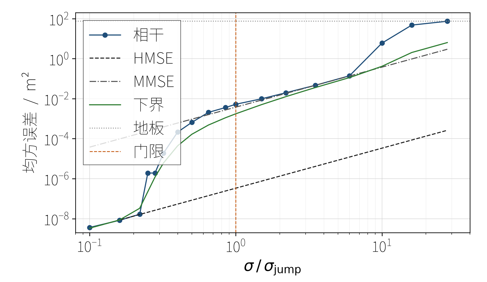
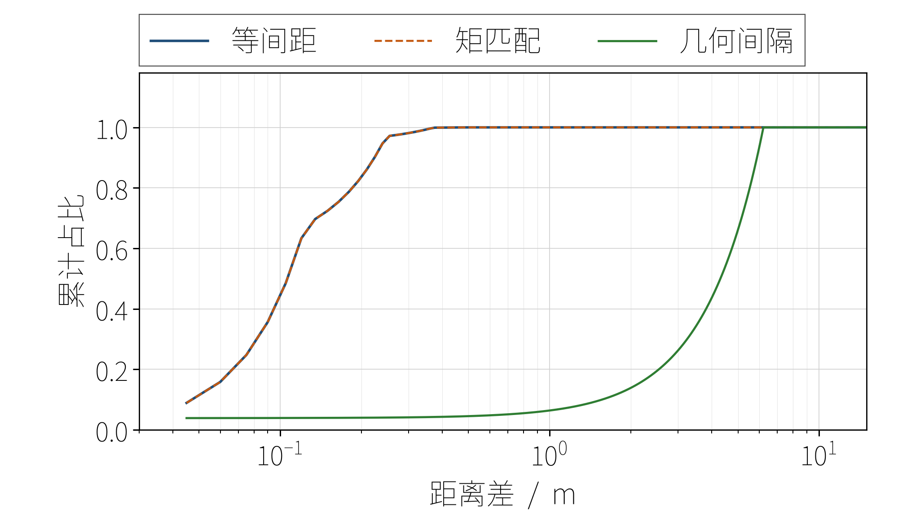
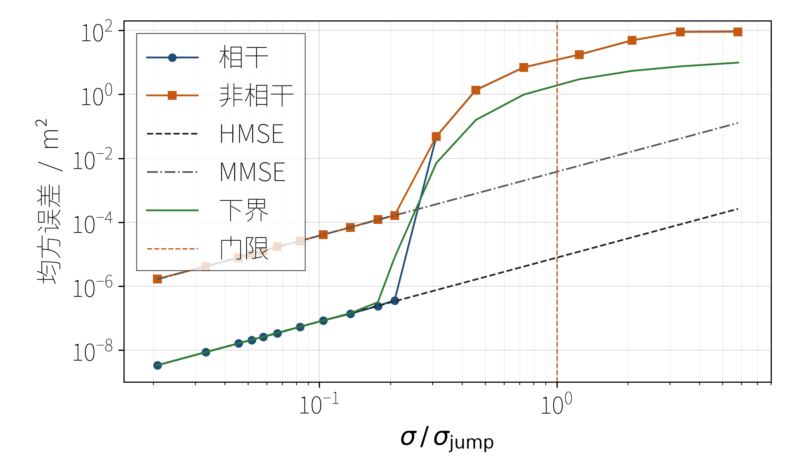

# 多频相位测距的门限

Range Estimation from Wrapped Multi-Frequency Phase Observations

两条平行直线在何处分开，非等间隔又改写哪一跳。

研究笔记，2026 年 10 月。

## 1 问题在估计理论中的位置

在若干个频率上各测一个相位，再用这些相位估计距离，是干涉测距、多波长测量和步进频率测距共用的模型。第 \(i\) 个观测是

\[
\varphi_i = \mathrm{wrap}(2\pi f_i d/c + e_i), \qquad e_i \sim \mathcal{N}(0,\sigma^2),
\]

各 \(e_i\) 独立，\(c = 299\,792\,458\,\mathrm{m/s}\)，\(\mathrm{wrap}\) 把角度折回 \((-\pi,\pi)\)。相干估计使残差平方和最小，因而用得上相对同一本振的绝对相位。公共相位未知时，估计量改为最大化相量和的模，载频不再提供距离信息。

### 1.1 与单音频率估计是同一类门限

双对数图上，普通线性估计的均方误差随噪声成直线。这个模型在高信噪比和中等信噪比各有一条斜率相同的直线，中间几乎垂直地跳起几十分贝。跳完以后沿上面那条直线走，直到相位本身开始折叠，误差才铺满搜索窗。

这一跳不是这个模型独有的。Rife 与 Boorstyn 在单音频率的极大似然估计里已经写出同一骨架：信噪比高时方差贴着克拉美–罗界，低于一道门限后估计量锁到错误的谱峰，方差离开该界。雷达模糊函数、Ziv 与 Zakai 的分辨下界、Weiss 与 Weinstein 的检验点下界，描述的是同一件事。局部界在高信噪比端是紧的；全局均方在一道门限上离开它。

李巍与齐望东给出了两条直线的高度，并指出第二道门限与频率怎样排列有关。他们的工具是微扰。他们没有把第一道门限写成频率集合的函数，也没有把“保持二次矩、只改间隔”和“远处出现同样深的谷”分开。

Weiss 与 Weinstein 在连续时间、平坦谱的时延估计里看到三个信噪比区域，中间一区相对载频界抬高约 \(12(\omega_0/W)^2\)。那个因子是下面等间距公式在频点很多时的极限。观测是连续波形，不是有限个包裹相位。

### 1.2 这个模型上已经算清的三件事

第一，两条直线的高度由两个二次矩决定。记 \(F = \sum_i f_i^2\)，\(S = \sum_i (f_i - \bar f)^2\)。载频直线与带宽直线之比 \(R = F/S\) 不随噪声改变，所以双对数图上它们平行。

第二，第一道门限的相位尺度是 \(\sigma_{\mathrm{jump}} = \pi\sqrt{S}/\bar f\)。它是“错一个平均波长”这个高斯检验的尺度，不是一条对一切估计量都成立的定理。

第三，非等间隔并不自动取消这一跳。只有远处出现代价与平均波长处相当的深谷时，平台才会消失，错误的距离也不再是一个波长。

有限样本的全局极大似然均方没有闭式。下面给出的是门限的相位尺度、谷填充下界，以及这批试验与二者的对照。下界是界。混合公式的脚是方程的解，不是从曲线上量出来的膝。

## 2 已经成立的结论

### 2.1 两条直线

噪声很小、误差还没有跨进下一个折叠时，相干估计的均方是载频直线

\[
\mathrm{HMSE} = \frac{c^2\sigma^2}{4\pi^2 F}.
\]

公共相位被消去以后，信息只留在间距上，均方成为带宽直线

\[
\mathrm{MMSE} = \frac{c^2\sigma^2}{4\pi^2 S}.
\]

李巍与齐望东的式 (30) 与式 (42) 分别是这两条直线。二者都正比于 \(\sigma^2\)。

\(N\) 个等间距频点、带宽 \(B = (N-1)\Delta f\) 时，

\[
R = 1 + \frac{12(N-1)}{N+1}\left(\frac{\bar f}{B}\right)^2.
\]

\(N\) 很大时，系数趋于 12，主导项就是 \(12(\bar f/B)^2\)。离散频点并没有一块连续的平坦频谱，只是二次矩在这个极限下算成了同一个数。\(N = 8\) 时系数是 9.33 而不是 12。同一 \(\bar f/B\) 下，连续谱公式大约高 1.1 分贝。

本文的等间距例子是 2400 到 2470 MHz、间隔 10 MHz。平均频率 2435 MHz，带宽 70 MHz，\(S = 4200\,\mathrm{MHz}^2\)，\(R = 11295\)，即 40.53 分贝。平均波长 \(\lambda = 0.12312\,\mathrm{m}\)。

往返传播把相位写成 \(4\pi f d/c\)，等价于把观测式里的 \(c\) 换成 \(c/2\)。波长和模糊周期缩小一半，两条均方都除以 4。\(\sigma_{\mathrm{jump}}\) 用频率比写出，弧度值不变。

### 2.2 门限与混合预测

距离差取成平均波长时，折叠去掉整周，剩下的相位向量长度为 \(2\sigma_{\mathrm{jump}}\)。因此

\[
\sigma_{\mathrm{jump}} = \pi\sqrt{S}/\bar f.
\]

等间距例子是 0.0836 rad，约 4.8 度。在这个噪声上，单次相位读数远没有折到 \(\pm\pi\)。折叠发生在距离假设跨过一个载频周期的时候。

两个距离相差 \(\delta\) 时，把相位差向量当作高斯观测来判决，错误概率是

\[
P_e(\delta) = Q\bigl(\sqrt{J(\delta)}/(2\sigma)\bigr),
\]

\(J(\delta)\) 是该距离差上的相位代价，\(Q\) 是标准正态的右尾。在平均波长处，自变量正好是 \(\sigma_{\mathrm{jump}}/\sigma\)。噪声等于门限时，向左右各错一个波长的概率合起来是 \(2Q(1) = 0.317\)。

这个 \(P_e\) 是高斯向量检验，不是包裹以后的似然比。主瓣附近、残差远小于 \(\pi\) 时，两者接近。残差接近 \(\pi\) 的那些谷，留到第 5 章。

一次试验以概率 \(p = 2Q(\sigma_{\mathrm{jump}}/\sigma)\) 滑出一个波长，否则留在主瓣。混合预测是

\[
\mathrm{MSE} \approx (1-p)\,\mathrm{HMSE} + p\lambda^2.
\]

令 \(p\lambda^2 = \mathrm{HMSE}\)，等间距这组解出 \(\sigma = 0.0170\,\mathrm{rad}\)，即 \(0.204\,\sigma_{\mathrm{jump}}\)。这是公式的脚，不是试验曲线的膝。8000 次试验期望看见一次滑移的位置约在 \(0.26\,\sigma_{\mathrm{jump}}\)。

在门限上还有一个直接换算。\(\sigma = \sigma_{\mathrm{jump}}\) 时 \(\lambda^2 = 4\,\mathrm{MMSE}\)。若 \(p = 0.317\)，则 \(p\lambda^2\) 比带宽直线高 1.0 分贝。

### 2.3 等间距试验看见的上升

相干估计在以真值 12.345 m 为中心、半长 14.990 m 的窗里搜索。0.22 到 0.50 倍门限每个噪声点 8000 次，其余 1600 次。滑移指误差绝对值超过半个平均波长。

0.10 与 0.22 倍门限上滑移为零，样本均方与载频直线相差 0.3 分贝以内。0.25 倍处 8000 次中有一次滑移，样本均方升到 −57.2 分贝。一次一个波长的错误在 8000 次里的贡献也是 −57.2 分贝。这个点是一次大误差把样本均值抬起来，不是一条中间的渐近线。

从 0.25 倍到 1 倍门限，样本均方等于滑移率乘以 \(\lambda^2\)，差在 0.1 分贝以内。门限上滑移率 0.344，样本均方 −22.8 分贝，带宽直线 −24.2 分贝，高出 1.4 分贝，与 0.317 所预测的 1.0 分贝同向。1.5 倍以后，一部分滑移长于一个波长，样本均方开始高于这个乘积。图 1 是这条曲线。

图 1　等间距八个频点的均方误差，横轴用 \(\sigma_{\mathrm{jump}} = 0.0836\,\mathrm{rad}\) 归一。相干估计离开载频直线后贴上带宽直线。绿色曲线是搜索半窗上的下界，橙色竖线在门限处。

非相干估计从最低噪声起就在带宽直线上。0.10 倍门限处它是 −44.4 分贝，带宽直线是 −44.2 分贝。它是 \(\sigma_{\mathrm{jump}}\) 并非一切估计量之门限的例子：公共相位一开始就把载频消掉，下面没有另一条更低的直线。

### 2.4 局部信息不跳，下界先离开

单个包裹正态相位关于它自己的信息是 \(\sigma\) 的光滑函数。距离的局部克拉美–罗界跟着载频走，不跳。等间距这组上，它到 \(\sigma = 0.84\,\mathrm{rad}\) 仍与载频直线相差 0.03 分贝。跳跃是全局估计量离开了主瓣。

半窗上的 Ziv–Zakai 下界是

\[
\mathrm{ZZB} = \frac{1}{L}\int_0^L \delta\, G[(L-\delta)P_e(\delta)]\,\mathrm{d}\delta,
\]

\(L = 14.990\,\mathrm{m}\)，\(G\) 把加权错误概率曲线上的洼地填平，\(P_e\) 仍用上面的高斯向量检验。高信噪比时，主瓣贡献的积分恒等于 \(1/4\)，下界回到载频直线。等间距在 \(\sigma = 0.008\,\mathrm{rad}\) 上，两者之差是 0.00 分贝。对积分有贡献的距离差大约只有 0.5 mm。

下界是真值在半窗上均匀分布时的贝叶斯风险。试验是真值固定在窗中心。在门限上，下界 −27.6 分贝，带宽直线 −24.2 分贝，相干试验 −22.8 分贝。0.22 倍门限处试验仍没有滑移，下界已经比载频直线高约 3 分贝。下界先离开，试验后离开。它约束均方，不是膝。

半窗先验方差是 12.7 分贝。试验地板来自整段搜索窗 29.979 m，为 18.74 分贝。\(\sigma = 2.34\,\mathrm{rad}\) 时等间距下界是 8.1 分贝，还没有贴到先验方差。整段模糊周期上的下界会被周期远端的复制谷抬高，本文不使用那一条。

第二道门限是另一件事。\(\sigma\) 到 1 弧度量级时，相位边缘自己失效，必须回到复观测。等间距相干试验在 \(\sigma = 0.50\,\mathrm{rad}\) 仍贴着带宽直线，到 \(\sigma = 2.34\,\mathrm{rad}\) 才落到 18.7 分贝的窗地板。这道门限移动的是地板何时到来，不是 \(\sigma_{\mathrm{jump}}\)。

## 3 非等间隔与积分落在哪一个谷

### 3.1 三个旋钮

频率集合上有三件可以分别拧的事，彼此不能替代。

\(S/\bar f^2\) 决定第一道门限的相位尺度，也决定两条直线的垂直间隔。把频点从平均频率两侧拉开，这一跳变矮，并且移到更大的相位噪声上。

每个深谷的代价 \(J(\delta)\) 和距离平方 \(\delta^2\) 决定平台还在不在，以及滑错以后的代价是一个波长的平方还是数米的平方。\(J(\delta)\) 与 \(J(\lambda)\) 相当时，滑过去的概率与错一个波长相同。

频点的最大公约数决定所有相位同时回到整周的精确周期，也就是无模糊距离。互素或中国余数式的排频只移动这一个周期。

### 3.2 矩匹配不改第一道门限

第二组保持与等间距相同的个数、平均频率和间距二次矩，频点取整数兆赫，间隔的最大公约数是 1 MHz，精确周期约 300 m。八个频点为 2390、2418、2425、2432、2443、2449、2454、2469 MHz。\(R\) 与 \(\sigma_{\mathrm{jump}}\) 因此与等间距相同。

在 \(\sigma = 0.0836\,\mathrm{rad}\) 上，半窗积分的分段与等间距相同。2 m 以内的代价也重合。只把等间隔改成不等间隔、同时保持二次矩，取消不了这一跳。两组的差别要到更大的噪声才出现。

### 3.3 一段谷贡献多少

谷填充不是把每个谷的错误概率加起来。从右向左看，加权错误概率 \((L-\delta)P_e(\delta)\) 每创一次新高，这个谷才负责它左侧、直到上一个更高记录之间的那一段。右端为 \(\delta_a\)、左端为 \(\delta_b\) 时，贡献是

\[
\frac{L-\delta_a}{L}\, P_e(\delta_a)\, \frac{\delta_a^2-\delta_b^2}{2}.
\]

左端若接上主瓣，\(\delta_b\) 取 \(\sqrt{J(\delta_a)}/\beta\)，其中 \(\beta = 2\pi\sqrt{F}/c\)。等间距在门限上，这条边界只有 1.2 mm。

在 \(\sigma = 0.0836\,\mathrm{rad}\) 上，平均波长那一段贡献 −29.2 分贝，二倍波长 −32.9 分贝，三倍波长 −43.0 分贝。三段相加 −27.6 分贝，与半窗数值积分相同。按数值积分来分，平均波长的谷占 67%，二倍波长占 29%。更远的谐波几乎不进积分：代价按谐波次数的平方变深，错误概率掉得比距离平方的增长更快。

几何间隔不是这样。它的远谷填不满主瓣，因为 \((L-\delta)\) 更小，加权错误概率低于平均波长处。它负责的是从平均波长一直延伸到该谷的长段。图 2 把这一差别画在同一个噪声上。等间距与矩匹配在 0.25 m 以内积满，两条曲线叠在一起。几何间隔要到 6.21 m 才积满。

图 2　半窗下界沿距离的累计占比，噪声取等间距门限 0.0836 rad。等间距与矩匹配在 0.25 m 以内积满。几何间隔要到 6.21 m 才积满。

### 3.4 几何间隔拿掉平台

第三组是公比 1.02 的等比频率，中心取 2435 MHz，算术平均 2437.5 MHz。\(S\) 约为等间距的 23 倍，\(R\) 降到 26.87 分贝，\(\sigma_{\mathrm{jump}}\) 升到 0.403 rad。平均波长仍是 0.1230 m。这是 \(S/\bar f^2\) 的变化：第一道门限的相位尺度变大，两条直线的间隔变矮。

6.211 m 处的谷底代价是 0.650，与平均波长处的 0.650 相同。八个相位残差的绝对值都不超过 0.44 rad。这是一个深旁瓣，不是所有频点同时回到整周。距离约为平均波长的 50 倍，平方误差约高 34 分贝。滑过去的概率与错一个波长相同，错的距离则不是一个波长。

因为 \((L-6.211\,\mathrm{m})\) 更小，这个远谷的加权错误概率低于平均波长谷，填不满主瓣。它拥有的区间是从平均波长到 6.211 m。这一段占半窗积分的 96%。质量沿这段铺开：一半在 4.3 m 以外，九成在 5.9 m 以内，不是 6.211 m 上的一个尖峰。半窗下界因此是 −51 分贝，载频直线仍是 −64.8 分贝。

噪声的绝对值与等间距试验相同，所以 \(\sigma = 0.0836\,\mathrm{rad}\) 只是几何间隔自身门限的 0.21 倍。该点相干试验仍在载频直线上，−64.5 分贝；下界已经是 −51 分贝。到自身门限的 0.31 倍，相干与非相干都到了 −13.2 分贝，滑移率只有 0.0031。同样的滑移率若都落在一个波长上，均方只有约 −43 分贝。\(0.0031\times(6.21\,\mathrm{m})^2\) 约是 −9 分贝，与 −13 分贝同一量级。平台消失。用平均波长算出的脚在 0.0967 rad，只预告概率何时起来，不预告误差有多远。图 3 是这组曲线。

图 3　几何间隔的均方误差。横轴用这一组自己的门限 0.403 rad 归一。相干估计离开载频直线后越过带宽直线，中间没有平台。绿色曲线是搜索半窗上的下界。

三组的二次矩与门限如下。

| 设计 | 平均频率 | 间距二次矩 | 间隔 | 门限 |
| --- | --- | --- | --- | --- |
| 等间距 | 2435 MHz | 4200 MHz² | 40.53 dB | 0.0836 rad |
| 矩匹配 | 2435 MHz | 4200 MHz² | 40.53 dB | 0.0836 rad |
| 几何间隔 | 2437.5 MHz | \(9.78\times 10^4\) MHz² | 26.87 dB | 0.403 rad |

表 1　三组频点。矩匹配与等间距共用平均频率、间距二次矩和门限。几何间隔的 \(S\) 更大，门限更高，直线间隔更矮。

### 3.5 更大噪声上的一串谷

矩匹配与等间距要到相位噪声再大一个量级才分开。\(\sigma = 0.836\,\mathrm{rad}\) 时，半窗下界分别是 −2.4 与 −3.8 分贝。矩匹配在 10.6 到 11.3 m 有一串谷，谷底代价约 14；等间距在同一段约 25。这一串里加权错误概率最高的一点在 10.65 m，单独占矩匹配积分的 29%。去掉这一段，下界从 −2.4 分贝落到约 −3.9 分贝，与等间距的 −3.8 分贝相符。窗内最深的谷并不在 10.65 m，而在稍远的 11.0 m；\((L-\delta)\) 偏向更近的那一个，所以创纪录的是 10.65 m。近处的谷没有造成这 1.4 分贝。这些谷的代价约是 14，不是 0，所以也不是精确的整周重合。

## 4 工程上可以定下的规则

第一道门限处，相位边缘仍然成立。等间距这组的 \(\sigma_{\mathrm{jump}}\) 是 0.084 rad。\(\sigma\) 到 1 弧度量级时，相位边缘自己失效，预算必须回到复观测。那是第二道门限，不要和第一道混用。

有公共相位参考时，工作点要在约 \(0.2\,\sigma_{\mathrm{jump}}\) 以下，载频直线才是该用的预算。等间距这组对应的相位标准差约为 1 度，即 0.017 rad。大约 \(0.5\,\sigma_{\mathrm{jump}}\) 到相位开始折叠之前，预算改用带宽直线。这一组因此比载频直线差 40.53 分贝。没有公共相位时，高信噪比预算直接就是带宽直线，平行的那一跳没有落点。远处若还有与 \(J(\lambda)\) 相当的深谷，公共相位未知只取消载频直线，取消不了那一段上升。

设计频点时，对每一个深谷解 \(P_e(\delta)\,\delta^2 = \mathrm{HMSE}\)，取最早的那个 \(\sigma\)，不要只报 \(\sigma_{\mathrm{jump}}\)。等间距上，这个方程的解与 \(0.20\,\sigma_{\mathrm{jump}}\) 重合，因为危险谷就在平均波长上。几何间隔上，远谷把下界抬得更早：在自身门限的 0.21 倍，下界已经是 −51 分贝，载频直线仍是 −64.8 分贝。一次没有被发现的滑移，概率与错一个波长相同，均方约差 34 分贝。

三个旋钮按上一章分开考核。拉开 \(S/\bar f^2\) 改变的是第一道门限和直线间隔。深谷的 \(J(\delta)\) 与 \(\delta^2\) 改变的是平台和滑错的距离。最大公约数改变的是无模糊距离。用更长的精确周期去推迟第一道门限，拧的是第三个旋钮，第一个不动。

## 5 随后要回答的问题

下面五件事都已经有明确的完成标准。做完其中一件，就回答一个现在还开着的问题。有限样本的全局包裹最小二乘仍然不必追求闭式。

### 5.1 按最坏的谷排频点

在带宽、\(N\) 和合成器步长（整数兆赫）的约束下，使“最早离开载频直线的那个 \(\sigma\)”尽量大，同时不留下 \(J(\delta)\approx J(\lambda)\) 且 \(\delta\) 远大于 \(\lambda\) 的谷。完成的标准是：一组频点，其第一道门限晚于等间距，并且没有任何一个谷在远大于平均波长的距离上达到与 \(J(\lambda)\) 相当的深度。矩匹配已经说明，二次矩不变时只打乱间隔没有用。要动的是 \(S\) 和那些深谷的位置，两件一起看。

### 5.2 同一先验下比较贝叶斯均方

在门限上，半窗下界是 −27.6 分贝，相干试验是 −22.8 分贝，大约差 5 分贝。下界是半窗均匀先验下的贝叶斯风险，试验是窗中心的条件均方。要判断这 5 分贝是界松了还是估计量次优，必须在同一个先验下计算后验均值的均方，并与相干极大似然比较。完成的标准是：同一先验、同一噪声网格上的两条均方曲线，以及门限处差值的归属。这也回答整周模糊的整数最小二乘、或对模糊边沿积分，是否值得做。

### 5.3 只在残差接近半周的谷上换似然比

高斯向量检验在残差远小于 \(\pi\) 时是合适的近似。第一道门限上 \(\sigma = 0.08\,\mathrm{rad}\)，几何间隔 6.211 m 的残差也不超过 0.44 rad，这两处都不是可疑的地方。可疑的是 \(\sigma = 0.836\,\mathrm{rad}\) 时 10.6 到 11.3 m 那一串谷，残差可以到大约 2.5 rad。完成的标准是：只在这一串谷上，用包裹以后的似然比代替高斯向量检验，看矩匹配与等间距那 1.4 分贝的下界差是否移动。不必先把所有距离上的错误概率都改写成包裹形式。

### 5.4 在复观测上只复核第一道门限

相位模型是复观测 \(y_i = \exp(\mathrm{j}\, 2\pi f_i d/c) + n_i\) 的高信噪比边缘。第一道门限处这个边缘成立。完成的标准是：在同一组等间距频点上，用相干极大似然直接处理复观测，核对第一道门限是否仍在 \(\sigma_{\mathrm{jump}}\) 附近。预期是第一跳不变，地板和第二道门限会动。幅度衰落、各频点信噪比不同、以及共用本振带来的相关相位噪声，是预算上的修正，放在这次核对之后。

### 5.5 滑移长于一个波长以后的二次矩

\(1.5\,\sigma_{\mathrm{jump}}\) 以后，等间距的样本均方高于滑移率乘以 \(\lambda^2\)，因为一部分错误长于一个波长。等间距的谷在 \(k\lambda\) 上，深度按 \(k^2\) 变化，可以用 \(\delta^2\) 与 \(Q(k\sigma_{\mathrm{jump}}/\sigma)\) 对这些创纪录的谷加权。非等间隔则用第 3 章谷段公式里那些创纪录的谷，而不是整数倍波长。完成的标准是：在 1.5 倍门限以远，这个加权与样本均方的差落到比现在的 \(\lambda^2\) 乘积明显更小，并写明仍对不上的那一段。不追求全局包裹最小二乘的闭式。

### 5.6 两件不做的事

不把力气用在证明每一个估计量都在 \(\sigma_{\mathrm{jump}}\) 上跳跃。非相干估计从最低噪声起就在带宽直线上，已经是反例。门限是“错一个平均波长”这个检验的相位尺度，只对仍然用得上绝对载波相位的估计量有意义。

也不用中国余数定理或更长的精确周期去推迟第一道门限。那只移动无模糊距离。第一道门限由 \(\bar f\) 与 \(S\) 决定，远处深谷再按 \(J(\delta)\) 与 \(\delta^2\) 改写平台。

## 6 文献

李巍、齐望东，Optimization in Multi-Frequency Interferometry Ranging: Theory and Experiment，arXiv:1202.1424，2012。式 (30) 与式 (42) 分别对应本文的载频直线和带宽直线。他们给出两条直线的高度，并指出第二道门限与频率排布有关。工具是微扰。

A. Weiss 与 E. Weinstein，Fundamental Limitations in Passive Time-Delay Estimation，Part I（窄带，IEEE Transactions on Acoustics, Speech, and Signal Processing，1983）与 Part II（宽带，1984）。连续时间、平坦谱的时延估计分成三个信噪比区域，中间区域相对载频界抬高约 \(12(\omega_0/W)^2\)。该因子是等间距 \(R\) 在频点很多时的极限，观测模型不同。

J. Ziv 与 M. Zakai，Some Lower Bounds on Signal Parameter Estimation，IEEE Transactions on Information Theory，1969。本文的下界用他们的分辨思想，并加上谷填充。成对错误概率取自高斯相位向量检验。

D. C. Rife 与 R. R. Boorstyn，Single-Tone Parameter Estimation from Discrete-Time Observations，IEEE Transactions on Information Theory，第 20 卷，第 5 期，第 591–598 页，1974。单音频率的极大似然估计在一道信噪比门限之下离开克拉美–罗界。那是同一类门限，参数是频率而不是距离，观测也不是一组包裹相位。
