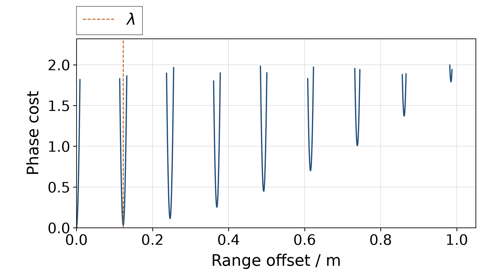
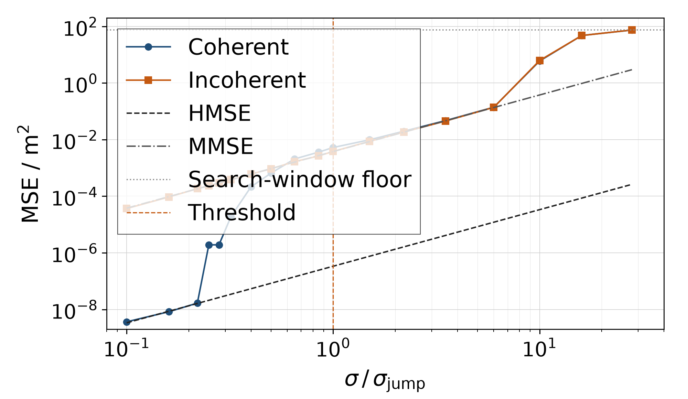
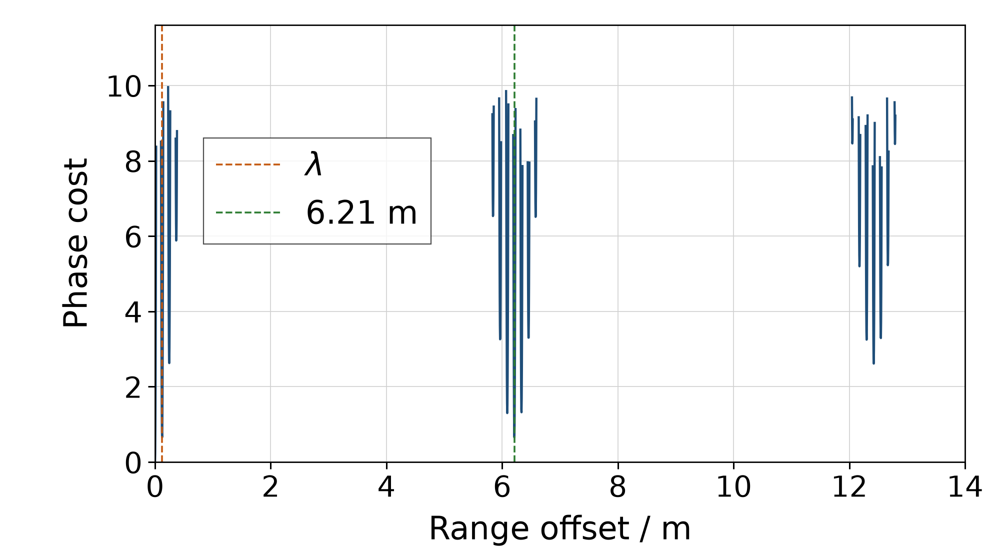

# 多频相位测距的门限

2026 年 10 月

## 1 观测模型

在 \(N\) 个频率 \(f_1,\dots,f_N\) 上各测一个相位，用这些相位估计距离 \(d\)。第 \(i\) 个频率上的读数是

\[
\varphi_i = \mathrm{wrap}(2\pi f_i d/c + e_i), \qquad e_i \sim \mathcal{N}(0,\sigma^2),
\]

各 \(e_i\) 独立，\(c = 299\,792\,458\,\mathrm{m/s}\)。\(\mathrm{wrap}\) 把角度对 \(2\pi\) 取模，取值在 \((-\pi,\pi]\) 内。

真实相位 \(2\pi f_i d/c\) 是若干整周加一个零头，读数只留下零头。距离改变 \(\delta\) 时，第 \(i\) 个读数转过 \(2\pi f_i\delta/c\)；如果每个频率转过的角度都接近整周，所有读数几乎不变，\(d\) 与 \(d+\delta\) 就难以区分。记平均频率为 \(\bar f\)，平均波长为 \(\lambda = c/\bar f\)。\(\delta = \lambda\) 时，第 \(i\) 个读数转过 \(2\pi + 2\pi(f_i-\bar f)/\bar f\)，只比整周多出一个小角度，频点越靠近平均频率，这个角度越小；所有 \(f_i\delta/c\) 恰好都是整数时，读数完全不变。所以有限个包裹相位只能把距离确定到一组别名为止：平均波长整数倍附近的近似别名，以及由频率的最大公约数决定的精确周期。

相干估计最小化包裹残差的平方和：

\[
\hat d = \arg\min_{d} \sum_i \mathrm{wrap}\bigl(\varphi_i - 2\pi f_i d/c\bigr)^2 .
\]

\(\sigma\) 远小于 \(\pi\) 时，包裹正态密度在主值区间内与正态密度只差可以忽略的项，这个最小化就是极大似然估计。它使用各频点相对同一本振的绝对相位，载频因此进入距离信息。

若各频点还共有一个未知相位（例如收发两端没有公共相位参考），这个相位必须消去。非相干估计最大化相量和的模：

\[
\hat d_{\mathrm{inc}} = \arg\max_{d} \Bigl|\sum_i e^{\mathrm{j}(\varphi_i - 2\pi f_i d/c)}\Bigr| .
\]

所有相量同乘一个 \(e^{\mathrm{j}\theta}\) 不改变模，所以公共相位不影响它。载频项 \(2\pi\bar f d/c\) 在各频点上也是同一个常数，与公共相位分不开，随它一起消去；剩下的距离信息只来自 \(f_i-\bar f\)，即频率间距。

以下各节把这个模型下相干估计的均方误差随 \(\sigma\) 增大的变化逐项理清。用到的都是参数估计里现成的工具：包裹极大似然、Fisher 信息与克拉美–罗界、两假设检验与 Ziv–Zakai 下界、滑移的混合近似，以及三组频点上的归档试验。

## 2 现象：两条平行直线与一跳

取 2400 到 2470 MHz、间隔 10 MHz 的八个频点（下称等间距例子），在一组 \(\sigma\) 上重复试验，记录相干估计的样本均方误差，得到图 1。横轴是 \(\sigma\) 与第 3 节导出的尺度 \(\sigma_{\mathrm{jump}} = 0.0836\,\mathrm{rad}\) 之比。图中下面的黑色虚线是载频直线 HMSE（high-SNR mean-square error，高信噪比区间的均方误差），上面的灰色点划线是带宽直线 MMSE（moderate-SNR mean-square error，中等信噪比区间的均方误差，不是最小均方误差）。

图 1　等间距八个频点上相干估计的均方误差。蓝色圆点是试验，每点 1600 或 8000 次，随机种子 7；黑色虚线是载频直线（HMSE），灰色点划线是带宽直线（MMSE）；绿色曲线是半窗 Ziv–Zakai 下界（第 5 节），灰色点线是搜索窗地板，橙色竖线标出 \(\sigma = \sigma_{\mathrm{jump}}\)。

从左往右读这张图。\(\sigma\) 不超过 \(0.22\,\sigma_{\mathrm{jump}}\) 时，圆点落在载频直线上：每个频率上的整周都判对了，载频本身在测距离。\(\sigma\) 再增大不到三倍，到约 \(0.65\,\sigma_{\mathrm{jump}}\)，圆点几乎垂直地升到带宽直线上；从那里到 \(6\,\sigma_{\mathrm{jump}}\)，它比带宽直线最多高 1.4 分贝。这一段里整周已不可靠，能用的只剩频率间距。两条直线平行，相距 40.53 分贝。\(\sigma\) 继续增大，均方离开带宽直线，升到搜索窗地板，即估计不再携带信息、误差在整个搜索窗上均匀分布时的均方。按噪声增大的顺序，前面那一跳是第一道门限，这里是第二道门限，出现在相位噪声到 \(1\,\mathrm{rad}\) 量级时。上面的相位模型是复观测 \(y_i = \exp(\mathrm{j}\,2\pi f_i d/c) + n_i\) 在高信噪比下的极限，到 \(1\,\mathrm{rad}\) 量级，这个极限本身也不再成立，第二道门限的预算要回到复观测；这里只记下它的位置。

要理清的就是这个现象：相干均方先沿载频直线，再在一段不宽的噪声范围里跳到与之平行的带宽直线上。两条直线的高度已有现成的结果；这一跳发生在多大的 \(\sigma\) 上、由频率集合的什么量决定、能否靠排频推迟，是后面几节的内容。

两条直线的高度来自主瓣内的线性最小二乘。主瓣指真值附近、还没有跨到相邻别名的那一段。误差留在主瓣内时，包裹可以去掉：以相位对频率作图，相干估计拟合一条过原点的直线，斜率给出距离；非相干估计多拟合一个截距，即公共相位。记 \(F = \sum_i f_i^2\)，\(S = \sum_i (f_i-\bar f)^2\)，两条均方是

\[
\mathrm{HMSE} = \frac{c^2\sigma^2}{4\pi^2 F}, \qquad \mathrm{MMSE} = \frac{c^2\sigma^2}{4\pi^2 S}.
\]

\(F\) 主要来自载频，\(S\) 只取决于频点围绕平均频率的分布，两条直线因此称为载频直线与带宽直线。二者都正比于 \(\sigma^2\)，比值 \(R = F/S\) 与 \(\sigma\) 无关，所以在双对数图上平行。拟合截距相当于先减去平均频率：\(F = S + N\bar f^2\)，于是 \(R = 1 + N\bar f^2/S\)。等间距例子里 \(\bar f = 2435\,\mathrm{MHz}\)，\(S = 4200\,\mathrm{MHz}^2\)，\(R = 11295\)，即 40.53 分贝；平均波长 \(\lambda = 0.12312\,\mathrm{m}\)。

这两条高度是李巍与齐望东用微扰分析得到的式 (30) 与式 (42)，HMSE 与 MMSE 两个名称也取自他们。他们称这一现象为双门限效应，按信噪比升高的方向编号，把从 MMSE 落到 HMSE 的过渡称为第二道门限，即这里的第一道门限。他们没有把这一过渡所在的噪声写成频率集合的函数。

连续时间的被动时延估计里有同样的三段。Weinstein 与 Weiss 用改进的 Ziv–Zakai 下界得到：高信噪比时下界与克拉美–罗界重合，中等信噪比时高出 \(12(\omega_0/W)^2\) 倍（\(\omega_0\) 为中心频率，\(W\) 为带宽），低信噪比时趋于只由先验区间决定的常数。\(N\) 个等间距频点、带宽 \(B = (N-1)\Delta f\) 时，

\[
R = 1 + \frac{12(N-1)}{N+1}\left(\frac{\bar f}{B}\right)^2 ,
\]

\(N\) 很大时系数趋于 12，与他们的因子相同。那是另一种观测模型取到的同一极限，离散的包裹相位并不等同于连续平坦谱：\(N = 8\) 时系数是 9.33，比同一 \(\bar f/B\) 下的连续谱值低约 1.1 分贝。

## 3 第一道门限的相位尺度

### 3.1 相位尺度 \(\sigma_{\mathrm{jump}}\)

两个距离假设相差 \(\delta\) 时，第 \(i\) 个频率上的相位差是 \(2\pi f_i\delta/c\)。记包裹后相位差向量的平方长度为

\[
J(\delta) = \sum_i \mathrm{wrap}(2\pi f_i\delta/c)^2 .
\]

\(J(0) = 0\)。\(J\) 在 \(\delta \neq 0\) 处的局部极小称为谷；谷底的 \(J\) 越小，相距 \(\delta\) 的两个距离越难区分。图 2 是等间距例子的 \(J(\delta)\)。

图 2　等间距例子的 \(J(\delta)\)（单位 rad²），只画出 \(J \le 2\) 的部分；橙色竖线是平均波长 \(\lambda\)。谷位于 \(\lambda\) 的整数倍附近，第 \(k\) 个谷底的 \(J\) 约为 \(k^2 J(\lambda)\)。平均波长处的谷底 \(J = 0.028\)，在这个纵轴上几乎贴着零。

取 \(\delta = \lambda\)。第 \(i\) 个分量是 \(2\pi f_i/\bar f = 2\pi + 2\pi(f_i-\bar f)/\bar f\)，去掉整周后剩下 \(2\pi(f_i-\bar f)/\bar f\)，所以 \(\sqrt{J(\lambda)} = 2\pi\sqrt{S}/\bar f\)。记

\[
\sigma_{\mathrm{jump}} = \pi\sqrt{S}/\bar f ,
\]

则 \(\sqrt{J(\lambda)} = 2\sigma_{\mathrm{jump}}\)。

把相位差向量当作高斯观测来判决两个假设，错误概率是

\[
P_e(\delta) = Q\bigl(\sqrt{J(\delta)}/(2\sigma)\bigr),
\]

\(Q\) 是标准正态分布的右尾概率。在 \(\delta = \lambda\) 处，自变量正好是 \(\sigma_{\mathrm{jump}}/\sigma\)：\(\sigma_{\mathrm{jump}}\) 是区分相距一个平均波长的两个距离时的噪声尺度。\(\sigma = \sigma_{\mathrm{jump}}\) 时，向两侧各错一个波长的概率合计 \(2Q(1) = 0.317\)。平均波长附近的谷底在 \(\delta = \lambda(1-1/R)\)，那里 \(J = (1-1/R)\,J(\lambda)\)，与 \(J(\lambda)\) 只差 \(1/R\)。

由 \(F = S + N\bar f^2\) 还得到 \(R = 1 + N\pi^2/\sigma_{\mathrm{jump}}^2\)：门限的相位尺度与两条直线的间隔由同一个量 \(S/\bar f^2\) 决定。

等间距例子里 \(\sigma_{\mathrm{jump}} = 0.0836\,\mathrm{rad}\)，约 4.8 度。在这个噪声上，单个读数离 \(\pm\pi\) 还很远；包裹起作用，是因为距离假设跨过了一个载频周期，而不是某个读数被折回。

这个 \(P_e\) 来自高斯向量检验，不是包裹以后的似然比。残差远小于 \(\pi\) 时两者接近；残差接近 \(\pi\) 的谷在 6.3 节出现。

往返测距的相位是 \(4\pi f d/c\)，相当于把 \(c\) 换成 \(c/2\)：波长与精确周期减半，两条均方直线都除以 4；\(\sigma_{\mathrm{jump}}\) 只依赖频率之比，弧度值不变。

### 3.2 混合近似离开载频直线的位置

设一次试验以概率 \(p = 2Q(\sigma_{\mathrm{jump}}/\sigma)\) 滑出一个波长，否则留在主瓣。均方的混合近似是

\[
\mathrm{MSE} \approx (1-p)\,\mathrm{HMSE} + p\lambda^2 .
\]

令 \(p\lambda^2 = \mathrm{HMSE}\)，等间距例子解出 \(\sigma = 0.0170\,\mathrm{rad}\)，即 \(0.204\,\sigma_{\mathrm{jump}}\)；混合近似在这里离开载频直线。在 \(\sigma = \sigma_{\mathrm{jump}}\) 处，\(\mathrm{MMSE} = c^2/(4\bar f^2) = \lambda^2/4\)；代入 \(p = 0.317\)，\(p\lambda^2\) 比带宽直线高 1.0 分贝。到了门限，仅一波长滑移就足以把均方抬到带宽直线的高度。

### 3.3 等间距试验

相干估计在以真值 12.345 m 为中心、半长 14.990 m 的搜索窗里取全局最小：先在步长 \(\lambda/8\) 的格点上取最小，再在该点附近迭代细化。窗长 29.979 m 正好是等间距例子的精确周期 \(c/\Delta f\)。0.22 到 0.50 倍门限的六个噪声点每点 8000 次，其余每点 1600 次，随机种子为 7，结果存于 [`computation/data/`](../computation/data/)。滑移指误差绝对值超过半个平均波长。下文的分贝值都相对 1 m²。

0.10 到 0.22 倍门限的三个噪声点上没有滑移，样本均方与载频直线相差不超过 0.35 分贝。0.25 倍处 8000 次中出现一次滑移，样本均方升到 −57.2 分贝；一个一波长的错误摊到 8000 次上，正好贡献 −57.2 分贝。试验曲线从哪里开始上升还取决于试验次数：8000 次里期望出现一次滑移要求 \(p = 1/8000\)，对应 \(0.26\,\sigma_{\mathrm{jump}}\)。这一点的上升来自单个大误差，不是两条直线之间的另一条渐近线。

从 0.25 倍到 1 倍门限，样本均方等于滑移率乘以 \(\lambda^2\)，误差在 0.1 分贝以内：这一段的均方几乎全部来自一波长滑移。门限上滑移率 0.344，样本均方 −22.8 分贝，比带宽直线（−24.2 分贝）高 1.4 分贝；混合近似用 \(p = 0.317\) 预测高 1.0 分贝，方向相同。1.5 倍门限以后，一部分滑移长于一个波长，样本均方开始高于滑移率乘以 \(\lambda^2\)。

## 4 局部信息不跳；非相干估计的反例

包裹正态相位关于其均值的 Fisher 信息是 \(\sigma\) 的光滑函数。由它得到的距离克拉美–罗界沿载频直线变化，不跳；等间距例子里，到 \(\sigma = 0.84\,\mathrm{rad}\) 它与载频直线仍只差 0.03 分贝。李巍与齐望东在复观测上也得到 HMSE 与克拉美–罗界重合。跳跃来自全局估计离开主瓣；Fisher 信息只描述真值附近似然的曲率，不涉及主瓣以外的谷，对这一跳它能说的只有这些。

单音频率的极大似然估计有同样的结构：Rife 与 Boorstyn 指出，高信噪比时方差与克拉美–罗界重合，信噪比低于一道门限后估计值落在错误的谱峰上。那里的参数是频率，观测也不是一组包裹相位。

非相干估计说明这一跳属于谁。它与相干估计用同样的观测、同样的频点，只是不用绝对载波相位。图 3 中，它从最低噪声起就在带宽直线上：0.10 倍门限处是 −44.4 分贝，带宽直线是 −44.2 分贝。公共相位一开始就把载频消去，它下面没有更低的直线可以离开，也就没有第一道门限。所以 \(\sigma_{\mathrm{jump}}\) 是使用绝对载波相位的估计量的门限，不是观测本身的性质；不存在「一切估计量都在 \(\sigma_{\mathrm{jump}}\) 上跳」的定理。

图 3　等间距例子中相干估计（蓝色圆点）与非相干估计（橙色方点）的均方误差，横轴以 \(\sigma_{\mathrm{jump}}\) 归一。非相干估计从最低噪声起就在带宽直线上；约 2 倍门限以后两条曲线几乎重合，10 倍门限处一起离开带宽直线。

## 5 半窗 Ziv–Zakai 下界

图 1 的绿色曲线在试验之前就离开了载频直线。它约束什么，不约束什么？

设真值在长 \(L\) 的区间上均匀分布。Ziv 与 Zakai 用区分两个假设的错误概率给估计误差定下界；Bellini 与 Tartara 在其中加入谷填充，均方下界是

\[
\mathrm{ZZB} = \frac{1}{L}\int_0^L \delta\, G\bigl[(L-\delta)\,P_e(\delta)\bigr]\,\mathrm{d}\delta,
\qquad G[h](\delta) = \max_{\eta\ge\delta} h(\eta),
\]

即 \(G\) 把函数换成自右向左的累积最大值。成对错误概率 \(P_e\) 仍用 3.1 节的高斯向量检验。任何估计量按这个先验平均后的均方都不低于 ZZB。这里取 \(L = 14.990\,\mathrm{m}\)，是搜索窗长度的一半，所以称为半窗下界：试验的误差不会超过半个窗长，而 \(L\) 若取整个周期，周期远端的复制谷会把下界抬高。

高信噪比时只有主瓣有贡献：\(\sqrt{J(\delta)} \approx \beta\delta\)，其中 \(\beta = 2\pi\sqrt{F}/c\)，积分化为 \((2\sigma/\beta)^2\int_0^\infty u\,Q(u)\,\mathrm{d}u\)。由 \(\int_0^\infty u\,Q(u)\,\mathrm{d}u = 1/4\)，下界等于 \(\sigma^2/\beta^2 = \mathrm{HMSE}\)。等间距例子在 \(\sigma = 0.008\,\mathrm{rad}\) 上，两者之差是 0.00 分贝，对积分有贡献的距离差只到约 0.5 mm。

### 5.1 逐谷分解

谷填充不是把各个谷的错误概率相加。按 \(G\) 的定义，自右向左读加权错误概率 \(h(\delta) = (L-\delta)P_e(\delta)\)：每出现一个新高点 \(\delta_a\)，它就决定左侧一整段的被积函数，直到左边第一个 \(h\) 更高的位置 \(\delta_b\)。这一段对下界的贡献是

\[
\frac{L-\delta_a}{L}\, P_e(\delta_a)\, \frac{\delta_a^2-\delta_b^2}{2}.
\]

左端落在主瓣上时，\(\delta_b \approx \sqrt{J(\delta_a)}/\beta\)。

等间距例子在门限 \(\sigma = 0.0836\,\mathrm{rad}\) 上，自右向左的新高点落在各个 \(k\lambda\) 谷上。贡献最大的三段来自一倍、二倍、三倍平均波长的谷，分别是 −29.2、−32.9 与 −43.0 分贝，三段相加 −27.6 分贝，与半窗数值积分相同。一倍波长一段的左端落在主瓣上，只有 1.2 mm。按数值积分划分，平均波长的谷占 67%，二倍波长占 29%。更远的 \(k\lambda\) 谷几乎不进入积分：第 \(k\) 个谷底的 \(J\) 按 \(k^2\) 增大，\(P_e\) 随之下降，远快于 \(\delta^2\) 的增长。

### 5.2 它约束什么，不约束什么

这个下界针对真值在半窗上均匀分布的先验；试验把真值固定在搜索窗中心，给出的是条件均方的样本估计。门限上，下界 −27.6 分贝，带宽直线 −24.2 分贝，相干试验 −22.8 分贝。

0.22 倍门限处，下界已经比载频直线高约 3 分贝（−74.8 分贝），8000 次试验却还没有滑移，样本均方 −77.8 分贝，在下界之下。两者并不矛盾：下界约束的是均方的期望。那里一波长滑移的概率约 \(5.5\times10^{-6}\)，8000 次中期望只有 0.04 次，多半一次也抽不到，样本均方因而低于期望；按混合近似，期望约为 −70.0 分贝，在下界之上。下界先离开载频直线、试验后离开，一部分原因就在试验次数。下界约束均方，不标出试验曲线的转折点。

噪声很大时，下界趋于半窗先验的方差 \(L^2/12\)，即 12.7 分贝；\(\sigma = 2.34\,\mathrm{rad}\) 时，等间距的下界是 8.1 分贝，仍低于这个值。估计不再携带信息、误差在整段搜索窗（29.979 m）上均匀分布时，均方是 18.74 分贝，即图 1 中的搜索窗地板。等间距相干试验在 \(\sigma = 0.50\,\mathrm{rad}\)（6 倍门限）仍在带宽直线上，在 \(\sigma = 0.84\,\mathrm{rad}\)（10 倍门限）已高出带宽直线约 12 分贝，到 \(\sigma = 2.34\,\mathrm{rad}\) 到达地板。这是第二道门限；它决定误差何时到达地板，不改变 \(\sigma_{\mathrm{jump}}\)。

门限上，下界与试验相差约 5 分贝。一个是先验平均的下界，一个是条件均方，两者不能直接相减；这 5 分贝属于界还是属于估计量，是第 8 节的开放问题之一。

## 6 非等间隔

把间隔做成不等，能改变什么？频率集合上有三个设计量，彼此不能替代。

1. \(S/\bar f^2\) 决定第一道门限的相位尺度，也决定两条直线的间隔（\(R = 1 + N\pi^2/\sigma_{\mathrm{jump}}^2\)）。频点从平均频率向两侧拉开，这一跳变矮，并移到更大的相位噪声上。
2. 每个深谷谷底的 \(J(\delta)\) 与距离 \(\delta\) 决定相干均方是否在带宽直线上停留，以及一次滑移的代价是一个波长的平方还是数米的平方。\(J(\delta)\) 与 \(J(\lambda)\) 相当时，滑到该谷的概率与错一个波长相同。
3. 频点的最大公约数决定所有相位同时回到整周的精确周期，即无模糊距离。互素或中国剩余定理式的排频只改变这个周期，不推迟第一道门限。间隔近似相等时留下的近似周期不属于这一项，它们表现为第二项里的深谷（6.2 节）。

### 6.1 保持 \(S\)：矩匹配

第二组频点与等间距的个数、平均频率和 \(S\) 都相同（下称矩匹配）：2390、2418、2425、2432、2443、2449、2454、2469 MHz。频点取整数兆赫，间隔的最大公约数是 1 MHz，精确周期约 300 m。\(R\) 与 \(\sigma_{\mathrm{jump}}\) 因而与等间距相同。

2 m 以内，两组的 \(J(\delta)\) 在 \(J \le 14\) 的部分完全重合：这一段的谷附近残差都不发生包裹，\(J\) 只由 \(N\)、\(\bar f\) 与 \(S\) 决定，而这三个量两组相同。在 \(\sigma = 0.0836\,\mathrm{rad}\) 上，半窗积分的分段也与等间距相同。只把等间隔改成不等间隔而保持 \(S\)，这一跳不会消失；两组的差别要到更大的噪声才出现（6.3 节）。

### 6.2 几何间隔：与一个波长同样深的远谷

第三组频点是公比 1.02 的等比数列，从 2272 到 2610 MHz，几何中心 2435 MHz，算术平均 2437.5 MHz。跨度约 338 MHz，是等间距例子的 4.8 倍；\(S\) 约为等间距的 23 倍，几乎全部来自更宽的跨度。\(R\) 降到 26.87 分贝，\(\sigma_{\mathrm{jump}}\) 升到 0.403 rad，平均波长仍是 0.1230 m。这是第一个设计量的变化：门限移到更大的相位噪声上，两条直线靠近。

变化同时落在第二个设计量上。图 4 是这组频点的 \(J(\delta)\)：6.211 m 处谷底的 \(J\) 是 0.650，与 \(J(\lambda) = 0.650\) 相同，八个相位残差的绝对值都不超过 0.44 rad。这个谷的来历是间隔：七个间隔在 45.4 到 51.2 MHz 之间，平均 48.26 MHz，而 \(c\) 除以 48.26 MHz 是 6.212 m；在 6.211 m 上，相邻频点之间的相位差都在 0.94 到 1.06 周之间。2% 的公比没有把这个近似周期打散。等间距例子的间隔是 10 MHz，同样的周期在 29.98 m，落在半窗之外。6.211 m 约为平均波长的 50 倍：滑过去的概率与错一个波长相同，平方误差却高约 34 分贝。

图 4　几何间隔的 \(J(\delta)\)，只画出 \(J \le 10\) 的部分。橙色竖线是平均波长，绿色竖线是 6.21 m，两处谷底都是 0.65；12.4 m 附近还有一簇谷，最深处约 2.6。

在半窗积分里，这个远谷的 \(L-\delta\) 较小，加权错误概率低于平均波长处，填不到主瓣；它决定的一段从平均波长一直延伸到 6.211 m，占积分的 96%。这一段的贡献沿距离分布：积分的一半来自 4.3 m 以外，九成来自 5.9 m 以内，并不集中在 6.211 m 一点。图 5 在等间距门限的噪声上比较三组频点的累计占比。在这个噪声上，几何间隔的半窗下界约为 −51 分贝，载频直线是 −64.8 分贝。

图 5　半窗下界沿距离的累计占比，噪声取等间距门限 0.0836 rad。等间距与矩匹配两条曲线重合，0.25 m 处积到 96%，0.4 m 以内积满；几何间隔（绿色）要到 6.21 m 才积满。

试验用的噪声与等间距是同一组绝对值，所以 \(\sigma = 0.0836\,\mathrm{rad}\) 只是几何间隔自身门限的 0.21 倍。这一点上相干样本均方是 −64.5 分贝，仍在载频直线上，而下界已是 −51 分贝。原因与 5.2 节相同：滑到 \(\pm 6.211\,\mathrm{m}\) 的概率约 \(1.4\times10^{-6}\)，1600 次试验抽不到。到自身门限的 0.31 倍，相干与非相干估计的样本均方都到了约 −13 分贝（−13.2 与 −13.1），比这组的带宽直线（−34.4 分贝）高约 21 分贝，而滑移率只有 0.0031。同样的滑移率若都落在一个波长上，均方约为 −43 分贝；\(0.0031\times(6.21\,\mathrm{m})^2\) 约为 −9 分贝，与 −13 分贝同一量级。相干均方离开载频直线以后不在带宽直线上停留。用平均波长算出的混合离开点是 0.0967 rad，它给出滑移开始出现的噪声，不给出滑错的距离。图 6 是这组曲线。

图 6　几何间隔的均方误差，横轴以这一组自身的门限 0.403 rad 归一。黑色虚线是载频直线，灰色点划线是带宽直线，绿色曲线是半窗下界。相干估计（蓝色圆点）离开载频直线后直接越过带宽直线；非相干估计（橙色方点）从带宽直线出发，在同一噪声上越过它。

### 6.3 更大噪声上的一串谷

矩匹配与等间距要到相位噪声再大一个量级才分开。\(\sigma = 0.836\,\mathrm{rad}\) 时，两者的半窗下界分别是 −2.4 与 −3.8 分贝。矩匹配在 10.6 到 11.3 m 有一串谷，谷底的 \(J\) 约 14；等间距在同一段的谷底都不低于 22.9。这一串里加权错误概率最高的点在 10.65 m，它决定的一段单独占矩匹配积分的 29%；去掉这一段，下界从 −2.4 分贝降到约 −3.9 分贝，与等间距的 −3.8 分贝相符。这一串里最深的谷在稍远的 11.0 m；\(L-\delta\) 偏向较近的谷，所以自右向左的新高落在 10.65 m。这 1.4 分贝来自这串远谷，不来自近处的谷。

这些谷底的 \(J\) 约为 14 而不是 0，所以也不是精确的整周重合。它们的相位残差可达约 2.5 rad，接近半周，3.1 节的高斯向量检验在这里最不可靠。同一噪声上的试验也是矩匹配较高：相干样本均方 10.3 分贝，等间距 7.8 分贝。

## 7 工程规则

下面的规则只用于相位模型成立的区间，即 \(\sigma\) 远小于 1 rad；到 1 rad 量级，预算改用复观测（第二道门限）。换算成信噪比时可用复观测的高信噪比关系 \(\sigma^2 \approx 1/(2\,\mathrm{SNR})\)，SNR 是单个频点复相量的信噪比。

有公共相位参考时：

- 工作点在约 \(0.2\,\sigma_{\mathrm{jump}}\) 以下，才按载频直线做预算。等间距例子对应的相位标准差约 1 度，即 0.017 rad，单个频点的信噪比约 32 分贝。
- 约 \(0.5\,\sigma_{\mathrm{jump}}\) 到相位模型失效之间，按带宽直线做预算；等间距例子比载频直线差 40.53 分贝。
- 两者之间，均方近似等于滑移率乘以 \(\lambda^2\)（3.3 节）。

没有公共相位时，高信噪比预算直接就是带宽直线，载频直线上的那一跳没有对应的工作区。远处若还有与 \(J(\lambda)\) 相当的深谷，去掉公共相位只去掉了载频直线，去不掉那个谷造成的上升；几何间隔的非相干估计就是这样（6.2 节）。

排频时，对 \(P_e\) 的每一对局部极大 \(\pm\delta\)（即每一对谷）解

\[
2P_e(\delta)\,\delta^2 = \mathrm{HMSE},
\]

取最早的 \(\sigma\)。左边是滑进这一对谷的期望平方误差，系数 2 计入 \(+\delta\) 与 \(-\delta\) 两侧；它超过 HMSE 时，均方离开载频直线。只报 \(\sigma_{\mathrm{jump}}\) 不够。等间距与矩匹配上，最早的解来自平均波长的谷，\(\sigma = 0.0170\,\mathrm{rad}\)（\(0.204\,\sigma_{\mathrm{jump}}\)），与 3.2 节的混合离开点相同。几何间隔上，最早的解来自 6.211 m 的谷，约 0.069 rad（自身门限的 0.17 倍），早于按平均波长算出的 0.0967 rad；离开以后，一次未被检出的滑移，概率与错一个波长相同，均方却高约 34 分贝。

间隔近似相等时，要在 \(c\) 除以典型间隔的距离上检查 \(J(\delta)\)：那里可能留下与 \(J(\lambda)\) 同样深的谷，最大公约数与中国剩余定理都看不到它。

| 频点 | \(\bar f\) | \(S\) | \(R\) | \(\sigma_{\mathrm{jump}}\) | 最早的离开点 | 决定它的谷 |
| --- | --- | --- | --- | --- | --- | --- |
| 等间距 | 2435 MHz | 4200 MHz² | 40.53 dB | 0.0836 rad | 0.0170 rad | 0.123 m |
| 矩匹配 | 2435 MHz | 4200 MHz² | 40.53 dB | 0.0836 rad | 0.0170 rad | 0.123 m |
| 几何间隔 | 2437.5 MHz | \(9.78\times 10^4\) MHz² | 26.87 dB | 0.403 rad | 0.069 rad | 6.211 m |

表 1　三组频点。最早的离开点是 \(2P_e(\delta)\,\delta^2 = \mathrm{HMSE}\) 在半窗内所有谷上的最早解。

三个设计量分开评估：拉开 \(S/\bar f^2\) 改变第一道门限和两条直线的间隔；深谷的 \(J(\delta)\) 与 \(\delta\) 决定相干均方是否在带宽直线上停留、滑错多远；最大公约数改变无模糊距离。更长的精确周期只动第三个量，第一道门限不动。

## 8 已做干净的与仍开放的

这里没有提出新的估计理论。用到的都是参数估计里现成的工具，每一种都用到它在这个问题上能给出结论为止：

1. 主瓣内的线性最小二乘，即李巍与齐望东的微扰分析，给出两条直线的高度；\(R = F/S = 1 + N\pi^2/\sigma_{\mathrm{jump}}^2\) 与 \(\sigma\) 无关，两条直线平行。
2. 两假设的高斯检验给出第一道门限的相位尺度 \(\sigma_{\mathrm{jump}} = \pi\sqrt{S}/\bar f\)，即区分相距一个平均波长的两个距离时的噪声尺度。
3. 滑移的混合近似与归档试验给出门限附近的均方：混合近似在 \(0.204\,\sigma_{\mathrm{jump}}\) 离开载频直线；8000 次试验的首次滑移在 \(0.25\,\sigma_{\mathrm{jump}}\)，与试验次数决定的 \(0.26\,\sigma_{\mathrm{jump}}\) 相符；从那里到门限，样本均方等于滑移率乘以 \(\lambda^2\)，误差在 0.1 分贝以内。
4. 包裹正态的 Fisher 信息与克拉美–罗界只描述主瓣曲率，不跳；这一跳不在局部工具的范围内。
5. 非相干估计是同一观测上的反例：它没有第一道门限，所以门限属于使用绝对载波相位的估计量，不属于观测本身。
6. Ziv–Zakai 下界加上 Bellini 与 Tartara 的谷填充，给出半窗下界和它的逐谷分解；它是均匀先验下的均方下界，先于条件试验离开载频直线，不标出试验曲线的转折点。
7. 三组频点上的下界与试验把设计量分开：保持 \(S\) 的非等间隔不取消第一道门限；近似相等的间隔留下与 \(J(\lambda)\) 同样深的远谷，使相干均方不在带宽直线上停留，并把一次滑移放大到数米；排频取 \(2P_e(\delta)\,\delta^2 = \mathrm{HMSE}\) 的最早解。
8. 无模糊距离由频率的最大公约数决定，中国剩余定理式的排频延长它。这件事数论已经回答完；\(\sigma_{\mathrm{jump}}\) 只由 \(S/\bar f^2\) 决定，延长无模糊距离不推迟第一道门限。

有限 \(N\) 下全局包裹最小二乘的均方没有闭式，这里也不去找。下面五个问题仍开放，都可以用同样的工具，通过数值计算与试验回答。

### 8.1 按最坏的谷排频点

在带宽、\(N\) 与整数兆赫合成器步长的约束下，能否让 \(2P_e(\delta)\,\delta^2 = \mathrm{HMSE}\) 的最早解晚于等间距的 0.0170 rad，同时不在 \(\delta \gg \lambda\) 处留下 \(J(\delta)\approx J(\lambda)\) 的谷？矩匹配说明，\(S\) 不变时只打乱间隔没有用；几何间隔把最早解推到约 0.069 rad，靠的是 4.8 倍的跨度，留下的正是 6.211 m 那样的远谷。\(S\) 与深谷的位置要一起调整。在同样的约束下找到一组同时满足两个条件的频点，或者用完整的搜索确认没有，这个问题就回答了。

### 8.2 在同一先验下比较贝叶斯均方

门限上，半窗下界是 −27.6 分贝，相干试验是 −22.8 分贝，相差约 5 分贝。下界针对半窗均匀先验，试验是搜索窗中心的条件均方，两者不能直接相减。在同一先验下计算后验均值的均方，并在同一噪声网格上与相干极大似然对照，就能判定这 5 分贝属于界的松弛还是估计量的次优。这个对照也会说明，整周模糊的整数最小二乘、或对模糊边沿积分，是否值得做。

### 8.3 只在残差接近半周的谷上换似然比

高斯向量检验在残差远小于 \(\pi\) 时是合适的近似。第一道门限上 \(\sigma = 0.08\,\mathrm{rad}\)，几何间隔 6.211 m 谷的残差也不超过 0.44 rad，这两处的近似都可靠。不可靠的是 \(\sigma = 0.836\,\mathrm{rad}\) 时 10.6 到 11.3 m 的那串谷，残差可达约 2.5 rad。只在这串谷上把高斯向量检验换成包裹以后的似然比，重算矩匹配与等间距之间 1.4 分贝的下界差，看它是否移动，就回答了这个问题；其余距离上的错误概率不必先重算。

### 8.4 在复观测上复核第一道门限

相位模型是复观测的高信噪比极限，第一道门限处这个极限成立。在同一组等间距频点上用相干极大似然直接处理复观测，核对第一道门限是否仍在 \(\sigma_{\mathrm{jump}}\) 附近：预期第一跳不变，地板与第二道门限会移动。核对之后，幅度衰落、各频点信噪比不同、以及共用本振带来的相关相位噪声，再作为修正加入预算。

### 8.5 滑移长于一个波长以后的二阶矩

\(1.5\,\sigma_{\mathrm{jump}}\) 以后，等间距的样本均方高于滑移率乘以 \(\lambda^2\)，因为一部分滑移长于一个波长。等间距前几个谷在 \(k\lambda\) 附近，谷底的 \(J\) 是 \(k^2 J(\lambda)\)，成对错误概率是 \(Q(k\sigma_{\mathrm{jump}}/\sigma)\)。可以用 \(\delta^2\) 与 \(Q(k\sigma_{\mathrm{jump}}/\sigma)\) 对 5.1 节自右向左的加权错误概率新高所对应的那些谷加权，代替单一的 \(\lambda^2\)；非等间隔用同样的新高点，而不是整数倍波长。在 1.5 倍门限以远，这样加权以后若明显比 \(\lambda^2\) 乘积更贴近样本均方，并能指出仍对不上的区间，这个问题就回答了。

## 文献

李巍、齐望东，Optimization in Multi-Frequency Interferometry Ranging: Theory and Experiment，arXiv:1202.1424，2012。式 (30) 与式 (42) 给出 HMSE 与 MMSE；分析用微扰法。

A. J. Weiss 与 E. Weinstein，Fundamental Limitations in Passive Time-Delay Estimation—Part I: Narrow-Band Systems，IEEE Transactions on Acoustics, Speech, and Signal Processing，第 31 卷第 2 期，472–486 页，1983。E. Weinstein 与 A. J. Weiss，Part II: Wide-Band Systems，同刊第 32 卷第 5 期，1064–1078 页，1984。第二部分用改进的 Ziv–Zakai 下界，在连续时间时延估计中得到高、中、低三段，中等信噪比区间比克拉美–罗界高 \(12(\omega_0/W)^2\) 倍；观测模型与这里不同。

J. Ziv 与 M. Zakai，Some Lower Bounds on Signal Parameter Estimation，IEEE Transactions on Information Theory，第 15 卷第 3 期，386–391 页，1969。用二元假设检验的错误概率给出估计误差的下界。

S. Bellini 与 G. Tartara，Bounds on Error in Signal Parameter Estimation，IEEE Transactions on Communications，第 22 卷第 3 期，340–342 页，1974。Ziv–Zakai 下界的谷填充形式。

D. C. Rife 与 R. R. Boorstyn，Single-Tone Parameter Estimation from Discrete-Time Observations，IEEE Transactions on Information Theory，第 20 卷第 5 期，591–598 页，1974。单音频率估计中局部界紧、全局均方在门限处离开的同类结构；参数是频率，不是距离。
